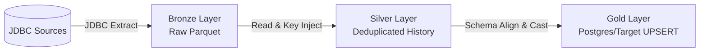
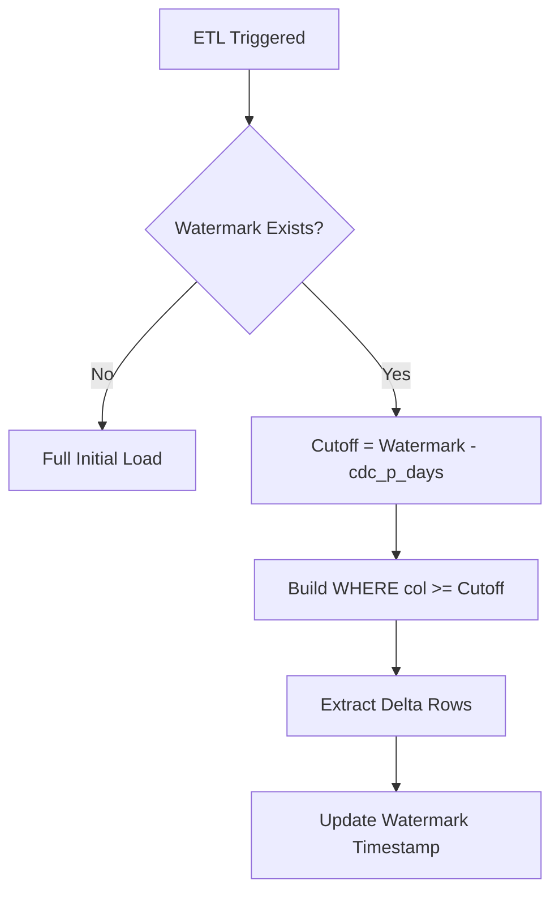

# Data Engineering Concepts Implemented in the ETL Pipeline

## Concept Index

- [Level 1: Foundational Concepts](#level-1-foundational-concepts)
  - [1.1 Medallion Architecture (Bronze / Silver / Gold)](#11-medallion-architecture-bronze--silver--gold)
  - [1.2 Metadata-Driven ETL Design](#12-metadata-driven-etl-design)
  - [1.3 Parallel JDBC Extraction](#13-parallel-jdbc-extraction)
  - [1.4 Parquet & Delta Lake Hybrid Storage](#14-parquet--delta-lake-hybrid-storage)
  - [1.5 Audit Columns & Lineage Metadata Ingestion](#15-audit-columns--lineage-metadata-ingestion)
- [Level 2: Intermediate Concepts](#level-2-intermediate-concepts)
  - [2.1 Change Data Capture (CDC) with Watermarks & Lookback](#21-change-data-capture-cdc-with-watermarks--lookback)
  - [2.2 Execution Certification & Threshold Reconciliation](#22-execution-certification--threshold-reconciliation)
  - [2.3 Natural Key Deduplication Strategies](#23-natural-key-deduplication-strategies)
  - [2.4 Dynamic Target Schema Alignment & Quoting](#24-dynamic-target-schema-alignment--quoting)
  - [2.5 Column Mapping & Explicit Type Casting](#25-column-mapping--explicit-type-casting)
  - [2.6 Multi-Level Concurrency (ThreadPool + JDBC Partition Workers)](#26-multi-level-concurrency-threadpool--jdbc-partition-workers)
- [Level 3: Advanced Concepts](#level-3-advanced-concepts)
  - [3.1 Adaptive Partitioning & Volume-Based Chunk Sizing](#31-adaptive-partitioning--volume-based-chunk-sizing)
  - [3.2 Multi-Engine Dynamic Schema Resolution](#32-multi-engine-dynamic-schema-resolution)
  - [3.3 Role-Based Access Control (RBAC) & Zero-Hardcoding Policy](#33-role-based-access-control-rbac--zero-hardcoding-policy)
  - [3.4 State Machine Execution Lifecycle](#34-state-machine-execution-lifecycle)
  - [3.5 Canonical Type System & Cross-Database Normalization](#35-canonical-type-system--cross-database-normalization)
  - [3.6 Automated Data Quality Engine (DQ Rules & Actions)](#36-automated-data-quality-engine-dq-rules--actions)
  - [3.7 Column-Level Data Lineage Tracking](#37-column-level-data-lineage-tracking)
  - [3.8 Automated Schema Drift Detection & Auto-Migration Policies](#38-automated-schema-drift-detection--auto-migration-policies)
  - [3.9 Automated Metadata Recommendation Engine](#39-automated-metadata-recommendation-engine)
  - [3.10 Stage Profiling & Metrics Collection](#310-stage-profiling--metrics-collection)
  - [3.11 Real-Time Heartbeat Daemon & Signal Guards](#311-real-time-heartbeat-daemon--signal-guards)
  - [3.12 Database-Backed Dynamic Connection Management](#312-database-backed-dynamic-connection-management)
- [Level 4: Architectural Patterns](#level-4-architectural-patterns)
  - [4.1 Master-Subscriber Metadata Model](#41-master-subscriber-metadata-model)
  - [4.2 Service Layer Pattern](#42-service-layer-pattern)
  - [4.3 Plugin & Discovery Architecture](#43-plugin--discovery-architecture)
  - [4.4 Dependency Injection with ConnectionManager](#44-dependency-injection-with-connectionmanager)
  - [4.5 Context Managers for Resource Cleanup & Locking](#45-context-managers-for-resource-cleanup--locking)
- [Concept Cross-Reference Matrix](#concept-cross-reference-matrix)

---

## Level 1: Foundational Concepts

### 1.1 Medallion Architecture (Bronze / Silver / Gold)

**Definition**: A data design pattern used to logically organize data in a lakehouse, progressing quality and structure as data moves through three distinct layers: Raw Landing (Bronze), Cleansed & Deduplicated History (Silver), and Business-Ready Aggregated Target (Gold).

**Why it matters**: Isolates downstream analytical workloads from source system schema changes, raw extraction errors, and network outages while ensuring full historical auditability.

**Project Implementation**:
- **File**: [`src/orchestrator/etl.py`](../src/orchestrator/etl.py#L320-L750)
- **Code Snippet**:
  ```python
  # Bronze: Raw extraction from source via JDBC to Parquet landing path
  landing_path = self.loader.write_landing(df, meta, date_partition)

  # Silver: Read Bronze, inject keys, deduplicate, enforce schema, and write to history
  df = self.extractor.read_landing(meta, date_partition=active_date_partition)
  df_key = transformer.add_source_identification_key(df, meta)
  df_dedup = transformer.deduplicate(df_key, meta)
  history_path = self.loader.write_history(df_audit, meta)

  # Gold: Apply business target schema and UPSERT / overwrite into production database
  target_path = self.loader.write_target(df, meta)
  ```

**Flow Explanation**:



**Example in Action**:
```text
INFO  [Landing] load_with_db_link  priority=1  tag=oracle_opf
INFO  [sales_orders] Starting BRONZE_WRITE: 633,967 rows → Parquet
INFO  [sales_orders] Starting SILVER_WRITE: 633,967 rows → Delta/Parquet history
INFO  [sales_orders] Starting GOLD_WRITE: 633,967 rows → target (CDC merge)
```

---

### 1.2 Metadata-Driven ETL Design

**Definition**: An architecture where pipeline behavior, SQL queries, column mappings, execution order, parallelism, and retry flags are governed by a central metadata repository rather than hardcoded scripts.

**Why it matters**: Eliminates code modifications when onboarding new tables or updating database schemas. Adding a new table requires a single metadata table entry.

**Project Implementation**:
- **File**: [`src/metadata/metadata_reader.py`](../src/metadata/metadata_reader.py#L43-L105)
- **Code Snippet**:
  ```python
  SELECT
      etl.table_id AS id,
      etl.source_tag,
      etl.source_table,
      COALESCE(m.database_type, 'unknown') AS source_db_type,
      etl.target_tag,
      etl.priority,
      etl.table_type AS load_type,
      etl.columns_unique_key AS natural_key_column,
      COALESCE(etl.num_partitions_override, ...) AS num_partitions
  FROM metadata.db_tables_etl etl
  LEFT JOIN metadata.db_tables_catalog m
         ON etl.source_tag = m.database_tag AND etl.source_table = m.table_name
  ```

**Dependencies**: `ConnectionManager`, `MetadataRow`.

---

### 1.3 Parallel JDBC Extraction

**Definition**: Splitting a database table read into $N$ parallel JDBC queries using numeric or date range bounds on a partition column (`lowerBound`, `upperBound`, `numPartitions`).

**Why it matters**: Avoids single-threaded JDBC bottlenecks. Extracted 633,967 rows from Oracle in **7.8 seconds** across 20 parallel threads.

**Project Implementation**:
- **File**: [`src/extract/extractor.py`](../src/extract/extractor.py#L170-L210)
- **Code Snippet**:
  ```python
  primary_col = part_col.split(",")[0].strip()
  bounds = self._get_column_bounds(conn, meta.full_source_table, part_col, db_type)
  return (
      reader
      .option("partitionColumn", primary_col)
      .option("lowerBound", str(bounds["min"]))
      .option("upperBound", str(bounds["max"]))
      .option("numPartitions", str(meta.num_partitions))
  )
  ```

---

### 1.4 Parquet & Delta Lake Hybrid Storage

**Definition**: Using Apache Parquet for raw file landing and Delta Lake for ACID history storage with fallback mechanisms.

**Why it matters**: Provides high compression and columnar speed for Bronze reads while supporting time-travel and ACID transactional guarantees for Silver writes.

**Project Implementation**:
- **File**: [`src/load/loader.py`](../src/load/loader.py#L65-L85)
- **Code Snippet**:
  ```python
  if self._delta_available:
      df.write.format("delta").mode(write_mode).partitionBy("source_tag").save(path)
  else:
      df.write.mode(write_mode).partitionBy("source_tag").parquet(path)
  ```

---

### 1.5 Audit Columns & Lineage Metadata Ingestion

**Definition**: Injecting system metadata columns (`pipeline_run_id`, `source_identification_key`, `ingestion_timestamp`) into every record during processing.

**Why it matters**: Guarantees record-level lineage back to the original pipeline run, batch ID, and source table.

**Project Implementation**:
- **File**: [`src/transform/transformer.py`](../src/transform/transformer.py#L30-L50)
- **Code Snippet**:
  ```python
  def add_source_identification_key(self, df: DataFrame, meta: MetadataRow) -> DataFrame:
      prefix = meta.source_key_prefix or f"{meta.source_tag}-"
      key_expr = F.concat(F.lit(prefix), F.lit(meta.source_table), F.lit("-"), F.col(meta.natural_key_column))
      return df.withColumn("source_identification_key", key_expr)
  ```

---

## Level 2: Intermediate Concepts

### 2.1 Change Data Capture (CDC) with Watermarks & Lookback

**Definition**: Incrementally fetching updated/inserted rows based on timestamp watermarks (`last_success_timestamp`) minus a configurable lookback safety window (`cdc_p_days`).

**Why it matters**: Reduces daily extraction volumes by 95%+, shifting processing times from hours to seconds for large enterprise tables.

**Project Implementation**:
- **File**: [`src/cdc/cdc_handler.py`](../src/cdc/cdc_handler.py#L40-L75)
- **Code Snippet**:
  ```python
  if meta.last_success_timestamp:
      cutoff = meta.last_success_timestamp - timedelta(days=lookback_days)
      cutoff_str = cutoff.strftime("%Y-%m-%d %H:%M:%S")
      conditions = [f"{quote_col(col)} >= '{cutoff_str}'" for col in meta.cdc_column_list]
      return " OR ".join(conditions)
  ```

**Flow Explanation**:



---

### 2.2 Execution Certification & Threshold Reconciliation

**Definition**: Mathematical verification asserting $\text{actual\_loss} == \text{expected\_loss}$ during deduplication to prevent accidental data destruction.

**Why it matters**: Prevents corrupt pipelines from silently overwriting clean production target databases.

**Project Implementation**:
- **File**: [`src/validation/reconciler.py`](../src/validation/reconciler.py#L130-L160)
- **Code Snippet**:
  ```python
  @staticmethod
  def certify_execution(input_count: int, output_count: int, actual_loss: int, expected_loss: int, layer: str, table_name: str, distinct_natural_key_count: int = 0):
      if actual_loss != expected_loss:
          raise RuntimeError(
              f"[Execution Certification FAILED] Table '{table_name}' ({layer}): "
              f"actual row loss={actual_loss} does not match expected loss={expected_loss} "
              f"(input={input_count}, output={output_count}). Aborting pipeline execution immediately."
          )
  ```

---

### 2.3 Natural Key Deduplication Strategies

**Definition**: Window-based deduplication (`ROW_NUMBER() OVER (PARTITION BY natural_keys ORDER BY updated_at DESC)`) ensuring strictly one active record per business entity.

**Project Implementation**:
- **File**: [`src/transform/transformer.py`](../src/transform/transformer.py#L60-L90)
- **Code Snippet**:
  ```python
  window_spec = Window.partitionBy(*natural_keys).orderBy(*order_cols)
  df_dedup = df.withColumn("_row_num", F.row_number().over(window_spec)).filter(F.col("_row_num") == 1).drop("_row_num")
  ```

---

### 2.4 Dynamic Target Schema Alignment & Quoting

**Definition**: Aligning DataFrame schemas with target relational database schemas at runtime, auto-matching columns, and applying dialect-safe identifier quoting (MySQL backticks, Postgres double-quotes, Oracle raw).

**Project Implementation**:
- **File**: [`src/load/schema_validator.py`](../src/load/schema_validator.py#L45-L80)
- **File**: [`src/utils/db_utils.py`](../src/utils/db_utils.py#L100-L120)

---

### 2.5 Column Mapping & Explicit Type Casting

**Definition**: Translating source database column names and datatypes into standardized target schema columns based on metadata mapping rules.

**Project Implementation**:
- **File**: [`src/transform/column_mapper.py`](../src/transform/column_mapper.py#L30-L60)

---

### 2.6 Multi-Level Concurrency (ThreadPool + JDBC Partition Workers)

**Definition**: Two-tier parallelism: Outer level processes multiple independent database tables concurrently via Python `ThreadPoolExecutor`, while inner level extracts each table using multiple Spark partition tasks.

**Project Implementation**:
- **File**: [`src/orchestrator/etl.py`](../src/orchestrator/etl.py#L130-L160)
- **Code Snippet**:
  ```python
  with ThreadPoolExecutor(max_workers=self.max_parallel_tables) as executor:
      futures = {executor.submit(worker, meta): meta for meta in tables}
      for future in as_completed(futures):
          meta = futures[future]
          ...
  ```

---

## Level 3: Advanced Concepts

### 3.1 Adaptive Partitioning & Volume-Based Chunk Sizing

**Definition**: Dynamically calculating optimal Spark partition counts and JDBC fetch sizes based on historical catalog row counts and table volume metrics.

**Project Implementation**:
- **File**: [`src/metadata/metadata_reader.py`](../src/metadata/metadata_reader.py#L70-L88)
- **Code Snippet**:
  ```sql
  LEAST(COALESCE(m.table_row_count, 100000), 500000)::integer AS chunk_size,
  COALESCE(
      etl.num_partitions_override,
      CASE
          WHEN COALESCE(m.table_row_count, 100000) < COALESCE(etl.minimum_partition_threshold, 50000) THEN 1
          ELSE LEAST(
              CEIL(COALESCE(m.table_row_count, 100000)::numeric / COALESCE(etl.target_rows_per_partition, 250000))::integer,
              COALESCE(etl.maximum_partitions, 32)
          )
      END
  ) AS num_partitions
  ```

---

### 3.2 Multi-Engine Dynamic Schema Resolution

**Definition**: Unified schema alignment across heterogenous engines (Oracle, MySQL, PostgreSQL, SQL Server), mapping native data types dynamically.

**Project Implementation**:
- **File**: [`src/load/schema_validator.py`](../src/load/schema_validator.py#L90-L140)

---

### 3.3 RBAC & Zero-Hardcoding Policy

**Definition**: Enforcing Role-Based Access Control on database operations and externalizing all connection strings, usernames, and passwords to environment variables and vault references.

**Project Implementation**:
- **File**: [`src/security/authorization.py`](../src/security/authorization.py#L25-L60)
- **File**: [`src/connections/connection_manager.py`](../src/connections/connection_manager.py#L140-L180)

---

### 3.4 State Machine Execution Lifecycle

**Definition**: A formal state model governing table pipeline runs: `RUNNING` $\rightarrow$ `EXTRACTING` $\rightarrow$ `BRONZE_WRITE` $\rightarrow$ `BRONZE_READ` $\rightarrow$ `TRANSFORM` $\rightarrow$ `SILVER_WRITE` $\rightarrow$ `GOLD_WRITE` $\rightarrow$ `SUCCESS` / `FAILED` / `CANCELLED` / `ABANDONED`.

**Project Implementation**:
- **File**: [`src/constants.py`](../src/constants.py#L40-L70)
- **File**: [`src/logging_/batch_logger.py`](../src/logging_/batch_logger.py#L150-L210)

---

### 3.5 Canonical Type System & Cross-Database Normalization

**Definition**: An intermediate database type mapping layer normalizing database types (e.g. Oracle `VARCHAR2`, MySQL `VAR_STRING`, Postgres `VARCHAR`) into a single Canonical Schema Model.

**Project Implementation**:
- **File**: [`src/metadata/canonical_types.py`](../src/metadata/canonical_types.py#L15-L65)

---

### 3.6 Automated Data Quality Engine (DQ Rules & Actions)

**Definition**: Evaluating data quality assertions (Null checks, Uniqueness checks, Range checks) after layer writes with automated enforcement actions (`SKIP_TABLE`, `FAIL_SOURCE`, `FAIL_PIPELINE`).

**Project Implementation**:
- **File**: [`src/quality/dq_engine.py`](../src/quality/dq_engine.py#L30-L90)

---

### 3.7 Column-Level Data Lineage Tracking

**Definition**: Tracking transformation flow and field origins from source tables through Medallion layers down to column-level granularity.

**Project Implementation**:
- **File**: [`src/metadata/lineage_service.py`](../src/metadata/lineage_service.py#L20-L80)

---

### 3.8 Automated Schema Drift Detection & Auto-Migration Policies

**Definition**: Comparing live source database schemas against metadata catalog definitions, detecting added/dropped/altered columns, and executing controlled DDL updates.

**Project Implementation**:
- **File**: [`src/validation/schema_drift_detector.py`](../src/validation/schema_drift_detector.py#L40-L110)

---

### 3.9 Automated Metadata Recommendation Engine

**Definition**: Inspecting source database statistics to automatically recommend optimal primary keys, natural keys, partition columns, and chunk sizes.

**Project Implementation**:
- **File**: [`src/metadata/recommendation_service.py`](../src/metadata/recommendation_service.py#L35-L95)

---

### 3.10 Stage Profiling & Metrics Collection

**Definition**: Capturing microsecond-level timing and row-count metrics per pipeline stage, serializing metrics into `metadata.batch_log.stage_metrics` (JSONB).

**Project Implementation**:
- **File**: [`src/logging_/stage_profiler.py`](../src/logging_/stage_profiler.py#L30-L100)

---

### 3.11 Real-Time Heartbeat Daemon & Signal Guards

**Definition**: A background daemon thread (`BatchHeartbeatThread`) updating `last_progress_update` every 2 seconds alongside process exit signal handlers (`atexit`, `SIGTERM`, `SIGINT`).

**Project Implementation**:
- **File**: [`src/logging_/batch_logger.py`](../src/logging_/batch_logger.py#L22-L60)

---

### 3.12 Database-Backed Dynamic Connection Management

**Definition**: Managing database credentials dynamically from `metadata.connections` table with environment variable fallback resolution (`ConnectionService`).

**Project Implementation**:
- **File**: [`src/services/connection_service.py`](../src/services/connection_service.py#L40-L110)

---

## Level 4: Architectural Patterns

### 4.1 Master-Subscriber Metadata Model
Centralized catalog model separating raw database discovery (`db_tables_catalog`, `db_columns_catalog`) from ETL control plane rules (`db_tables_etl`, `db_columns_etl`).

### 4.2 Service Layer Pattern
Encapsulation of business logic into distinct services (`PipelineService`, `NotificationService`, `ConnectionService`, `SchemaPromotionService`).

### 4.3 Plugin & Discovery Architecture
Modular framework for table discovery, metadata promotion, and schema evolution.

### 4.4 Dependency Injection with ConnectionManager
Injecting connection configurations and credential providers down into components rather than instantiating global state.

### 4.5 Context Managers for Resource Cleanup & Locking
Python `with` context manager wrappers ensuring database connections, transactional locks, and Spark resources are cleanly closed on completion or error.

---

## Concept Cross-Reference Matrix

| Concept | Medallion Arch | Metadata Control | CDC & Watermark | Reconciler | Schema Validator | DQ Engine |
| :--- | :---: | :---: | :---: | :---: | :---: | :---: |
| **Medallion Arch** | — | Direct | Direct | Direct | Direct | Direct |
| **Metadata Control** | Direct | — | Direct | Direct | Direct | Direct |
| **CDC & Watermark** | Direct | Direct | — | Independent | Independent | Independent |
| **Reconciler** | Direct | Direct | Independent | — | Independent | Independent |
| **Schema Validator** | Direct | Direct | Independent | Independent | — | Direct |
| **DQ Engine** | Direct | Direct | Independent | Direct | Direct | — |

---

*Document compiled and verified against PySpark Pipeline codebase version 2.0.0.*
