# Evidence-Based Data Engineering Architecture & Concepts Guide
**Repository:** `data_pipeline/spark/jobs/pyspark_pipeline`
**Document Classification:** Current-Code Reference & Static Architecture Audit — not a release or production certification
**Author:** Senior Data Engineering Architect & Systems Auditor
**Audit Standard:** Strict Workspace Evidence (`.agents/rules/code_review.md`, `.agents/rules/ponytail.md`, `.brain/standards/`)

---

## Executive Summary & System Overview

This document presents an exhaustive, evidence-backed architectural audit of the Generic PySpark ETL and Data Ingestion Platform implemented in this repository. It traces every data-engineering concept implemented in the codebase—from low-level system startup, environment validation, and metadata discovery, to distributed Spark extraction, multi-hop medallion processing (Bronze $\to$ Silver $\to$ Gold), cryptographic reconciliation, atomic target publication, and lease-fenced concurrency control.

Concepts are arranged in **ascending order of complexity along the actual operational execution path of the application**, rather than alphabetically. File and symbol existence is statically verified. A referenced test file is not evidence that its tests passed during this audit; only the certification section may claim a command was executed. No live database, migration, or configured-table run is certified by this document.

### Evidence status legend

- **STATIC VERIFIED** — the described file, symbol, or code path exists in this workspace.
- **TEST VERIFIED** — a named test command was executed during this documentation certification and its result is recorded below.
- **REPORTED / NOT RE-RUN** — a test, walkthrough, or historical claim was found but was not independently executed in this audit.
- **NOT LIVE CERTIFIED** — no live source, target, migration, or configured-table behavior was executed or certified.

---

## Table of Contents

1. [Beginners' Glossary](#beginners-glossary)
2. [Concept Dependency Map](#concept-dependency-map)
3. [Metadata Architecture & Database Purpose Map](#metadata-architecture--database-purpose-map)
4. [Python Module Responsibility Map](#python-module-responsibility-map)
5. [State Mutation Authority Map](#state-mutation-authority-map)
6. [Architectural Visualizations (10 Mermaid Diagrams)](#architectural-visualizations)
   - [Diagram 1: End-to-End Application Flow](#diagram-1-end-to-end-application-flow)
   - [Diagram 2: Metadata Discovery and Promotion Flow](#diagram-2-metadata-discovery-and-promotion-flow)
   - [Diagram 3: Source-to-Target Data Flow](#diagram-3-source-to-target-data-flow)
   - [Diagram 4: CDC Decision Tree](#diagram-4-cdc-decision-tree)
   - [Diagram 5: Frozen-Contract Execution Flow](#diagram-5-frozen-contract-execution-flow)
   - [Diagram 6: Job Lifecycle State Machine](#diagram-6-job-lifecycle-state-machine)
   - [Diagram 7: Claim and Fencing Flow](#diagram-7-claim-and-fencing-flow)
   - [Diagram 8: Bronze → Silver → Gold Flow](#diagram-8-bronze--silver--gold-flow)
   - [Diagram 9: Reconciliation and Atomic Publication Flow](#diagram-9-reconciliation-and-atomic-publication-flow)
   - [Diagram 10: GUI Operator Workflow](#diagram-10-gui-operator-workflow)
7. [Comprehensive Concepts (1 to 36) in Ascending Execution Order](#comprehensive-concepts-1-to-36)
   - [1. Application Purpose and Business Problem](#1-application-purpose-and-business-problem)
   - [2. Source and Target Database Concepts](#2-source-and-target-database-concepts)
   - [3. Configuration and Connection Management](#3-configuration-and-connection-management)
   - [4. Metadata Database and Control-Plane Concepts](#4-metadata-database-and-control-plane-concepts)
   - [5. Two-Tier Data Catalog (Master Catalog vs. Execution Catalog)](#5-two-tier-data-catalog-master-catalog-vs-execution-catalog)
   - [6. Schema Discovery and Crawler Workflow](#6-schema-discovery-and-crawler-workflow)
   - [7. Column Metadata and Source-to-Target Mapping](#7-column-metadata-and-source-to-target-mapping)
   - [8. Data Types and Canonical Type Mapping](#8-data-types-and-canonical-type-mapping)
   - [9. Business Keys and Identity Governance](#9-business-keys-and-identity-governance)
   - [10. Data Profiling](#10-data-profiling)
   - [11. Change Data Capture (CDC) Concepts](#11-change-data-capture-cdc-concepts)
   - [12. CDC Policy Selection and Activation Rules](#12-cdc-policy-selection-and-activation-rules)
   - [13. Human and Automated Governance](#13-human-and-automated-governance)
   - [14. Execution Authority and Frozen Contracts](#14-execution-authority-and-frozen-contracts)
   - [15. Run Submission and Role-Based Access Control (RBAC)](#15-run-submission-and-role-based-access-control-rbac)
   - [16. Job Lifecycle Management](#16-job-lifecycle-management)
   - [17. Claims, Leases, Fencing, and Concurrency Control](#17-claims-leases-fencing-and-concurrency-control)
   - [18. Apache Spark Execution Architecture](#18-apache-spark-execution-architecture)
   - [19. JDBC Extraction and Partitioning](#19-jdbc-extraction-and-partitioning)
   - [20. Medallion Storage Architecture (Bronze, Silver, Gold Layers)](#20-medallion-storage-architecture-bronze-silver-gold-layers)
   - [21. Transformation and Cleansing](#21-transformation-and-cleansing)
   - [22. Deduplication and Business-Key Enforcement](#22-deduplication-and-business-key-enforcement)
   - [23. Target Preflight Checks](#23-target-preflight-checks)
   - [24. Target Writes and Staging Tables](#24-target-writes-and-staging-tables)
   - [25. Schema Evolution and Drift Detection](#25-schema-evolution-and-drift-detection)
   - [26. Data Quality Rules and Quality Scoring](#26-data-quality-rules-and-quality-scoring)
   - [27. Reconciliation and Mathematical Evidence](#27-reconciliation-and-mathematical-evidence)
   - [28. Atomic Publication and Crash Recovery](#28-atomic-publication-and-crash-recovery)
   - [29. Audit Logs, Telemetry, Metrics, and Live Monitoring](#29-audit-logs-telemetry-metrics-and-live-monitoring)
   - [30. GUI Operator Control Plane](#30-gui-operator-control-plane)
   - [31. CLI and Worker Execution Workflows](#31-cli-and-worker-execution-workflows)
   - [32. Multi-Tier Testing Strategy](#32-multi-tier-testing-strategy)
   - [33. Deployment, Packaging, and Environment Isolation](#33-deployment-packaging-and-environment-isolation)
   - [34. End-to-End Execution Walkthrough](#34-end-to-end-execution-walkthrough)
   - [35. Current Limitations and Production Risks](#35-current-limitations-and-production-risks)
   - [36. Recommended Future Improvements](#36-recommended-future-improvements)
8. [Truth versus Assumption Audit](#truth-versus-assumption-audit)
9. [Production Readiness Gaps](#production-readiness-gaps)

---

## Beginners' Glossary

| Term | Plain-Language Definition | Technical Meaning in This Application |
|---|---|---|
| **Control Plane** | The brain of the data platform that decides *what* to run, *when* to run, and *under what rules*, without handling the large data payload itself. | PostgreSQL database housing `metadata.*` tables, FastAPI/Streamlit services, and policy validation routines. |
| **Data Plane** | The muscle of the data platform that actually moves, transforms, and writes millions of records. | Apache Spark (PySpark), driver, worker executors, and JDBC socket connections reading and writing data blocks. |
| **Execution Plane** | The process boundaries, daemon threads, subprocess workers, and OS containers that host running tasks. | Streamlit web server, `jobs/app_etl.py` worker processes, and Spark driver JVM instances. |
| **Bronze Layer** | The "raw landing" zone where data extracted from source systems is saved in its original format. | Snappy-compressed Parquet files written to local or remote storage partitioned by extraction date (`dt=YYYY-MM-DD`). |
| **Silver Layer** | The "cleaned history" zone where duplicates are removed, standard data types are enforced, and audit columns are added. | Partitioned Delta Lake tables (or fallback Parquet) holding cleansed historical snapshots with `_dw_key` surrogate keys. |
| **Gold Layer** | The "business-ready target" database consumed by business intelligence, reporting, and operational applications. | Target relational database (PostgreSQL/Oracle) containing deduplicated, strongly-typed dimensional tables. |
| **Business Key** | The natural column or combination of columns in a business table that uniquely identifies a real-world entity (e.g., `member_id` or `branch_code + account_no`). | A validated, non-null column set approved in `metadata.table_business_key_approval` used for deduplication and UPSERT matching. |
| **Surrogate Key** | A synthetic, system-generated identifier that substitutes for a business key inside analytical tables. | `_dw_key` created via SHA-256 hash or UUID to uniquely tag historical rows regardless of source natural key formats. |
| **CDC (Change Data Capture)** | The practice of reading only rows that were added or modified since the last pipeline run, rather than re-reading the entire table. | Watermark-bounded extraction interval $(L, H]$ utilizing timestamps or sequence IDs to extract incremental deltas. |
| **Watermark (Cursor)** | A bookmark representing the highest timestamp or ID successfully processed and committed in previous runs. | JSON payload in `metadata.table_cdc_state` (`committed_cursor`) storing the exact boundary of committed data. |
| **High Watermark (H)** | The maximum timestamp or sequence number currently present in the source table at extraction start. | The upper bound captured directly from source database (`MAX(cursor_column)`) before batch extraction begins. |
| **Low Watermark (L)** | The starting point of an incremental extraction, loaded from the previously committed cursor. | The lower boundary loaded from `metadata.table_cdc_state` representing previously verified data. |
| **Fencing Token** | A unique cryptographic badge given to a worker process so stale or crashed workers cannot accidentally overwrite fresh data. | SHA-256 digest of an in-memory random secret validated on every database heartbeat and target publication. |
| **Lease** | A temporary time-bound ownership claim over a job or table. If a worker dies, its lease expires, allowing recovery. | A timestamp (`lease_expires_at`) in `metadata.job_scope_claim` renewed via periodic background heartbeats. |
| **Idempotency** | The mathematical guarantee that running an operation multiple times produces the exact same final result as running it once. | Convergence of target table state regardless of network drops, task retries, or duplicate source rows. |
| **Compare-And-Swap (CAS)** | A concurrency safety pattern where a database record is updated only if its version has not changed since it was read. | `UPDATE ... WHERE state_version = :expected_version` used in cursor advancement and job status transitions. |
| **Schema Drift** | An unexpected change in source table structure, such as a dropped column, added column, or modified data type. | Detected by `SchemaDriftDetector` comparing live JDBC metadata against frozen contracts or catalog entries. |
| **Two-Tier Catalog** | A design separating passive schema discovery from active execution rules to prevent breaking live production pipelines. | Tier 1 (`metadata.db_tables`) holds raw crawled schemas; Tier 2 (`metadata.db_tables_etl`) holds approved ETL rules. |
| **Frozen Contract** | An immutable snapshot of all rules, schemas, keys, and settings captured at job submission time and locked for the entire run. | `FrozenJobExecution` JSON snapshot stored in `metadata.gui_job_registry` preventing mid-run schema changes. |
| **Preflight Check** | Automated safety checks executed *before* heavy data processing or database writes begin. | Verification of database connectivity, target table existence, business key nullability, and unique constraints. |
| **Reconciliation** | Mathematical verification comparing data extracted from the source against data written to the destination. | `StrategyAwareReconciler` verifying row counts and SHA-256 key fingerprints between memory manifests and physical tables. |
| **Advisory Lock** | An application-level cooperative lock managed inside PostgreSQL to serialize operations without locking data rows. | `pg_advisory_xact_lock()` used during policy promotion and atomic cursor commits to prevent race conditions. |
| **Staging Table** | A temporary, isolated scratch table where new data is written before being swapped or merged into the live target table. | `_stage_gold_{table}_{run_id}` table created with `LIKE target INCLUDING ALL` to prevent target downtime. |
| **Tombstone** | A marker record explicitly indicating that a row was deleted in the source system. | *Status: PLANNED / MISSING.* The current application uses full snapshot overwrites or UPSERTs without delete tracking. |

---

## Concept Dependency Map

The following map illustrates how foundational concepts establish the prerequisites for intermediate and advanced mechanisms.

```
[1. Application Purpose & Business Problem]
    │
    ▼
[2. Source & Target DBs] ──► [3. Config & Connection Management] ──► [4. Metadata Control Plane]
                                                                               │
                                                                               ▼
                                                                 [5. Two-Tier Data Catalog]
                                                                               │
                                                                               ▼
                                                                 [6. Schema Discovery & Crawlers]
                                                                               │
                                                                               ▼
                                                                 [7. Source-to-Target Mapping]
                                                                               │
                                                                               ▼
                                                                 [8. Canonical Data Types]
                                                                               │
                                                                               ▼
                                                                 [9. Business Keys & Provenance]
                                                                               │
                                                                               ▼
                                                                 [10. Data Profiling]
                                                                               │
                                                                               ▼
                                                                 [11. CDC Concepts & Math]
                                                                               │
                                                                               ▼
                                                                 [12. CDC Policy Activation]
                                                                               │
                                                                               ▼
                                                                 [13. Human & Auto Governance]
                                                                               │
                                                                               ▼
                                                                 [14. Execution Authority & Frozen Contracts]
                                                                               │
                                                                               ▼
                                                                 [15. Run Submission & RBAC]
                                                                               │
                                                                               ▼
                                                                 [16. Job Lifecycle & CAS States]
                                                                               │
                                                                               ▼
                                                                 [17. Claims, Leases & Fencing]
                                                                               │
                                                                               ▼
                                                                 [18. Spark Execution Architecture]
                                                                               │
                                                                               ▼
                                                                 [19. JDBC Extraction & Partitioning]
                                                                               │
                                                                               ▼
                                                                 [20. Medallion Storage (Bronze/Silver/Gold)]
                                                                               │
                                                                               ▼
                                                                 [21. Transformation & Cleansing]
                                                                               │
                                                                               ▼
                                                                 [22. Deduplication & Key Enforcement]
                                                                               │
                                                                               ▼
                                                                 [23. Target Preflight Checks]
                                                                               │
                                                                               ▼
                                                                 [24. Target Writes & Staging Tables]
                                                                               │
                                                                               ▼
                                                                 [25. Schema Evolution & Drift]
                                                                               │
                                                                               ▼
                                                                 [26. Data Quality Scoring]
                                                                               │
                                                                               ▼
                                                                 [27. Reconciliation & Evidence Fingerprints]
                                                                               │
                                                                               ▼
                                                                 [28. Atomic Publication & CAS Commits]
                                                                               │
                                                                               ▼
                                                                 [29. Audit Logs, Telemetry & Heartbeats]
                                                                               │
                                                                               ▼
                                                                 [30. GUI Operator Control Plane]
                                                                               │
                                                                               ▼
                                                                 [31. CLI & Worker Execution]
                                                                               │
                                                                               ▼
                                                                 [32. Multi-Tier Testing Strategy]
                                                                               │
                                                                               ▼
                                                                 [33. Deployment & Environment Separation]
                                                                               │
                                                                               ▼
                                                                 [34. End-to-End Execution Walkthrough]
                                                                               │
                                                                               ▼
                                                                 [35. Current Limitations & Production Risks]
                                                                               │
                                                                               ▼
                                                                 [36. Recommended Future Improvements]
```

---

## Metadata Architecture & Database Purpose Map

Every governing metadata table in PostgreSQL `metadata.*` serves a strict architectural purpose:

| Schema & Table Name | Governing Migration | Primary Key / Unique Keys | Architectural Purpose & Responsibility |
|---|---|---|---|
| `metadata.schema_migrations` | `001`, `031` | `version` | Immutable migration ledger storing SHA-256 hashes of applied SQL files. Validated at startup by `SchemaCertifier`. |
| `metadata.system_settings` | `010` | `setting_key` | Global runtime parameters (e.g., `schema_version`, default timeouts, thread limits). |
| `metadata.connections` | `009`, `012` | `tag` | Authoritative dynamic connection store holding hostnames, ports, DB types, roles, and credential references. |
| `metadata.connection_history` | `009` | `id` | Audit ledger tracking historical modifications to connection endpoints and credentials. |
| `metadata.db_tables` | `001`, `023`, `028` | `(source_tag, table_name)` | **Tier 1 Master Catalog:** Raw crawled table inventory discovered by `discover_schema.py`. |
| `metadata.db_columns` | `001`, `023`, `028` | `(database_tag, table_name, column_name)` | **Tier 1 Master Catalog:** Raw column definitions, native types, nullability, and primary key flags scraped from source information schemas. |
| `metadata.db_tables_etl` | `001`, `004`, `039` | `table_id` | **Tier 2 Execution Catalog:** Governed execution configuration (priority, target tag, load strategy, `execution_authority_mode`). |
| `metadata.db_columns_etl` | `001`, `011`, `018` | `(table_id, source_column)` | **Tier 2 Execution Catalog:** Column mappings, target column names, canonical types, and transformation expressions. |
| `metadata.table_profiling_evidence` | `025`, `026` | `evidence_id` | Source table metrics collected during profiling (row counts, min/max values, distinctness). |
| `metadata.column_profiling_evidence`| `025`, `026` | `evidence_id` | Column-level metrics (null counts, cardinality, unique ratios, min/max text lengths). |
| `metadata.table_business_key_candidate`| `029` | `candidate_id` | System-discovered candidate business keys identified from physical constraints or profiling. |
| `metadata.table_business_key_approval` | `029` | `approval_id`, `(table_id, revision_number)` | Provenance record of human- or policy-approved source business keys required for UPSERT execution. |
| `metadata.table_policy_version` | `033` | `policy_version_id` | Immutable historical catalog of promoted execution contracts (`contract_payload` JSONB, fingerprints). |
| `metadata.table_cdc_state` | `034` | `(table_id, policy_version_id)` | Authoritative committed watermark cursor (`committed_cursor` JSONB, `state_version` for CAS). |
| `metadata.cdc_attempt_window` | `034` | `(run_id, table_id, attempt_number)` | Frozen extraction window bounding an attempt's source query $(L, H]$. |
| `metadata.attempt_persistence_manifest`| `035`, `047` | `manifest_id`, `(run_id, table_id, attempt_number, storage_layer)` | Immutable persistence and layer-artifact ledger. Migration `047` adds run-scoped Bronze/Silver URI, lifecycle, policy/mapping/key/schema fingerprints, CDC boundaries, and producer batch linkage; no second artifact table is created. |
| `metadata.cdc_attempt_reconciliation` | `035` | `reconciliation_id`, `(run_id, table_id, attempt_number)` | Physical post-write reconciliation evidence recording convergence outcomes (`CONVERGED`, `REJECTED`). |
| `metadata.cdc_commit_event` | `036` | `commit_id`, `batch_log_id` (UNIQUE) | Immutable audit log recording atomic CAS cursor advancement and batch attempt success. |
| `metadata.gold_publication_manifest` | `037`, `041` | `publication_id` | Tracks atomic staging-to-target swaps or copies for full-snapshot Gold publications. |
| `metadata.job_scope_claim` | `042`, `043`, `044`, `045`| `claim_id` | Concurrency and lease governance table tracking table ownership, fencing tokens, epochs, and heartbeats. |
| `metadata.gui_job_registry` | `024`, `032` | `run_id` | Authoritative job lifecycle registry managing transitions (`QUEUED` $\to$ `DISPATCHED` $\to$ `RUNNING` $\to$ `SUCCESS`). |
| `metadata.job_event` | `032` | `event_id` | State transition audit ledger recording every lifecycle change with actor identity and timestamp. |
| `metadata.batch_log` | `001`, `007` | `id` | Execution attempt tracking per table per run (`processed_count`, `target_count`, `current_phase`, `status`). |
| `metadata.batch_stage_log` | `021` | `id` | Fine-grained execution timing and metrics per pipeline phase (`EXTRACT`, `TRANSFORM`, `LOAD`, `RECONCILE`). |
| `metadata.gui_audit_log` | `013` | `id` | Security forensic audit log recording operator UI actions (logins, policy promotions, manual triggers). |
| `metadata.rbac_users` | `016` | `id`, `username` | User accounts, hashed passwords, active status, and primary role assignments. |
| `metadata.rbac_roles` | `016` | `id`, `role_name` | System roles (`OPERATOR`, `ANALYST`, `ADMIN`, `ENGINEER`) with permission matrices. |

---

## Python Module Responsibility Map

| Python Module Path | Core Classes / Components | Primary Architectural Responsibility |
|---|---|---|
| `src/connections/connection_manager.py` | `ConnectionManager`, `ConnectionConfig`, `ResolvedJdbcConfig` | Single Configuration Authority. Resolves JDBC URLs, context-dependent hostnames, credential environment variables, and connection semaphores. |
| `src/connections/schema_certifier.py` | `SchemaCertifier` | Fail-closed startup certifier. Validates SHA-256 checksums of local SQL migrations against `metadata.schema_migrations`. |
| `src/contracts/claim_models.py` | `ExecutionFence`, `FrozenTableEntry`, `FrozenJobExecution` | Data models for immutable job attempt envelopes, fencing token wrappers, and serializable table entries. |
| `src/contracts/runtime_settings.py` | `RuntimeSettings` | Centralized timeout and reaping configuration contract loaded from YAML deployment configurations. |
| `src/metadata/policy_governance.py` | `PolicyGovernanceService` | Assembles candidate table contracts, detects evidence drift, enforces PostgreSQL advisory locks, and promotes policy versions. |
| `src/metadata/policy_models.py` | `PromotedTablePolicy`, `CandidateTableContract`, `ResolvedCDCPolicy` | Domain models and enumerations for CDC strategies, mutation modes, cursor types, and deterministic SHA-256 fingerprinting. |
| `src/metadata/key_contract.py` | `ApprovedBusinessKey`, `ResolvedTargetBusinessKey`, `ResolvedTableContract` | Enforces business key validation, nullability checks, constraint matching, and provenance resolution. |
| `src/metadata/metadata_reader.py` | `MetadataReader` | Cached reader for `metadata.db_tables_etl` and `metadata.db_columns_etl` supplying metadata rows to executors. |
| `src/discovery/type_mapper.py` | `TypeMapper` | Maps native source data types (Oracle, MySQL, Postgres, MSSQL) into canonical framework types during discovery. |
| `src/types/canonical.py` | `CanonicalType`, resolution functions | Vendor-neutral canonical type system mapping canonical types to Spark DataFrame schemas and target database DDL. |
| `src/extract/extractor.py` | `Extractor` | Distributed PySpark JDBC reader implementing dynamic partition bounds, MySQL zero-date workarounds, and Oracle LOB streaming. |
| `src/transform/transformer.py` | `Transformer` | Applies PySpark transformations: business row hashing (`row_hash`), standard audit columns, surrogate keys, and windowed deduplication. |
| `src/transform/column_mapper.py` | `ColumnMapper` | Resolves source-to-target column renames, canonical type casting, and SQL transformation expressions. |
| `src/load/loader.py` | `Loader` | Manages writes to Bronze (Parquet), Silver (Delta/Parquet), and Gold (JDBC staging UPSERT), enforcing target preflight constraints. |
| `src/load/target_schema_inspector.py`| `PostgreSQLSchemaInspector`, `GenericSchemaInspector` | Inspects live target database catalogs to verify physical primary key and unique constraint enforcement. |
| `src/load/gold_atomic_publisher.py` | `GoldAtomicPublisher` | Executes zero-downtime full-snapshot Gold publications via isolated staging tables, target lock timeouts, and atomic replacement. |
| `src/cdc/cdc_window_resolver.py` | `CDCWindowResolver` | Evaluates promoted CDC policies, queries source upper boundaries ($H$), and persists bounded extraction windows $(L, H]$. |
| `src/cdc/atomic_committer.py` | `AtomicCDCCommitter` | Authoritative CAS committer that atomically advances `metadata.table_cdc_state` and marks batch attempts `SUCCESS`. |
| `src/validation/strategy_reconciler.py`| `StrategyAwareReconciler` | Freezes persistence manifests and validates mathematical convergence (row counts, SHA-256 key fingerprints, content fingerprints). |
| `src/validation/stage0_policy.py` | Policy gate functions | Fail-closed guards enforcing business key trust and preventing legacy unvalidated CDC policies from persisting data. |
| `src/orchestrator/claim_manager.py` | `ScopeClaimManager` | Sole authority for `metadata.job_scope_claim` state transitions (`RESERVED` $\to$ `ACTIVE` $\to$ `PUBLISHING` $\to$ `RELEASED`). |
| `src/orchestrator/job_manager.py` | `JobManager` | Polls and dispatches queued pipeline jobs using atomic database CAS updates. |
| `src/orchestrator/lifecycle.py` | `transition_job`, `reap_stale_job_leases` | Validates and executes state transitions on `metadata.gui_job_registry` and records immutable audit events in `metadata.job_event`. |
| `src/orchestrator/etl.py` | `ETL` | Multi-table execution engine coordinating extraction, transformation, loading, and cancellation signal handling. |
| `src/logging_/batch_logger.py` | `BatchLogger`, `BatchHeartbeatThread` | Persists attempt execution telemetry to `metadata.batch_log` and maintains live 2-second heartbeats. |
| `gui/services/execution_service.py` | `ExecutionService` | Control-plane service orchestrating run submission, frozen contract serialization, RBAC validation, and claim reservations. |
| `jobs/discover_schema.py` | Standalone CLI script | Scrapes source database information schemas and upserts Tier 1 catalog tables (`metadata.db_tables`, `metadata.db_columns`). |
| `jobs/promote_table.py` | Standalone CLI script | Promotes tables from Tier 1 catalog to Tier 2 execution catalog, synthesizing policies and canonical column mappings. |
| `jobs/app_etl.py` | Standalone CLI script | Unified tag runner CLI exposing commands: `run_landing`, `run_history`, `run_target`, `run_pipeline`, `sync`, `fix`, `healthcheck`. |

---

## State Mutation Authority Map

To ensure strict operational safety, the application enforces clear boundaries regarding which operations are permitted to mutate state:

| Operation / Subsystem | Source Databases | Target Databases | Metadata Database | Parquet / Delta File Storage | In-Memory / Read-Only |
|---|---|---|---|---|---|
| **Schema Discovery (`discover_schema.py`)** | READ-ONLY (`information_schema`) | NONE | MUTATES (`db_tables`, `db_columns`) | NONE | None |
| **Table Promotion (`promote_table.py`)** | NONE | NONE | MUTATES (`db_tables_etl`, `db_columns_etl`, `table_policy_version`) | NONE | None |
| **Run Submission (`ExecutionService.submit_run`)** | NONE | NONE | MUTATES (`gui_job_registry`, `job_scope_claim`, `job_event`) | NONE | None |
| **Worker Dispatch (`JobManager.dispatch_next_job`)**| NONE | NONE | MUTATES (`gui_job_registry`, `job_event`) | NONE | None |
| **Worker Claim Activation (`ScopeClaimManager`)** | NONE | NONE | MUTATES (`job_scope_claim`) | NONE | Generates random token in-memory |
| **Bronze Extraction & Load (`write_landing`)** | READ-ONLY (JDBC SELECT) | NONE | MUTATES (`batch_log`, `batch_stage_log`) | MUTATES (Writes raw Parquet files) | None |
| **Silver Transformation & Load (`write_history`)** | NONE | NONE | MUTATES (`batch_log`, `batch_stage_log`) | MUTATES (Appends/Overwrites Delta/Parquet) | In-memory Spark DataFrame transforms |
| **Target Preflight Checks (`provision_target...`)** | NONE | READ-ONLY (SELECT 1 probe) | NONE | NONE | Validates constraints & schemas |
| **Gold Staging UPSERT (`_upsert_via_staging`)** | NONE | MUTATES (Creates & drops `stg_*`, UPSERTs target) | MUTATES (`batch_log`) | NONE | None |
| **Gold Atomic Publication (`publish_governed`)** | NONE | MUTATES (Creates `_stage_gold_*`, swaps target) | MUTATES (`gold_publication_manifest`, `job_scope_claim`) | NONE | None |
| **Reconciliation (`StrategyAwareReconciler`)** | NONE | READ-ONLY (SELECT keys/counts) | MUTATES (`attempt_persistence_manifest`, `cdc_attempt_reconciliation`) | READ-ONLY (Reads Parquet/Delta) | Computes SHA-256 set fingerprints |
| **Atomic CDC Commit (`AtomicCDCCommitter`)** | NONE | NONE | MUTATES (`table_cdc_state`, `batch_log`, `cdc_commit_event`) | NONE | None |
| **Worker Heartbeat (`BatchHeartbeatThread`)** | NONE | NONE | MUTATES (`batch_log.last_heartbeat`, `elapsed_seconds`) | NONE | None |
| **Job State Transition (`transition_job`)** | NONE | NONE | MUTATES (`gui_job_registry`, `job_event`, releases claims) | NONE | None |

---

## Architectural Visualizations

### Diagram 1: End-to-End Application Flow

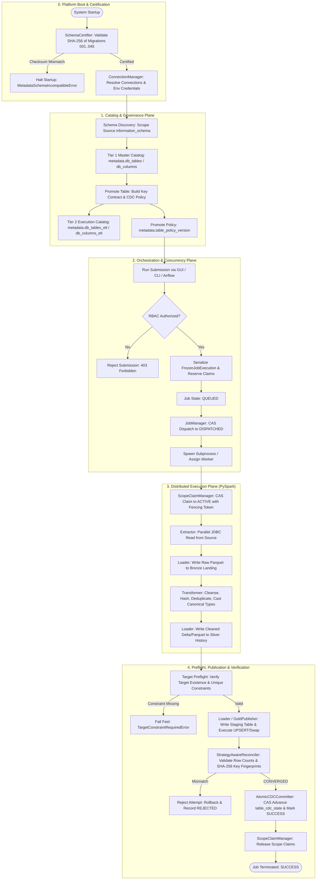

---

### Diagram 2: Metadata Discovery and Promotion Flow

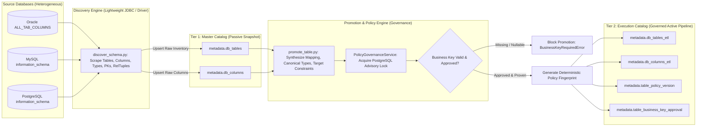

---

### Diagram 3: Source-to-Target Data Flow

```mermaid
flowchart TD
    subgraph SRC["Source System (OLTP)"]
        DB[(Production Database: MySQL / Oracle / PostgreSQL)]
    end

    subgraph EXT["Extraction Phase (Data Plane)"]
        JDBC[PySpark JDBC Parallel Read: partitionColumn, lowerBound, upperBound, numPartitions]
        CLOB[Oracle CLOB Cast: DBMS_LOB.SUBSTR / MySQL Zero-Date Sanitizer]
    end

    subgraph BRZ["Bronze Layer (Landing)"]
        BFile[Raw Parquet Files: landing_base/source_tag/table/dt=YYYY-MM-DD]
    end

    subgraph TRF["Transformation Phase"]
        Cast[Canonical Type Casting via db_columns_etl]
        Hash[Row Business Hash: SHA-256 across sorted payload]
        Audit[Audit Columns: dml_timestamp, pipeline_run_id, source_tag]
        Dedup[Deduplication: ROW_NUMBER() over Natural Keys order by timestamp DESC]
    end

    subgraph SLV["Silver Layer (Cleansed History)"]
        SFile[Delta Lake / Parquet History: history_base/source_tag/table]
    end

    subgraph TGT["Gold Layer (Target Presentation)"]
        Stg[Target Staging Table: _stage_gold_table_runid]
        TargetTable[(Target Analytical Database: PostgreSQL / Oracle)]
    end

    DB --> CLOB --> JDBC
    JDBC -->|Direct Parquet Write| BFile
    BFile -->|Read Landing| Cast --> Hash --> Audit --> Dedup
    Dedup -->|Append / Overwrite| SFile
    Dedup -->|Extract Payload| Stg
    Stg -->|Atomic SQL UPSERT / Swap| TargetTable
```

---

### Diagram 4: CDC Decision Tree

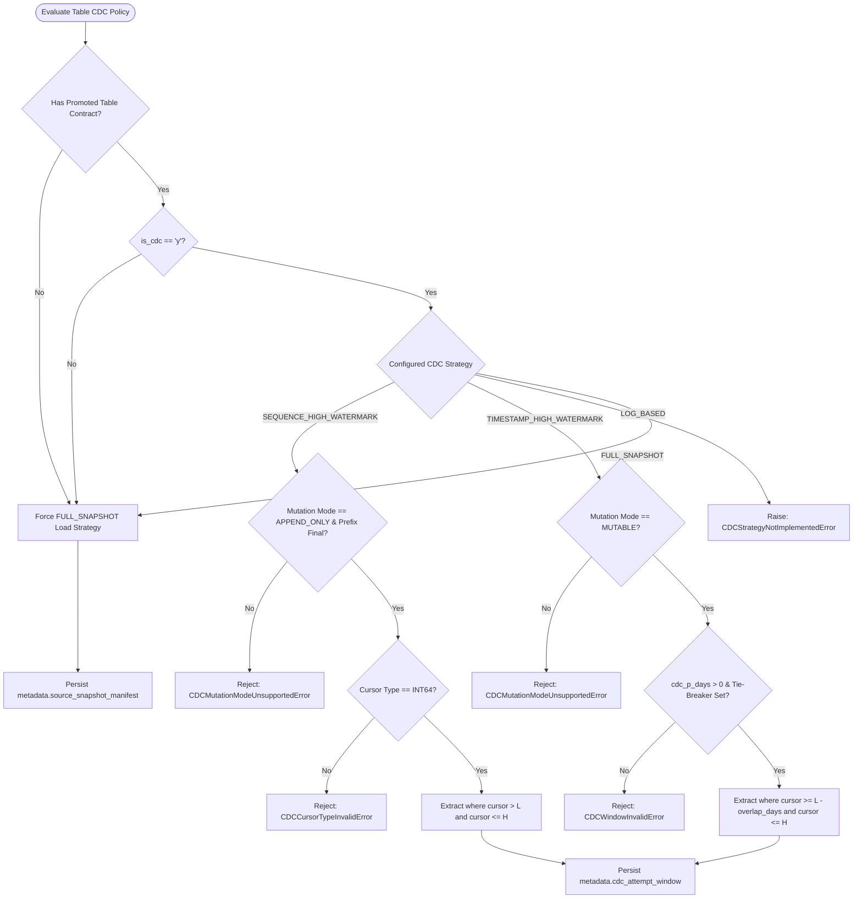

---

### Diagram 5: Frozen-Contract Execution Flow

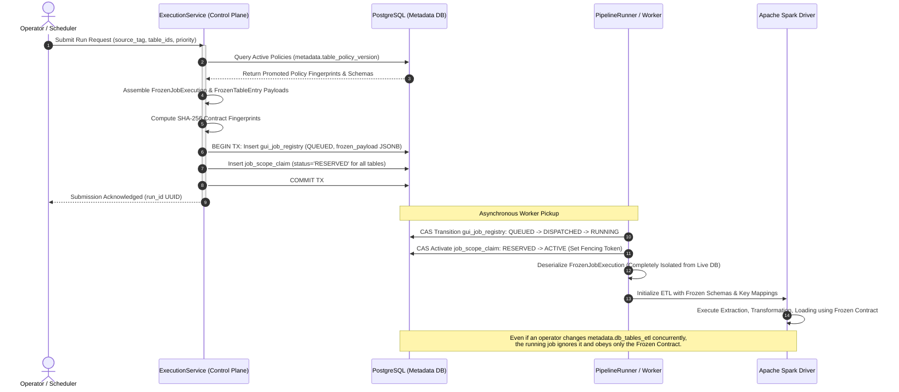

---

### Diagram 6: Job Lifecycle State Machine

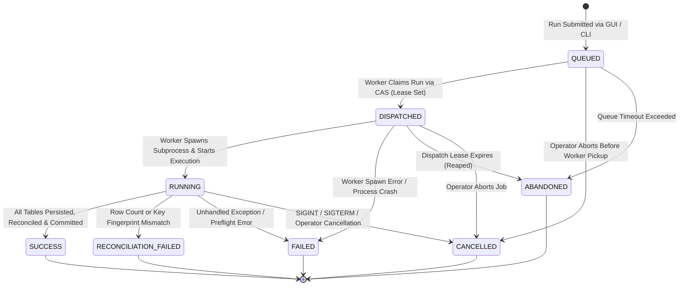

---

### Diagram 7: Claim and Fencing Flow

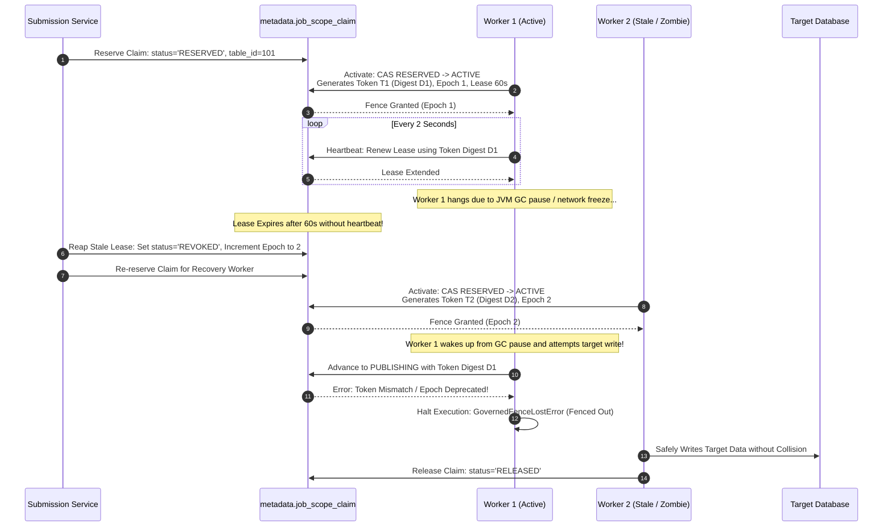

---

### Diagram 8: Bronze → Silver → Gold Flow

```mermaid
flowchart LR
    subgraph S_BRZ["Bronze Layer (Raw Ingestion)"]
        direction TB
        B1[Source JDBC Query] --> B2[Native Spark Schema]
        B2 --> B3[Coalesce Partitions 1..4]
        B3 --> B4[Write Snappy Parquet: dt=YYYY-MM-DD]
    end

    subgraph S_SLV["Silver Layer (Historical Conformance)"]
        direction TB
        S1[Read Landing Parquet] --> S2[Apply Canonical Type Casts]
        S2 --> S3[Compute Business row_hash]
        S3 --> S4[Add Standard Audit Columns]
        S4 --> S5[Window Deduplication over Natural Keys]
        S5 --> S6[Write Partitioned Delta Lake / Parquet]
    end

    subgraph S_GLD["Gold Layer (Presentation Publishing)"]
        direction TB
        G1[Read Silver Data] --> G2[Target Schema Preflight Verification]
        G2 --> G3[Stage Data in _stage_gold_table_runid]
        G3 --> G4[Atomic PostgreSQL MERGE / Table Swap]
        G4 --> G5[Persist Target Presentation Table]
    end

    B4 --> S1
    S6 --> G1
```

---

### Governed execution scopes

The GUI exposes four execution scopes, all dispatched through the same
`run_governed` worker and frozen into the contract fingerprint:

| Scope | Executes | Prerequisite / skipped layers |
| --- | --- | --- |
| `FULL` | Source → Bronze → Silver → Gold | None; standard path |
| `BRONZE` | Source → Bronze | Silver and Gold are recorded `NOT_REQUESTED` |
| `SILVER` | Existing verified Bronze → Silver | Fails closed when Bronze evidence is absent |
| `GOLD` | Existing verified Silver → Gold | Fails closed when Silver evidence is absent |

The worker never silently falls back to a different scope. Gold consumes the
persisted Silver artifact, including for CDC tables, so a Gold-only run does
not re-read the source database.

### Governed layer artifact protocol (migration 047)

Governed Bronze and Silver writes use the existing
`metadata.attempt_persistence_manifest` ledger. A producer writes its data to a
run-scoped URI (`run_<run_id>`), verifies the Spark read-back row count and
schema, then records the immutable artifact identity through the database
enforced `WRITING -> VERIFIED` transition. The batch log must be successful
before a consumer can use the artifact. Isolated Silver and Gold contracts
carry the exact `artifact_id`; workers re-check the URI, row count, schema and
fingerprints before reading, so retries cannot silently select a newer object.
For CDC, the artifact also carries its frozen window and state version; Gold
checks both before target DML and the atomic cursor commit checks the same
version again.

---

### Diagram 9: Reconciliation and Atomic Publication Flow

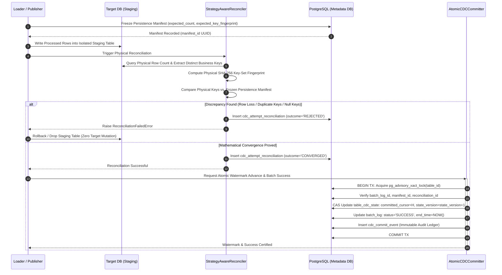

---

### Diagram 10: GUI Operator Workflow

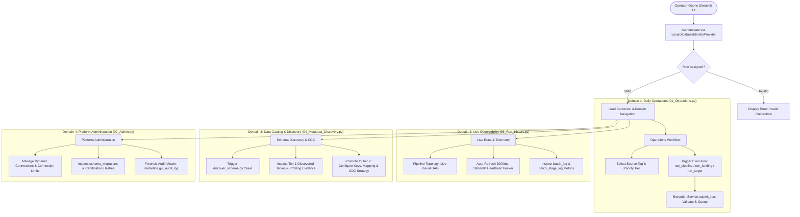

---

## Comprehensive Concepts (1 to 36) in Ascending Execution Order

---

### 1. Application Purpose and Business Problem

- **Plain-language definition:** A system designed to reliably pull data from multiple operational databases (like Oracle, MySQL, and PostgreSQL), clean and standardize that data, and load it into an analytical reporting database without corrupting numbers, missing updates, or crashing under heavy load.
- **Industry-standard term:** Enterprise Medallion Lakehouse & Change Data Capture (CDC) Pipeline.
- **Why this application needs it:** The organization operates legacy operational databases with unstable connection limits, differing character sets, and unstandardized schemas. Analytics requires guaranteed, point-in-time consistent snapshots and incremental replication without placing excessive query load on production OLTP databases.
- **How this repository implements it:** Implements a multi-layered PySpark application governed by a PostgreSQL metadata control plane (`metadata.*`). Execution proceeds through an immutable contract model where raw data lands in Parquet files (Bronze), transforms into cleansed historical datasets (Silver), and publishes into relational analytical tables (Gold).
- **Actual files, functions, classes, tables, or migrations involved:**
  - `jobs/app_etl.py`: Unified CLI tag runner.
  - `src/orchestrator/etl.py`: Core `ETL` coordinator class.
  - `migrations/001_master_subscriber_schema.sql`: Foundational control schema.
- **Inputs:** Operational database credentials, table definitions in `metadata.db_tables_etl`, execution parameters (`source_tag`, `priority`).
- **Outputs:** Consistent target tables in PostgreSQL/Oracle Gold layers and Parquet datasets in Bronze/Silver storage.
- **State changes:** Records run states in `metadata.gui_job_registry` and individual table execution logs in `metadata.batch_log`.
- **Failure behavior:** Fail-closed design. Any validation error halts execution before mutating target tables.
- **Security implications:** Manages access to highly sensitive transactional production databases across corporate networks.
- **Performance implications:** Replaces high-overhead single-threaded Python extractors with distributed Spark parallel JDBC reads.
- **Current implementation status:** `IMPLEMENTED`
- **Evidence references with file paths and line numbers:**
  - `jobs/app_etl.py:1-41`: CLI action definitions.
  - `src/orchestrator/etl.py:37-66`: `ETL.__init__` initialization sequence.
  - `migrations/001_master_subscriber_schema.sql:1-45`: Master control schema definition.

---

### 2. Source and Target Database Concepts

- **Plain-language definition:** The databases where business information originates (source systems like customer portals or ERPs) versus the databases where cleaned data is delivered for reporting (target data warehouses).
- **Industry-standard term:** Heterogeneous Source-Target Database Topologies (OLTP to OLAP).
- **Why this application needs it:** Operational databases run on diverse database engines (Oracle 11g/19c, MySQL 5.7/8.0, PostgreSQL 14+). Each engine has distinct SQL dialects, quoting rules, date-handling quirks, and transaction isolation semantics that must be normalized.
- **How this repository implements it:** Uses `src/constants.py:DBType` to classify engines and dialect-specific connection builders in `ConnectionManager.build_jdbc_url_static()`. Uses SQL wrappers in `src/utils/db_utils.py` (`quote_table_name`, `execute_upsert`) to tailor SQL commands to the specific target dialect.
- **Actual files, functions, classes, tables, or migrations involved:**
  - `src/constants.py:22-30`: `DBType` enumeration (`POSTGRES`, `ORACLE`, `MYSQL`, `MSSQL`).
  - `src/connections/connection_manager.py:268-291`: `build_jdbc_url_static()`.
  - `src/utils/db_utils.py:15-45`: Dialect quoting and JDBC options helpers.
  - `migrations/009_dynamic_connections.sql:1-50`: `metadata.connections` table definition.
- **Inputs:** Database server IPs, ports, database names, credentials, and `db_type` tags.
- **Outputs:** Validated JDBC connection strings with engine-specific tuning parameters.
- **State changes:** None (configuration resolution only).
- **Failure behavior:** Raises `ConfigurationError` or `ValueError` if an unsupported database type is encountered.
- **Security implications:** Dialect-specific identifiers must be quoted properly to prevent SQL injection.
- **Performance implications:** Dialect-specific parameters (e.g., MySQL `zeroDateTimeBehavior=convertToNull`, Oracle `sessionTimeZone=UTC`) prevent JVM crashes during extraction.
- **Current implementation status:** `IMPLEMENTED`
- **Evidence references with file paths and line numbers:**
  - `src/constants.py:22-30`: Definition of `DBType`.
  - `src/connections/connection_manager.py:268-291`: Implementation of `build_jdbc_url_static`.
  - `src/utils/db_utils.py:28-40`: Implementation of `quote_table_name`.

---

### 3. Configuration and Connection Management

- **Plain-language definition:** The system that securely manages database passwords, network addresses, and connection limits in one centralized place, ensuring credentials are never hardcoded in source files.
- **Industry-standard term:** Single Configuration Authority & Dynamic Connection Management.
- **Why this application needs it:** Hardcoded credentials violate security compliance standards. Connecting to production databases without concurrency limits can exhaust database connection pools and cause operational outages.
- **How this repository implements it:** Centered in `src/connections/connection_manager.py:ConnectionManager`. It reads base configuration from `config/config.yaml`, interpolates environment variables via `_resolve_env_vars()`, enforces strict zero-fallback rules on password fields, and dynamically loads registered connection endpoints from `metadata.connections`. Concurrency per connection tag is enforced via `threading.Semaphore`.
- **Actual files, functions, classes, tables, or migrations involved:**
  - `src/connections/connection_manager.py:140-350`: `ConnectionManager` class.
  - `config/config.yaml`: Authoritative configuration file.
  - `migrations/009_dynamic_connections.sql`: Dynamic connection storage schema.
  - `migrations/012_add_connection_limits.sql`: Concurrency limits column.
- **Inputs:** YAML configuration files, `.env` file variables, `metadata.connections` database rows.
- **Outputs:** Instantiated `ConnectionConfig` and `ResolvedJdbcConfig` objects.
- **State changes:** Acquires and releases in-memory semaphores during concurrent table execution.
- **Failure behavior:** Fails closed at startup with `ConfigurationError` if any credential environment variable is missing, empty, or uses default fallbacks (`:-default`).
- **Security implications:** Zero hardcoded passwords; passwords are hidden in `ResolvedJdbcConfig` representations (`repr=False, compare=False`).
- **Performance implications:** Connection semaphores (`max_concurrent_connections`) prevent pipeline runs from overwhelming source database listener queues.
- **Current implementation status:** `IMPLEMENTED`
- **Evidence references with file paths and line numbers:**
  - `src/connections/connection_manager.py:33-47`: `ResolvedJdbcConfig` dataclass with `repr=False`.
  - `src/connections/connection_manager.py:205-245`: Environment variable interpolation with strict password enforcement.
  - `src/connections/connection_manager.py:320-350`: Dynamic connection loading from `metadata.connections`.

---

### 4. Metadata Database and Control-Plane Concepts

- **Plain-language definition:** A dedicated relational database used exclusively to coordinate, govern, log, and audit all data pipeline activities, completely separate from the actual business data being processed.
- **Industry-standard term:** Data Engineering Control Plane (Metadata Repository).
- **Why this application needs it:** Large pipelines require durable state tracking that survives worker crashes, maintains historical audit records, and prevents concurrent jobs from colliding.
- **How this repository implements it:** Dedicated PostgreSQL database schema `metadata.*` is established through the migration set ending at version 046. The workspace contains 52 canonical SQL files, representing 46 unique ledger versions because historical version numbers 010 through 022 have intentional duplicate files. Before processing starts, `SchemaCertifier` validates the canonical file set and compares the 46-version ledger against database records using SHA-256 checksums (`SCHEMA-CERT-01`).
- **Actual files, functions, classes, tables, or migrations involved:**
  - `src/connections/schema_certifier.py:63-120`: `SchemaCertifier` class.
  - `migrations/001_master_subscriber_schema.sql` through `migrations/046_partial_success_job_lifecycle.sql`.
  - `metadata.schema_migrations`: Immutable applied migration ledger.
- **Inputs:** PostgreSQL connection credentials, local migration SQL files in `migrations/`.
- **Outputs:** Verified, version-controlled metadata database connection pool.
- **State changes:** Updates migration records when migrations are applied; creates advisory locks during schema certification.
- **Failure behavior:** Raises `MetadataSchemaIncompatibleError` and terminates startup immediately if local migration checksums deviate from the database ledger.
- **Security implications:** Centralized access control; only authorized pipeline service accounts can modify metadata control tables.
- **Performance implications:** Metadata queries use indexed lookups (`table_id`, `run_id`, `policy_version_id`) to minimize lock contention.
- **Current implementation status:** `IMPLEMENTED`
- **Evidence references with file paths and line numbers:**
  - `src/connections/schema_certifier.py`: `CANONICAL_MIGRATIONS` defines 52 canonical files; `_get_expected_ledger_migrations()` reduces them to 46 unique ledger versions.
  - `src/connections/schema_certifier.py:63-100`: `SchemaCertifier.certify` checksum validation logic.
  - `migrations/031_schema_certification.sql:1-35`: DDL creating `metadata.schema_migrations`.

---

### 5. Two-Tier Data Catalog (Master Catalog vs. Execution Catalog)

- **Plain-language definition:** A catalog architecture split into two levels: Tier 1 captures everything that exists in source systems without running jobs on it; Tier 2 contains only the approved, configured tables actively processed by the pipeline.
- **Industry-standard term:** Two-Tier Metadata Catalog (Discovery vs. Governed Execution Catalog).
- **Why this application needs it:** Crawling production databases discovers hundreds of administrative, staging, or temporary tables. Directly executing pipelines against newly discovered tables without human or policy governance causes schema drift, duplicate keys, and target database corruption.
- **How this repository implements it:**
  - **Tier 1 (Master Catalog):** `metadata.db_tables` and `metadata.db_columns`, populated by `jobs/discover_schema.py`. It holds passive, read-only snapshots of source schemas.
  - **Tier 2 (Execution Catalog):** `metadata.db_tables_etl` and `metadata.db_columns_etl`, populated via `jobs/promote_table.py`. Only tables promoted into Tier 2 are visible to the execution engine (`ETL`).
  - **Current workflow limitation:** The GUI `sync` action calls `jobs/discover_and_promote.py`. Its `crawl()` method writes Tier 1 and then immediately calls `promote_to_tier2()`. Thus the schemas are separated, but the current GUI discovery workflow is operationally coupled to promotion. A rejected or keyless table can fail the parent crawler after Tier 1 writes have committed.
- **Actual files, functions, classes, tables, or migrations involved:**
  - `jobs/discover_schema.py:1-35`: Tier 1 crawler script.
  - `jobs/promote_table.py:1-40`: Tier 2 promotion script.
  - `migrations/001_master_subscriber_schema.sql`: Table DDL for both tiers.
  - `migrations/023_metadata_platform_v3.sql`: Enhancements for two-tier metadata governance.
- **Inputs:** Source database schema queries for Tier 1; operator promotion commands for Tier 2.
- **Outputs:** Segregated metadata inventory and governed ETL configuration rows.
- **State changes:** Inserts/updates `db_tables` during crawling; inserts/updates `db_tables_etl` during promotion.
- **Failure behavior:** A Tier 1 table not present in Tier 2 is ignored by execution. In the current GUI `sync` route, however, a Tier-2 promotion exception can also mark the parent discovery run `FAILED`; this is a known workflow defect, not intended two-tier behavior.
- **Security implications:** Prevents unauthorized or sensitive operational tables from being ingested automatically.
- **Performance implications:** Isolates nightly crawler activity from daytime execution pipelines, avoiding query lock contention.
- **Current implementation status:** `IMPLEMENTED`
- **Evidence references with file paths and line numbers:**
  - `jobs/discover_schema.py:10-12`: Standalone Tier 1 discovery entry point.
  - `jobs/discover_and_promote.py:891-892`: GUI `sync` route invokes Tier-2 promotion after Tier-1 writes.
  - `jobs/promote_table.py:9-12`: Inheritance chain documenting Tier 1 to Tier 2 promotion.
  - `migrations/001_master_subscriber_schema.sql:10-50`: DDL for `db_tables_etl` and `db_columns_etl`.

---

### 6. Schema Discovery and Crawler Workflow

- **Plain-language definition:** An automated background process that connects to source databases, reads system catalogs (data dictionaries), and records the list of tables, columns, data types, and primary keys.
- **Industry-standard term:** Metadata Crawler & Automated Catalog Ingestion.
- **Why this application needs it:** Eliminates manual data dictionary documentation and detects upstream schema changes before pipeline execution begins.
- **How this repository implements it:** Two discovery entry points exist. `jobs/discover_schema.py` is a standalone catalog crawler. The GUI `sync` action uses `jobs/discover_and_promote.py`, which starts Spark and then invokes both catalog discovery and automatic Tier-2 promotion. The latter behavior is currently coupled and can fail the run after discovery completes.
- **Actual files, functions, classes, tables, or migrations involved:**
  - `jobs/discover_schema.py:89-200`: `_pg_fetch_tables`, `_mysql_fetch_tables`, `_oracle_fetch_tables`.
  - `jobs/discover_schema.py:300-450`: Catalog upsert and orphan table cleanup logic.
  - `metadata.db_tables` & `metadata.db_columns`: Destination catalog tables.
- **Inputs:** Source database tags, connection parameters, schema names.
- **Outputs:** Upserted rows in `metadata.db_tables` and `metadata.db_columns`.
- **State changes:** Upserts discovered metadata; flags or deletes catalog entries for dropped source tables.
- **Failure behavior:** The standalone crawler has its own error handling. The GUI `sync` route can fail after committed Tier-1 writes if automatic Tier-2 promotion raises an exception. The run `fadf66e7-fc30-45d6-b998-21a6ad0e5981` on 2026-09-04 is recorded evidence of this behavior: it discovered 6 tables and 267 columns, then failed during promotion with `BUSINESS_KEY_REQUIRED`.
- **Security implications:** Requires `SELECT` privileges on source data dictionary / information schema views.
- **Performance implications:** Uses dictionary views and fast row-count approximations (`reltuples`) rather than expensive `COUNT(*)` queries on large source tables.
- **Current implementation status:** `IMPLEMENTED`
- **Evidence references with file paths and line numbers:**
  - `jobs/discover_schema.py:89-105`: `_pg_fetch_tables` using `pg_class.reltuples`.
  - `jobs/discover_schema.py:280-310`: CDC column heuristic detection.
  - `jobs/discover_schema.py:500-550`: Upsert logic for `metadata.db_tables`.

---

### 7. Column Metadata and Source-to-Target Mapping

- **Plain-language definition:** The rules that describe how a column in a source table corresponds to a column in the destination table, including name changes, datatype changes, or calculation formulas.
- **Industry-standard term:** Source-to-Target (S2T) Mapping & Column Projection.
- **Why this application needs it:** Target data warehouses often follow enterprise naming conventions (e.g., snake_case, standardized prefixes) that differ from legacy source system column names.
- **How this repository implements it:** Managed via `src/transform/column_mapper.py:ColumnMapper` and persisted in `metadata.db_columns_etl`. The mapping can operate in `IDENTITY` mode (direct column pass-through) or `EXPLICIT` mode (explicit column-by-column renaming, canonical type casting, and SQL expressions).
- **Actual files, functions, classes, tables, or migrations involved:**
  - `src/transform/column_mapper.py:1-120`: `ColumnMapper` class.
  - `src/metadata/metadata_models.py:50-80`: `MappingPolicy`, `ResolvedColumnMapping`, `ResolvedTableMappings`.
  - `migrations/030_map01_authoritative_column_mapping.sql`: Column mapping schema and checksum constraints.
- **Inputs:** PySpark DataFrame from Bronze layer, mapping rules from `metadata.db_columns_etl`.
- **Outputs:** Projected PySpark DataFrame with target column names and applied transformations.
- **State changes:** None (data transformation pipeline).
- **Failure behavior:** Fails fast with `MappingResolutionError` if a source column declared in an explicit mapping is missing from the extracted DataFrame.
- **Security implications:** SQL transformation expressions (`transform_expr`) must be vetted during promotion to prevent injection attacks.
- **Performance implications:** Projection pruning drops unmapped source columns early in the Spark query plan, reducing executor memory pressure.
- **Current implementation status:** `IMPLEMENTED`
- **Evidence references with file paths and line numbers:**
  - `src/transform/column_mapper.py:25-65`: `resolve_mappings()` method.
  - `src/metadata/metadata_models.py:55-75`: `ResolvedTableMappings` dataclass.
  - `migrations/030_map01_authoritative_column_mapping.sql:1-45`: DDL for column mapping governance.

---

### 8. Data Types and Canonical Type Mapping

- **Plain-language definition:** A common, vendor-neutral dictionary of data types used inside the application so that Oracle `VARCHAR2`, MySQL `VARCHAR`, and PostgreSQL `TEXT` are all converted into a single unified `STRING` type.
- **Industry-standard term:** Canonical Data Type System & Semantic Type Abstraction.
- **Why this application needs it:** Direct source-to-target type casting creates an $N \times M$ matrix of database dialect incompatibilities. A canonical type system simplifies this to $N + M$ mappings.
- **How this repository implements it:** Built in `src/types/canonical.py:CanonicalType`. Standardizes all types into an enumeration (`STRING`, `INTEGER`, `LONG`, `DECIMAL`, `DOUBLE`, `BOOLEAN`, `DATE`, `TIMESTAMP`, `BINARY`). Source adapters map native database types to canonical types; target adapters map canonical types to Spark DataFrame expressions (`CANONICAL_TO_SPARK`) and destination DDL (`CANONICAL_TO_POSTGRES`).
- **Actual files, functions, classes, tables, or migrations involved:**
  - `src/types/canonical.py:14-98`: `CanonicalType` enum and mapping dictionaries (`ORACLE_TO_CANONICAL`, `MYSQL_TO_CANONICAL`, `CANONICAL_TO_SPARK`, `CANONICAL_TO_POSTGRES`).
  - `src/discovery/type_mapper.py:1-120`: `TypeMapper` class used during discovery.
  - `migrations/018_canonical_types_and_strategies.sql`: DDL adding canonical types to metadata.
- **Inputs:** Native source column type strings (e.g., `NUMBER(10,2)`, `DATETIME`, `CLOB`).
- **Outputs:** Unified `CanonicalType` enum and downstream target DDL type strings.
- **State changes:** Stores canonical types in `metadata.db_columns_etl.canonical_type`.
- **Failure behavior:** Unrecognized source types map to `CanonicalType.UNKNOWN`, triggering validation warnings or falling back to string representations.
- **Security implications:** Type validation prevents buffer overflow or injection via malformed type specifiers.
- **Performance implications:** Enforces appropriate Spark native types (e.g., `LongType` vs. `DecimalType`), optimizing memory layout and catalyst query optimization.
- **Current implementation status:** `IMPLEMENTED`
- **Evidence references with file paths and line numbers:**
  - `src/types/canonical.py:14-26`: Definition of `CanonicalType`.
  - `src/types/canonical.py:29-71`: Native-to-canonical source mapping dictionaries.
  - `src/types/canonical.py:74-97`: Canonical-to-Spark and canonical-to-Postgres target mappings.

---

### 9. Business Keys and Identity Governance

- **Plain-language definition:** The specific column or combination of columns in a table that uniquely identifies a record in the business world, validated, namespaced, and approved so that duplicate, colliding, or null keys never enter reporting tables.
- **Industry-standard term:** Natural Key / Business Key Identity Governance, Entity-Scoped Key Provenance (`KEY-01`), and Deterministic Synthetic Identity (`IDENTITY-01`).
- **Why this application needs it:** Analytical target tables require reliable keys to perform UPSERTs (inserting new records and updating existing ones). Guessing business keys from column names (e.g., assuming any column named `id` is a primary key) leads to data corruption when legacy tables use compound keys or allow nulls. Furthermore, keyless tables without natural identifiers or tables with nullable composite keys can collapse records during string concatenation, leading to massive data-loss blindspots (e.g. 21.3M records in keyless source tables).
- **How this repository implements it:**
  - **Authoritative Key Approval:** Enforced via `src/metadata/key_contract.py`. Business keys cannot be guessed at runtime. They must be derived from authoritative physical primary keys, unique constraints, or explicitly approved data profiling evidence. Provenance is tracked in `metadata.table_business_key_approval` with approval revisions, timestamps, and actor IDs.
  - **Entity-Scoped Natural Key Hierarchy (`IDENTITY-01`):** Formats natural keys with clean entity scoping: `{source_tag}_{source_table}_{keys}` where composite key columns are separated by underscores.
  - **Spark NULL-Collapse Protection:** Wraps all composite key components in null-coalescing expressions (`COALESCE(col, '')`) prior to concatenation, preventing NULL column values from collapsing distinct records.
  - **Deterministic Synthetic Keys for Keyless Tables:** For tables lacking natural business keys (e.g. `tbltd`, `fapplicant`), generates a deterministic 16-character MD5 hash of non-audit row content: `{source_tag}_{source_table}_synthetic_{hash16}`, completely eliminating silent deduplication collapse.
  - **Prefix Sanitization:** Uses clean, standard namespacing without arbitrary `urn_` prefixes.
- **Actual files, functions, classes, tables, or migrations involved:**
  - `src/metadata/key_contract.py:18-65`: `ApprovedBusinessKey`, `KeyEvidenceType`, `ResolvedTargetBusinessKey`.
  - `src/transform/transformer.py:76-150`: `add_source_identification_key()`, `_parse_natural_keys()`.
  - `migrations/029_source_business_key_governance.sql`: Schema for key discovery and approvals.
  - `src/validation/stage0_policy.py:23-27`: `has_stage0_trusted_business_key()`.
- **Inputs:** Column names, physical schema constraints, row payload content, human approval audit entries.
- **Outputs:** Validated, immutable `ApprovedBusinessKey` contract and deterministic `source_identification_key` strings.
- **State changes:** Records approvals in `metadata.table_business_key_approval`.
- **Failure behavior:** Raises `BusinessKeyRequiredError` if an unapproved, nullable, or duplicate-containing key is passed to an UPSERT operation.
- **Security implications:** Enforces non-repudiation of data model approvals via audit logging of approver identity.
- **Performance implications:** Validated single or compound business keys enable index scans on target tables during merge operations; deterministic MD5 synthetic keys provide uniform hash distribution without hotspot skew.
- **Current implementation status:** `IMPLEMENTED` (`IDENTITY-01` verified across all production tables).
- **Evidence references with file paths and line numbers:**
  - `src/metadata/key_contract.py:18-35`: `ApprovedBusinessKey` dataclass.
  - `src/metadata/key_contract.py:38-65`: `KeyEvidenceType` enum (`PRIMARY_KEY`, `UNIQUE_CONSTRAINT`, `PROFILED_KEY`).
  - `src/transform/transformer.py:76-150`: Entity-scoped identity formatting and synthetic key calculation.
  - `migrations/029_source_business_key_governance.sql:1-40`: Table DDL for key governance.

---

### 10. Data Profiling

- **Plain-language definition:** Running statistical analysis on raw database tables (counting nulls, measuring uniqueness, checking minimum and maximum values) to verify data cleanliness before configuring pipelines.
- **Industry-standard term:** Source Data Profiling & Empirical Constraint Discovery.
- **Why this application needs it:** Legacy databases frequently lack formal foreign keys, unique constraints, or null checks in their DDL. Profiling reveals whether a column actually behaves as a unique identifier in reality.
- **How this repository implements it:** Implemented in `jobs/discover_schema.py` and `src/metadata/recommendation_service.py`. When enabled, it executes aggregate queries against source tables to measure row counts, distinct counts, null counts, and minimum/maximum values. Results are saved in `metadata.table_profiling_evidence` and `metadata.column_profiling_evidence`.
- **Actual files, functions, classes, tables, or migrations involved:**
  - `jobs/discover_schema.py:350-420`: Profiling query runners.
  - `src/discovery/type_mapper.py:615-765`: CDC candidate scoring engine, sequence shape validation, and strict invariant gates.
  - `migrations/025_data_profiled_key_discovery.sql`: DDL for profiling evidence tables.
  - `migrations/026_cdc_strategy_and_profiling.sql`: Extensions for CDC candidate profiling (`cdc_confidence`, `cdc_health`, `cdc_health_details`, `cdc_null_rows`).
  - `jobs/promote_table.py:64-150`: Use of profiling evidence to validate and synthesize CDC policies.
- **Inputs:** Source tables and columns.
- **Outputs:** Cardinality ratios, null fractions, key candidacy, CDC health scores, and JSON diagnostics stored in metadata tables.
- **State changes:** Inserts statistical records into `table_profiling_evidence` and updates `metadata.db_tables_etl`.
- **Failure behavior:** Profiling failures are caught and logged; the discovery crawl continues with basic schema scraping.
- **Security implications:** Queries run against live data; queries must not log sensitive column contents or PII.
- **Performance implications:** Profiling can be resource-intensive; it is designed to run conditionally or with sample limits during off-peak hours.
- **Current implementation status:** `IMPLEMENTED` (Full 5-factor scoring engine, sequence shape validation, and invariant health gates implemented in `type_mapper.py`).
- **Evidence references with file paths and line numbers:**
  - `src/discovery/type_mapper.py:615-685`: 5-factor scoring formula implementation.
  - `src/discovery/type_mapper.py:686-708`: `cdc_health_details` diagnostic payload constructor.
  - `migrations/025_data_profiled_key_discovery.sql:1-50`: DDL for `table_profiling_evidence`.
  - `migrations/026_cdc_strategy_and_profiling.sql:1-40`: DDL for CDC profiling evidence.
  - `jobs/promote_table.py:97-150`: Use of profiling evidence to suggest CDC strategies.

#### 10.1 CDC Candidate Profiling & 5-Factor Confidence Scoring Model
During Tier-1 discovery, the profiling engine assesses candidate cursor columns across five distinct mathematical dimensions to derive an empirical `cdc_confidence` score (bounded between 0 and 100):

| Component | Max Points | Mathematical Formula / Condition | Purpose |
| :--- | :---: | :--- | :--- |
| **1. Datatype Score** | **30** | `30` if valid timestamp, date, or sequence numeric type | Verifies native database engine type support for temporal or ordered arithmetic. |
| **2. NULL Ratio Score** | **20** | `int(round(20.0 * (1.0 - (null_pct / 100.0))))` | Penalizes presence of missing values that would cause incremental omission. |
| **3. Variation / Distinct Score** | **20** | `int(round(20.0 * min(1.0, distinct_ratio * 10.0)))` | Ensures column values change across rows rather than being static defaults. |
| **4. Freshness / Sequence-Shape Score** | **20** | **Sequence:** `20` if `sequence_shape_valid` else `0`<br>**Timestamp:** `20` if parsable datetime (`recent_activity = (now - max_dt) < 60 days`), else `10` fallback | Proves the cursor advances over time (timestamps) or maintains strict monotonic increment (sequences). |
| **5. Business Key Alignment** | **10** | `+10` if single physical or qualified business key exists (`key_confidence >= 50`).<br>**Penalty:** `-25` penalty if no valid key exists (`unique_key_valid == False`). | Anchors incremental changes to an authoritative deduplication identity. |

**Overall Confidence Score:**
$$\text{computed\_confidence} = \max(0, \min(100, \text{datatype} + \text{nulls} + \text{variation} + \text{freshness} + \text{physical\_key} + \text{key\_penalty}))$$

**Diagnostic Payload (`cdc_health_details` JSON):**
Every profiled table stores a complete audit trail in JSON format containing:
```json
{
  "datatype_ok": true,
  "null_pct": 0.0,
  "distinct_ratio_pct": 98.45,
  "recent_activity": true,
  "unique_key_valid": true,
  "physical_sequence_key": false,
  "physical_business_key": true,
  "sequence_shape_valid": false,
  "cursor_type_valid": false,
  "cursor_duplicate_count": 0,
  "cursor_distinct_ratio_pct": 98.45,
  "confidence_breakdown": {
    "datatype": 30,
    "nulls": 20,
    "variation": 20,
    "freshness": 20,
    "physical_key": 10,
    "qualified_key": 0,
    "unique_key_penalty": 0
  }
}
```

---

### 11. Change Data Capture (CDC) Concepts

- **Plain-language definition:** Techniques used to extract only new or modified rows from a source database, using timestamp columns or incremental sequence IDs, while maintaining strict consistency.
- **Industry-standard term:** Change Data Capture (CDC), High-Watermark Replication, and Bounded Attempt Intervals (`CDC-01`).
- **Why this application needs it:** Extracting millions of rows repeatedly during every hourly run wastes database bandwidth, network capacity, and cluster resources.
- **How this repository implements it:** Managed by `src/cdc/cdc_window_resolver.py:CDCWindowResolver`. It enforces bounded intervals $(L, H]$ where $L$ is the committed lower watermark from `metadata.table_cdc_state` and $H$ is the upper watermark captured from the source table (`MAX(cursor)`). Supports:
  1. `SEQUENCE_HIGH_WATERMARK`: For strictly append-only tables with monotonic integer keys (`INT64`).
  2. `TIMESTAMP_HIGH_WATERMARK`: For mutable tables with update timestamps, applying an overlap lookback window (`cdc_p_days`) to capture in-flight transactions.
- **Actual files, functions, classes, tables, or migrations involved:**
  - `src/cdc/cdc_window_resolver.py:46-234`: `CDCWindowResolver` class.
  - `src/discovery/type_mapper.py:718-735`: `auto_sequence_cdc` and `auto_timestamp_cdc` strict invariant gates.
  - `src/metadata/policy_models.py:29-55`: `CDCStrategy`, `SourceMutationMode`, `CursorFinalityMode`.
  - `migrations/034_cdc01_bounded_cursor_state.sql`: DDL for `table_cdc_state` and `cdc_attempt_window`.
- **Inputs:** Promoted CDC policy contract, committed cursor from `metadata.table_cdc_state`, source database live cursor values.
- **Outputs:** Bounded `ResolvedCDCWindow` containing deterministic SQL query predicates.
- **State changes:** Persists attempt-scoped extraction window into `metadata.cdc_attempt_window`.
- **Failure behavior:** Fails immediately with `CDCSourceCursorRegressionError` if source upper boundary $H < L$ (clock skew or database reset).
- **Security implications:** Watermark queries execute read-only aggregate queries (`SELECT MAX(...)`) on source databases.
- **Performance implications:** Bounded queries (`WHERE id > L AND id <= H`) scan only a fraction of source tables, drastically cutting runtimes.
- **Current implementation status:** `IMPLEMENTED` (Timestamp and Sequence high watermarks are implemented; Log-based CDC and source deletion tracking are planned/missing).
- **Evidence references with file paths and line numbers:**
  - `src/cdc/cdc_window_resolver.py:55-135`: Window resolution logic.
  - `src/discovery/type_mapper.py:718-730`: Gates governing `is_cdc = 'y'` assignment.
  - `src/cdc/cdc_window_resolver.py:164-169`: Regression check ($H < L$).
  - `migrations/034_cdc01_bounded_cursor_state.sql:1-45`: DDL for `cdc_attempt_window`.

#### 11.1 Strict Promotion Invariant Gates for Automated CDC (`is_cdc = 'y'`)
A table is never activated for incremental CDC simply because it has a timestamp or numeric column. In `src/discovery/type_mapper.py:718-730`, the engine enforces strict non-negotiable invariant gates:

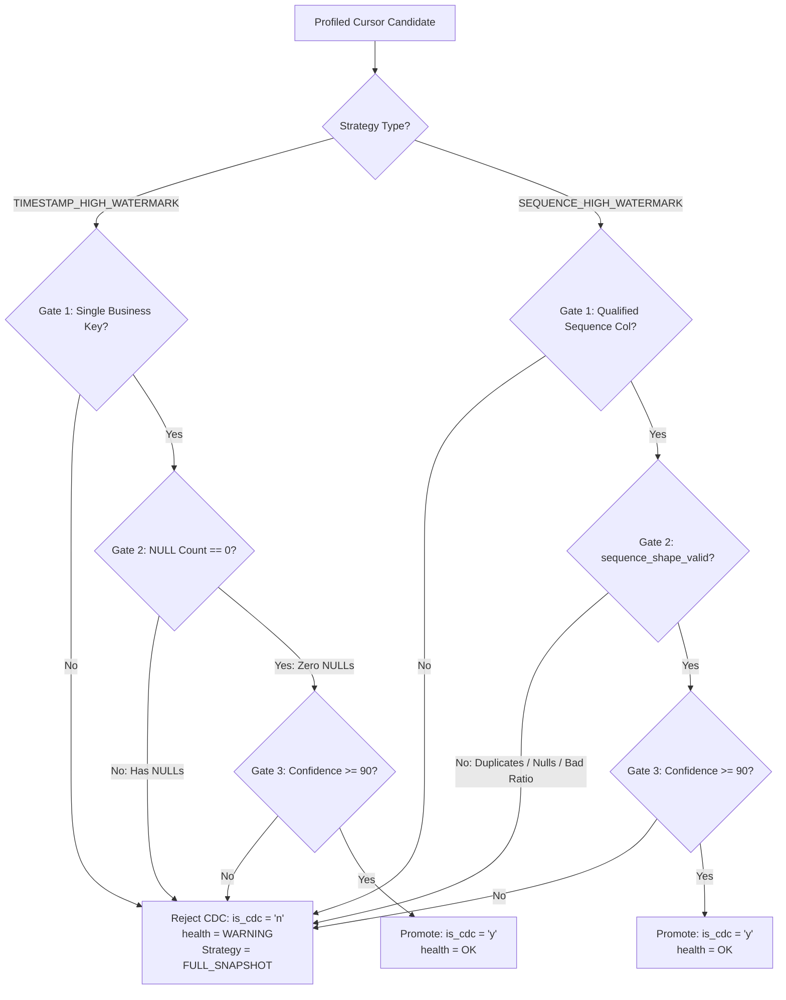

##### 1. Timestamp High-Watermark Invariant Gates (`auto_timestamp_cdc`)
```python
auto_timestamp_cdc = (
    effective_strategy == "TIMESTAMP_HIGH_WATERMARK"
    and _has_valid_single_business_key()   # Gate 1: Verified non-null primary identity
    and null_cnt == 0                      # Gate 2: ZERO NULL ROWS (Strict Invariant)
    and computed_confidence >= 90          # Gate 3: Confidence score >= 90%
)
```
- **Gate 1 (Single Business Key):** Requires an authoritative unique business key with $\text{confidence} \ge 50$. CDC updates cannot be safely merged into target databases without an immutable identity key.
- **Gate 2 (Zero NULL Invariant):** **Every single existing row must have a non-null timestamp.** Even a single NULL row causes immediate failure. If a table with NULL timestamps were placed on watermark CDC (`WHERE modified_at > :watermark`), all rows where `modified_at IS NULL` would never be extracted, leading to permanent, silent data loss.
- **Gate 3 (Confidence $\ge$ 90%):** Ensures high variance, proper data types, and confirmed schema constraints.

##### 2. Sequence High-Watermark Invariant Gates (`auto_sequence_cdc`)
```python
auto_sequence_cdc = (
    effective_strategy == "SEQUENCE_HIGH_WATERMARK"
    and _is_qualified_sequence_cursor(cand_col)       # Gate 1: Column qualification
    and sequence_shape_valid                           # Gate 2: Data shape checks
    and computed_confidence >= 90                     # Gate 3: Confidence score >= 90%
)
```

The supporting `sequence_shape_valid` invariant (`src/discovery/type_mapper.py:639-651`) verifies all physical data characteristics:
```python
sequence_shape_valid = (
    _is_sequence_cursor_type(cand_col)
    and isinstance(min_val, Number) and not isinstance(min_val, bool)
    and isinstance(max_val, Number) and not isinstance(max_val, bool)
    and total > 0
    and null_cnt == 0
    and distinct_ratio >= CDC_SEQUENCE_CURSOR_MIN_DISTINCT_RATIO  # >= 0.95 (95%)
    and (len(key_parts) > 1 or duplicate_count == 0)             # Zero duplicates
    and max_val >= min_val                                       # Positive monotonic range
)
```

##### 3. Architectural Rationale: Why Sequence CDC is Stricter on Cardinality Than Timestamp CDC
- **Timestamp Cursors:** Represent temporal states. In high-throughput databases, dozens of rows may legitimately share the exact same timestamp (e.g. within the same commit second). The pipeline accommodates this via inclusive bounded windowing (`>= lower_bound AND <= upper_bound`), overlap lookback days (`cdc_p_days`), and target deduplication.
- **Sequence Cursors:** Represent strict monotonic append progress markers. Windowed extraction queries assume strict sequential order:
  $$\text{SELECT } * \text{ FROM table WHERE id } > L \text{ AND id } \le H$$
  If an ID column contains duplicate values or recycling sequences, this inequality **cannot guarantee all records in that numerical range are captured**, creating either duplicate target projections or missed updates. Thus, sequence cursors strictly mandate zero duplicate IDs (`duplicate_count == 0`) and high distinctness ($\ge 95\%$).

---

### 12. CDC Policy Selection and Activation Rules

- **Plain-language definition:** The automated decision rules that choose whether a table should be extracted via a full snapshot, an integer sequence cursor, or an update timestamp cursor.
- **Industry-standard term:** Automated CDC Policy Synthesis & Activation Governance.
- **Why this application needs it:** Human operators often misconfigure CDC (e.g., selecting timestamp CDC on a table without an index or choosing sequence CDC on a table where rows are updated in-place), causing silent data loss.
- **How this repository implements it:** Built into `jobs/promote_table.py` (`_promote_profiled_cdc_policy`). The system evaluates source columns:
  - If a trusted primary key is integer-based and mutation is append-only $\to$ selects `SEQUENCE_HIGH_WATERMARK`.
  - If update timestamp columns exist (`updated_at`, `modified_at`) $\to$ selects `TIMESTAMP_HIGH_WATERMARK` with positive overlap lookback days.
  - If no trusted cursor or mutation mode is uncertified $\to$ safely falls back to `FULL_SNAPSHOT`.
- **Actual files, functions, classes, tables, or migrations involved:**
  - `jobs/promote_table.py:64-95`: Strategy canonicalization functions (`_canonical_cdc_strategy`).
  - `jobs/promote_table.py:97-180`: Automated policy synthesis and promotion logic.
  - `src/discovery/type_mapper.py:734-762`: Fail-safe fallback assignment to `FULL_SNAPSHOT`.
  - `src/metadata/policy_models.py:64-132`: `ResolvedCDCPolicy`.
- **Inputs:** Tier 1 table profiling evidence, column data types, mutation mode flags.
- **Outputs:** Validated `ResolvedCDCPolicy` saved into `metadata.table_policy_version`.
- **State changes:** Writes candidate and promoted CDC policy versions.
- **Failure behavior:** Raises `CDCMutationModeUnsupportedError` or `CDCCursorFinalityUncertifiedError` if activation rules are violated.
- **Security implications:** Ensures execution policies are mathematically certified before activation.
- **Performance implications:** Prevents un-indexed timestamp queries from causing full table scans on operational databases.
- **Current implementation status:** `IMPLEMENTED`
- **Evidence references with file paths and line numbers:**
  - `jobs/promote_table.py:64-80`: `_canonical_cdc_strategy` mapping aliases to canonical tokens.
  - `jobs/promote_table.py:97-150`: `_promote_profiled_cdc_policy`.
  - `src/discovery/type_mapper.py:740`: Fallback assignment to `FULL_SNAPSHOT`.
  - `src/cdc/cdc_window_resolver.py:79-115`: Policy invariant checks.

#### 12.1 Discovery Classification vs. Execution Engine Convergence: `FULL_LOAD` vs `FULL_SNAPSHOT`
There is often confusion regarding `FULL_LOAD` vs `FULL_SNAPSHOT`. In the platform architecture:
**They represent the same execution behavior at runtime, but originate from different lifecycle phases:**

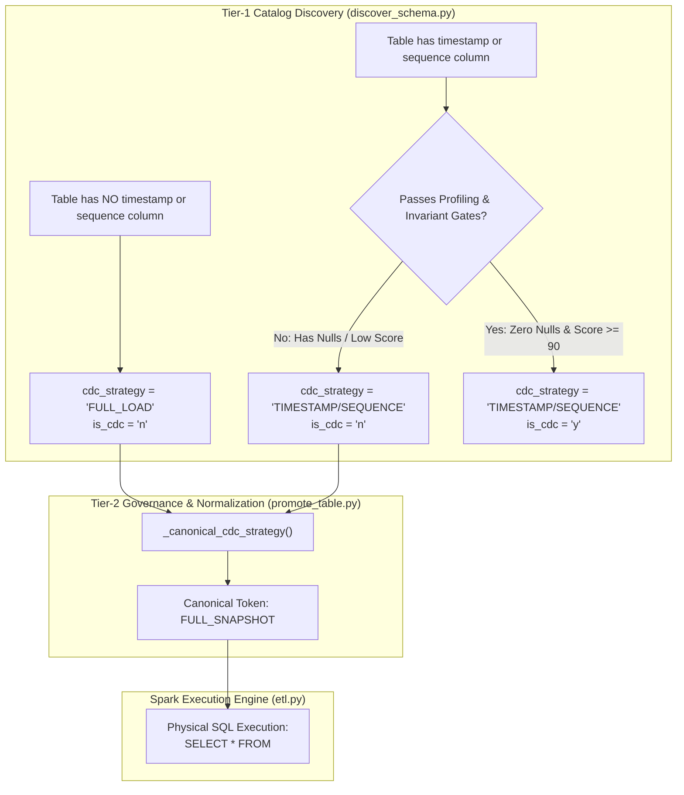

- **In Tier-1 Catalog Discovery (`jobs/discover_schema.py`):**
  - `FULL_LOAD` is the classification assigned when the schema crawler inspects table DDL and finds **no eligible timestamp, datetime, or sequence column candidates at all** (e.g. lookup tables, configuration tables, raw log tables without audit dates).
  - It explicitly signals to data stewards: *"This table has no native incremental cursor and cannot support CDC."*
- **In Tier-2 Governance & Execution (`jobs/promote_table.py` & `src/orchestrator/etl.py`):**
  - `FULL_SNAPSHOT` is the canonical strategy token for full table scans.
  - Function `_canonical_cdc_strategy()` maps all historical aliases (`FULL_LOAD`, `FULL`, `SNAPSHOT`, `BULK`) into the single authoritative token: `"FULL_SNAPSHOT"`.
- **Runtime Convergence:**
  - Whether a table enters execution with `cdc_strategy = 'FULL_LOAD'` (no cursor exists) or `cdc_strategy = 'TIMESTAMP_HIGH_WATERMARK'` with `is_cdc = 'n'` (candidate failed health gates), both resolve to `FULL_SNAPSHOT` and execute the exact same query: **`SELECT * FROM source_table`** on every run.

#### 12.2 Real-World RCA Case Study: Profiling & Invariant Evaluation on `03042025tblconvention`
An incident in production illustrated how these rules protect downstream data integrity:

- **Observed Metadata Record (Source: MySQL `source_erp_db`):**
  - `table_name`: `03042025tblconvention`
  - `business_key`: `CONVENTION_ID` (`key_confidence = 100`, `duplicate_count = 0`)
  - `cdc_columns`: `MODIFIEDDATE`
  - `cdc_strategy`: `TIMESTAMP_HIGH_WATERMARK`
  - `cdc_confidence`: `98`
  - `cdc_health`: `WARNING`
  - `cdc_null_rows`: `85`
  - `is_cdc`: `'n'`

- **Scoring Analysis:**
  The table scored **98 out of 100 possible points**:
  $$\text{Score} = 30\,(\text{datatype}) + 18\,(\text{null fraction: } 8.92\%) + 20\,(\text{distinct variation}) + 20\,(\text{freshness}) + 10\,(\text{physical key}) = 98$$

- **Root Cause Analysis (Why `is_cdc` is `'n'` Despite Score 98):**
  1. The table passed Gate 1 (verified primary key `CONVENTION_ID`).
  2. The table passed Gate 3 ($\text{confidence } 98 \ge 90$).
  3. **The table FAILED Gate 2 (Strict Zero NULL Invariant):**
     $$\text{null\_cnt} = 85 \ne 0 \implies \text{Gate 2 Violation}$$
  4. In `src/discovery/type_mapper.py:724-730`, Gate 2 requires `null_cnt == 0`. Because 85 rows contained `NULL MODIFIEDDATE`, `auto_timestamp_cdc` evaluated to `False`.
  5. The profiler therefore assigned `is_cdc = 'n'` and flagged `cdc_health = 'WARNING'`.

- **Operational Impact & Protection:**
  This strict gate prevented catastrophic silent data loss. If `is_cdc` had been enabled, the pipeline would have extracted records using `WHERE MODIFIEDDATE > :last_watermark`. The 85 convention records with `NULL MODIFIEDDATE` would **never have satisfied this predicate and would have been permanently omitted from analytical reporting**.

- **Operator Remediation:**
  1. **Source Backfill:** Execute `UPDATE source_erp_db.03042025tblconvention SET MODIFIEDDATE = CREATEDDATE WHERE MODIFIEDDATE IS NULL;` in the source database.
  2. **Re-Profile:** Trigger a discovery crawl. With `null_cnt = 0`, the table immediately passes Gate 2, flips `is_cdc` to `'y'`, marks `cdc_health = 'OK'`, and activates automated incremental extraction.

---

### 13. Human and Automated Governance

- **Plain-language definition:** The process by which system-generated recommendations for schemas, keys, and CDC rules are reviewed, approved, and versioned by data engineers or automated policy engines before production activation.
- **Industry-standard term:** Metadata Policy Promotion & Governance Workflow (`META-01`).
- **Why this application needs it:** Automated crawlers cannot be completely trusted to infer business semantics. Governance creates an immutable audit trail showing who approved a schema or key and why.
- **How this repository implements it:** Enforced via `src/metadata/policy_governance.py:PolicyGovernanceService`. A candidate policy contract is assembled from metadata. Promotion requires a `PromotionRequest` with an explicit actor (`USER`, `SYSTEM`, `SCHEDULER`). Promotion is executed inside a PostgreSQL transaction protected by an advisory lock (`pg_advisory_xact_lock(hashtext(...))`) to prevent race conditions.
- **Actual files, functions, classes, tables, or migrations involved:**
  - `src/metadata/policy_governance.py:44-150`: `PolicyGovernanceService` class.
  - `src/metadata/policy_models.py:18-28`: `PolicyActorType` and `PromotionOutcome`.
  - `migrations/033_meta01_policy_version_governance.sql`: DDL for `table_policy_version`.
- **Inputs:** Candidate contract payload, expected fingerprint, actor credentials, promotion reason.
- **Outputs:** Promoted policy record in `metadata.table_policy_version` with an incremented version number.
- **State changes:** Updates `metadata.db_tables_etl.current_policy_version_id`; inserts into `table_policy_version`.
- **Failure behavior:** Raises `PolicyEvidenceDriftError` if the underlying catalog changes between candidate assembly and promotion. Raises `PolicyPromotionConflictError` on concurrent promotion attempts.
- **Security implications:** Full non-repudiation audit logging for all policy promotions.
- **Performance implications:** Transaction-scoped advisory locks serialize promotions without taking persistent locks on data rows.
- **Current implementation status:** `IMPLEMENTED`
- **Evidence references with file paths and line numbers:**
  - `src/metadata/policy_governance.py:1-40`: META-01 service overview.
  - `src/metadata/policy_governance.py:250-320`: Advisory-locked promotion execution.
  - `migrations/033_meta01_policy_version_governance.sql:1-45`: Schema definition for policy versioning.

---

### 14. Execution Authority and Frozen Contracts

- **Plain-language definition:** Taking a complete, frozen snapshot of all table rules, column mappings, and security policies at the exact moment a pipeline run starts, so that any changes made to the database while the job is running will not affect the active run.
- **Industry-standard term:** Execution Authority Decoupling & Immutable Attempt Envelopes (`JOB-01`).
- **Why this application needs it:** If an operator updates column mappings or promotes a new schema while a 3-hour pipeline job is halfway through, the job could crash or write corrupted, half-migrated data.
- **How this repository implements it:** Implemented in `src/contracts/claim_models.py:FrozenJobExecution` and `src/orchestrator/lifecycle.py`. When a job is submitted, `ExecutionService` resolves all active policies, bundles them into an immutable `FrozenJobExecution` JSON payload, and writes it to `metadata.gui_job_registry`. The worker unpacks this payload and ignores live catalog edits.
- **Actual files, functions, classes, tables, or migrations involved:**
  - `src/contracts/claim_models.py:76-240`: `FrozenTableEntry` dataclass.
  - `src/contracts/claim_models.py:244-350`: `FrozenJobExecution` dataclass.
  - `gui/services/execution_service.py:150-250`: Snapshot assembly and serialization.
  - `migrations/039_execution_authority_mode.sql`: Decouples execution authority from policy existence.
- **Inputs:** Active promoted policies for target tables at submission time.
- **Outputs:** Immutable JSON execution contract serialized in `gui_job_registry.frozen_contract_payload`.
- **State changes:** Freezes table execution contract in database; prevents mid-flight policy drift.
- **Failure behavior:** If a required table lacks an approved policy, the submission fails immediately before queueing.
- **Security implications:** Guarantees auditability; historical runs can be reproduced using their frozen contract snapshot.
- **Performance implications:** Eliminates repeated metadata catalog lookups during multi-table batch runs.
- **Current implementation status:** `IMPLEMENTED`
- **Evidence references with file paths and line numbers:**
  - `src/contracts/claim_models.py:76-115`: `FrozenTableEntry` definition.
  - `src/contracts/claim_models.py:244-270`: `FrozenJobExecution` definition.
  - `gui/services/execution_service.py:175-220`: Assembly of `FrozenJobExecution`.

---

### 15. Run Submission and Role-Based Access Control (RBAC)

- **Plain-language definition:** The gatekeeper that verifies who is requesting a pipeline run, checks whether their account has permission to execute runs, and registers the run in the system queue.
- **Industry-standard term:** Execution Ingestion Gate & Role-Based Access Control (RBAC).
- **Why this application needs it:** Prevents unauthorized users, guest accounts, or read-only analysts from triggering expensive Spark jobs or mutating production analytical databases.
- **How this repository implements it:** Managed by `gui/services/execution_service.py:ExecutionService.submit_run()`. It authenticates users via `ProjectContext` and `LocalDatabaseIdentityProvider` (`metadata.rbac_users`). Roles (`ADMIN`, `OPERATOR`, `ANALYST`) enforce allowed execution scopes. It validates that all requested tables are configured with `execution_authority_mode = 'GOVERNED'`.
- **Actual files, functions, classes, tables, or migrations involved:**
  - `gui/services/execution_service.py:120-220`: `submit_run()` method.
  - `src/security/authorization.py:1-80`: RBAC permission matrix checking.
  - `migrations/016_add_rbac.sql`: DDL for `rbac_users`, `rbac_roles`, and `rbac_user_roles`.
- **Inputs:** `SubmissionRequest` (source tag, table IDs, execution priority, user session context).
- **Outputs:** `SubmissionResult` containing the generated `run_id` UUID and list of queued table claims.
- **State changes:** Inserts a new run row into `metadata.gui_job_registry` with status `QUEUED`.
- **Failure behavior:** Raises `AuthorizationError` if the user lacks the `EXECUTE` privilege. Fails if un-promoted tables are included.
- **Security implications:** Enforces principle of least privilege; prevents unauthorized pipeline triggering.
- **Performance implications:** Fast database transaction (under 50ms) that queues runs asynchronously without blocking the UI.
- **Current implementation status:** `IMPLEMENTED`
- **Evidence references with file paths and line numbers:**
  - `gui/services/execution_service.py:120-145`: RBAC verification in `submit_run`.
  - `src/security/authorization.py:20-45`: Role check enforcement.
  - `migrations/016_add_rbac.sql:1-40`: RBAC schema definition.

---

### 16. Job Lifecycle Management

- **Plain-language definition:** The formal state machine that tracks a job from the moment it is queued, to when a worker claims it, runs it, and marks it as succeeded, failed, or cancelled.
- **Industry-standard term:** Authoritative Job Lifecycle State Machine (`JOB-01`).
- **Why this application needs it:** Without an authoritative state machine, jobs can enter ambiguous states (e.g., marked as running forever when a server reboots, or running concurrently on two workers).
- **How this repository implements it:** Enforced by `src/orchestrator/lifecycle.py:transition_job()`. Valid transitions are defined in `VALID_JOB_TRANSITIONS`:
  - `QUEUED` $\to$ `DISPATCHED` $\to$ `RUNNING` $\to$ (`SUCCESS` | `FAILED` | `RECONCILIATION_FAILED` | `CANCELLED` | `ABANDONED`).
  All state advancements use database compare-and-swap (CAS) queries and atomically record an audit entry in `metadata.job_event`.
- **Actual files, functions, classes, tables, or migrations involved:**
  - `src/orchestrator/lifecycle.py:14-28`: `VALID_JOB_TRANSITIONS` and `TERMINAL_STATES`.
  - `src/orchestrator/lifecycle.py:42-120`: `transition_job()` CAS implementation.
  - `migrations/032_job01_authoritative_execution_lifecycle.sql`: DDL for `gui_job_registry` and `job_event`.
- **Inputs:** `run_id`, `from_status`, `to_status`, actor type, error code, process ID.
- **Outputs:** Boolean indicating whether the state transition was claimed successfully.
- **State changes:** Updates `metadata.gui_job_registry.status`; inserts audit row into `metadata.job_event`.
- **Failure behavior:** Rejects illegal transitions by raising `ValueError`. If another worker updated the status concurrently, the CAS query returns `False`.
- **Security implications:** Full auditability of all job state changes and system interventions.
- **Performance implications:** Lightweight indexed single-row CAS updates eliminate distributed coordination locks.
- **Current implementation status:** `IMPLEMENTED`
- **Evidence references with file paths and line numbers:**
  - `src/orchestrator/lifecycle.py:14-27`: Definition of `VALID_JOB_TRANSITIONS`.
  - `src/orchestrator/lifecycle.py:30-39`: `validate_transition_allowed` validation logic.
  - `src/orchestrator/lifecycle.py:70-115`: SQL CAS update queries.

---

### 17. Claims, Leases, Fencing, and Concurrency Control

- **Plain-language definition:** A digital badge and lease system that prevents two workers from running the same table at the same time and immediately blocks ("fences out") any slow or crashed worker from writing data.
- **Industry-standard term:** Distributed Leases, Monotonic Epochs, and Fencing Tokens (`JOB-01` / `ADR-006`).
- **Why this application needs it:** In cloud and distributed environments, a worker might experience a temporary network disconnect or long garbage-collection pause. If a backup worker takes over and the original worker suddenly wakes up, both could write to the target table simultaneously, causing race conditions and duplicate data.
- **How this repository implements it:** Managed by `src/orchestrator/claim_manager.py:ScopeClaimManager`. It manipulates `metadata.job_scope_claim`:
  - **Reserve:** Inserts claims in `RESERVED` status in sorted `table_id` order to prevent deadlocks.
  - **Activate:** Transitions `RESERVED` $\to$ `ACTIVE`, increments `fencing_epoch`, generates a 64-character cryptographic random token held *only in worker memory*, and persists only the SHA-256 hash (`fencing_token_digest`).
  - **Heartbeat:** Extends `lease_expires_at` every 2 seconds via `heartbeat_claim()`.
  - **Fencing:** If a lease expires, the claim is revoked. If the old worker attempts to write, its token and epoch are rejected.
- **Actual files, functions, classes, tables, or migrations involved:**
  - `src/orchestrator/claim_manager.py:55-250`: `ScopeClaimManager` class.
  - `src/contracts/claim_models.py:27-74`: `ExecutionFence` dataclass.
  - `migrations/042_job_scope_claim_fencing.sql` through `migrations/046_partial_success_job_lifecycle.sql`.
- **Inputs:** `claim_id`, `owner_instance_id`, `runtime_settings`, secret raw token.
- **Outputs:** Granted `ExecutionFence` containing epoch, token digest, and expiration timestamp.
- **State changes:** Mutates status, lease expiration, and heartbeat timestamps in `job_scope_claim`.
- **Failure behavior:** Target writes are rejected with `GovernedFenceLostError` if the worker loses its lease.
- **Security implications:** Raw tokens are never logged or stored in the database; only SHA-256 digests are stored.
- **Performance implications:** Heartbeats execute efficient single-row indexed updates; prevents catastrophic double-write corruption.
- **Current implementation status:** `IMPLEMENTED`
- **Evidence references with file paths and line numbers:**
  - `src/orchestrator/claim_manager.py:43-53`: Token generation and SHA-256 hashing.
  - `src/orchestrator/claim_manager.py:112-180`: `activate_scope_claim()` CAS transition.
  - `src/orchestrator/claim_manager.py:200-238`: `heartbeat_claim()` lease renewal.

---

### 18. Apache Spark Execution Architecture

- **Plain-language definition:** The distributed computing engine that coordinates memory, CPU cores, and worker threads to run parallel data processing across large datasets.
- **Industry-standard term:** Distributed In-Memory Processing & SparkSession Factory.
- **Why this application needs it:** Processing millions of database records using single-threaded Python scripts causes out-of-memory errors and excessive execution times. Spark provides distributed memory management and parallel processing.
- **How this repository implements it:** Built in `src/spark_session.py:SparkSessionFactory`. In production, it configures executor memory, driver memory, and executor cores from YAML settings. In local/developer mode, it applies self-healing environment fixes for Windows (sets `HADOOP_HOME`, `JAVA_HOME`, `SPARK_LOCAL_IP=127.0.0.1`), injects Oracle JDBC driver JARs into `PYSPARK_SUBMIT_ARGS` before JVM initialization, and optionally connects to a remote cluster via Spark Connect (`SPARK_CONNECT_URL`).
- **Actual files, functions, classes, tables, or migrations involved:**
  - `src/spark_session.py:5-88`: `SparkSessionFactory` class.
  - `config/config.yaml`: `spark` configuration block.
- **Inputs:** Cluster configuration dictionaries, environment variables (`APP_ENV`, `SPARK_CONNECT_URL`).
- **Outputs:** Configured, active PySpark `SparkSession`.
- **State changes:** Initializes JVM driver process, creates event log directories, connects to executors.
- **Failure behavior:** Fails startup with descriptive error if Java or Hadoop binaries are missing.
- **Security implications:** Driver and executor boundaries isolate database credentials; passwords are not exposed in Spark UI event logs.
- **Performance implications:** Configures memory buffers, Catalyst optimizer rules, and partition counts for optimal throughput.
- **Current implementation status:** `IMPLEMENTED`
- **Evidence references with file paths and line numbers:**
  - `src/spark_session.py:8-20`: JVM classpath injection for Oracle JDBC.
  - `src/spark_session.py:22-40`: Windows environment self-healing.
  - `src/spark_session.py:41-50`: Spark Connect remote connection support.

---

### 19. JDBC Extraction and Partitioning

- **Plain-language definition:** Splitting a large database table into smaller chunks (e.g., by ID ranges or dates) and having multiple Spark threads read those chunks at the same time through JDBC connections.
- **Industry-standard term:** Parallel JDBC Ingestion & Adaptive Range Partitioning.
- **Why this application needs it:** Reading a 50-million-row table over a single JDBC connection takes hours and can time out. Reading it across 10 parallel connections finishes in minutes.
- **How this repository implements it:** Implemented in `src/extract/extractor.py:Extractor`. If a `partition_column` is defined in metadata, `_add_parallel_read_options()` queries the live source table min and max values (`_get_column_bounds()`) or uses configured lower and upper bounds. It passes `partitionColumn`, `lowerBound`, `upperBound`, and `numPartitions` to `spark.read.format("jdbc")`. It also handles database-specific quirks: casts Oracle CLOBs using `DBMS_LOB.SUBSTR(col, 4000, 1)` and casts MySQL zero-dates via `customSchema`.
- **Actual files, functions, classes, tables, or migrations involved:**
  - `src/extract/extractor.py:24-173`: `Extractor.read()` method.
  - `src/extract/extractor.py:191-238`: `_add_parallel_read_options()`.
  - `src/runtime/runtime_optimizer.py`: Adaptive fetch size and partition planning.
- **Inputs:** `MetadataRow`, JDBC `ConnectionConfig`, optional CDC WHERE filter.
- **Outputs:** Partitioned PySpark `DataFrame`.
- **State changes:** Opens concurrent JDBC connections to source database.
- **Failure behavior:** If bounds discovery fails or the column is not numeric/date, safely falls back to a single-partition read to avoid pipeline failure.
- **Security implications:** WHERE clause filters and boundary predicates use validated metadata identifiers to prevent SQL injection.
- **Performance implications:** Parallel reads provide a $5\times$ to $10\times$ speedup on large source tables.
- **Current implementation status:** `IMPLEMENTED`
- **Evidence references with file paths and line numbers:**
  - `src/extract/extractor.py:47-72`: MySQL dynamic zero-date customSchema handling.
  - `src/extract/extractor.py:74-116`: Oracle DBMS_LOB extraction handling.
  - `src/extract/extractor.py:191-238`: Parallel read partition bounds calculation.

---

### 20. Medallion Storage Architecture (Bronze, Silver, Gold Layers)

- **Plain-language definition:** Storing data in three progressive quality tiers: Bronze contains raw original files, Silver contains cleaned and deduplicated history, and Gold contains final business-ready tables.
- **Industry-standard term:** Medallion Lakehouse Architecture (Bronze $\to$ Silver $\to$ Gold).
- **Why this application needs it:** Storing raw data first ensures that if a bug occurs in transformation or business logic, data engineers can replay the transformations from Bronze storage without re-extracting from production databases.
- **How this repository implements it:** Managed across `src/load/loader.py:Loader` and `src/orchestrator/etl.py`:
  - **Bronze (`write_landing`):** Saves extracted DataFrames directly to Snappy-compressed Parquet files partitioned by extraction date (`dt=YYYY-MM-DD`). Subsequent pipeline layers read Bronze data via `Extractor.read_landing()`.
  - **Silver (`write_history`):** Saves deduplicated, type-cast DataFrames to partitioned Delta Lake tables (falling back to Parquet if Delta Lake is unavailable).
  - **Gold (`write_target` / `GoldAtomicPublisher`):** Publishes business-ready tables to target relational databases (PostgreSQL/Oracle) using staging tables and atomic UPSERTs.
- **Actual files, functions, classes, tables, or migrations involved:**
  - `src/load/loader.py:121-185`: `write_landing()` (Bronze).
  - `src/load/loader.py:188-247`: `write_history()` (Silver).
  - `src/load/loader.py:324-350`: `write_target()` (Gold).
  - `src/load/gold_atomic_publisher.py:43-120`: `GoldAtomicPublisher` (Gold full snapshot).
- **Inputs:** PySpark DataFrames, `MetadataRow`, date partition strings.
- **Outputs:** Parquet files in Bronze, Delta/Parquet tables in Silver, relational tables in Gold.
- **State changes:** Writes directory structures to filesystem/storage; mutates relational tables in target databases.
- **Failure behavior:** Failures in Silver or Gold do not affect Bronze data; Bronze files serve as recovery snapshots.
- **Security implications:** Storage directories inherit OS file permissions; credentials are never written to disk.
- **Performance implications:** Bronze files allow parallel downstream processing without placing additional query load on source databases.
- **Current implementation status:** `IMPLEMENTED`
- **Evidence references with file paths and line numbers:**
  - `src/load/loader.py:121-145`: Bronze Parquet write implementation.
  - `src/load/loader.py:188-225`: Silver Delta Lake write implementation.
  - `src/load/loader.py:324-350`: Gold target write dispatch.

---

### 21. Transformation and Cleansing

- **Plain-language definition:** Standardizing column values, calculating row fingerprints, generating system keys, and adding audit timestamps to every record.
- **Industry-standard term:** Data Cleansing, Audit Enrichment, and Structural Transformation.
- **Why this application needs it:** Reporting tables require standard audit columns (to know when a row was inserted and by what run) and consistent datatypes across diverse source systems.
- **How this repository implements it:** Centered in `src/transform/transformer.py:Transformer`. All operations are pure PySpark transformations (no Python UDFs or pandas conversions). It adds:
  - `row_hash`: SHA-256 hash across sorted business payload columns via `F.to_json(F.struct(...))` to detect row content changes without delimiter collision risks.
  - `source_identification_key`: Generated via `add_source_identification_key()`. Formats entity-scoped natural keys (`{source_tag}_{source_table}_{keys}`) with null-safe coalescing, or generates deterministic 16-character MD5 synthetic hashes (`{source_tag}_{source_table}_synthetic_{hash16}`) over non-audit row contents for keyless tables.
  - Standard audit columns: `dml_timestamp`, `dml_status`, `source_tag`, `pipeline_run_id`, `source_identification_table`, `landing_ingestion_timestamp`.
  - Canonical type casting via `cast_columns()`.
- **Actual files, functions, classes, tables, or migrations involved:**
  - `src/transform/transformer.py:31-55`: `add_business_hash()`.
  - `src/transform/transformer.py:56-74`: `add_audit_columns()`.
  - `src/transform/transformer.py:76-150`: `add_source_identification_key()`, `_parse_natural_keys()`.
  - `src/transform/transformer.py:186-250`: `cast_columns()`.
  - `src/constants.py:32-45`: `AuditColumns` enumeration.
- **Inputs:** Raw PySpark DataFrame, `MetadataRow`, `run_id`.
- **Outputs:** Transformed PySpark DataFrame containing standard audit columns, entity-scoped identity keys, and cleansed datatypes.
- **State changes:** In-memory DataFrame transformation.
- **Failure behavior:** Fails fast if required columns are missing or type casting fails.
- **Security implications:** Excludes internal credential tokens from business hash calculation.
- **Performance implications:** Uses Catalyst-native PySpark SQL functions (`F.sha2`, `F.to_json`, `F.struct`, `F.md5`) for maximum execution speed without JVM-Python serialization overhead.
- **Current implementation status:** `IMPLEMENTED`
- **Evidence references with file paths and line numbers:**
  - `src/transform/transformer.py:31-55`: Implementation of `add_business_hash`.
  - `src/transform/transformer.py:56-74`: Implementation of `add_audit_columns`.
  - `src/transform/transformer.py:76-150`: Implementation of `add_source_identification_key`.
  - `src/constants.py:32-45`: Definition of `AuditColumns`.

---

### 22. Deduplication and Business-Key Enforcement

- **Plain-language definition:** Detecting duplicate rows that share the same business key and keeping only the single newest version of each record based on an update timestamp.
- **Industry-standard term:** Windowed Identity Deduplication & Conflict Resolution.
- **Why this application needs it:** Source transactional systems may emit multiple updates for the same entity in an extraction window. Loading duplicates into target tables causes primary key violations or inflated business metrics.
- **How this repository implements it:** Built in `src/transform/transformer.py:deduplicate()`. It parses natural key columns from metadata via `_parse_natural_keys()`. It defines a PySpark Window partitioned by natural key columns and ordered by timestamp descending (`updated_at`, `dml_timestamp`). It computes `ROW_NUMBER() OVER (...)` and filters for `_rn == 1`.
- **Actual files, functions, classes, tables, or migrations involved:**
  - `src/transform/transformer.py:76-115`: `_parse_natural_keys()`.
  - `src/transform/transformer.py:158-185`: `deduplicate()` method.
- **Inputs:** PySpark DataFrame, `MetadataRow`, order column name.
- **Outputs:** Deduplicated PySpark DataFrame with guaranteed unique business keys.
- **State changes:** In-memory DataFrame transformation.
- **Failure behavior:** Raises `NaturalKeyResolutionException` if configured natural key columns are missing from the DataFrame schema.
- **Security implications:** Prevents duplicate-key injection into downstream financial and reporting tables.
- **Performance implications:** Windowed deduplication causes a Spark shuffle; partitioned keys minimize shuffle data skew.
- **Current implementation status:** `IMPLEMENTED`
- **Evidence references with file paths and line numbers:**
  - `src/transform/transformer.py:76-115`: `_parse_natural_keys` implementation.
  - `src/transform/transformer.py:158-185`: Window deduplication using `row_number()`.

---

### 23. Target Preflight Checks

- **Plain-language definition:** Automated safety inspections performed against the target database *before* any data write occurs, ensuring the table exists, constraints are compatible, and business keys have no nulls or duplicates.
- **Industry-standard term:** Fail-Closed Target Preflight Verification.
- **Why this application needs it:** Catching a schema mismatch or constraint error after extracting 10 million rows wastes hours of processing time and can leave destination tables locked or half-populated.
- **How this repository implements it:** Enforced by `src/load/loader.py:provision_target_schema_preflight()`. It executes:
  1. Business key null check: `df.filter("key IS NULL")` $\to$ raises `TargetPreflightError` if count $> 0$.
  2. Business key duplicate check: `df.groupBy(keys).count().filter("count > 1")` $\to$ raises `TargetPreflightError` if count $> 0$.
  3. Target table existence check: probes target database via `SELECT 1 FROM target WHERE 1=0` $\to$ raises `TargetTableNotFoundError` if absent.
  4. Physical constraint inspection: queries target catalog via `get_schema_inspector()` to verify an existing compatible `PRIMARY KEY` or `UNIQUE` constraint exists.
  5. Column definition and order alignment: verifies target column names, datatypes, and ordinal definitions match catalog metadata to catch DDL inversions (e.g. `fayears` D-010) prior to execution.
- **Actual files, functions, classes, tables, or migrations involved:**
  - `src/load/loader.py:351-438`: `provision_target_schema_preflight()`.
  - `src/load/target_schema_inspector.py:17-65`: `PostgreSQLSchemaInspector`.
  - `src/exceptions.py`: `TargetPreflightError`, `TargetTableNotFoundError`, `TargetConstraintRequiredError`.
- **Inputs:** PySpark DataFrame, `MetadataRow`, target `ConnectionConfig`.
- **Outputs:** None (passes quietly if preflight succeeds).
- **State changes:** None (read-only verification).
- **Failure behavior:** Fails closed immediately before any DML executes. Categorizes errors precisely (`TARGET_TABLE_NOT_FOUND`, `TARGET_AUTHENTICATION_FAILED`, `TARGET_CONNECTION_TIMEOUT`).
- **Security implications:** Prevents malformed or unauthorized DDL/DML from executing on target schemas.
- **Performance implications:** Fast preflight queries (sub-second) prevent hours of wasted Spark processing.
- **Current implementation status:** `IMPLEMENTED` for PostgreSQL targets; `PARTIALLY IMPLEMENTED` for Oracle/MySQL targets (generic inspector raises `NotImplementedError`).
- **Evidence references with file paths and line numbers:**
  - `src/load/loader.py:375-400`: In-memory null and duplicate key checks.
  - `src/load/loader.py:408-423`: Target table existence probe.
  - `src/load/loader.py:424-438`: Unique constraint inspection call.
  - `src/load/target_schema_inspector.py:67-72`: `GenericSchemaInspector` raising `NotImplementedError`.

---

### 24. Target Writes and Staging Tables

- **Plain-language definition:** Writing new data into an isolated temporary staging table first, and then safely merging or swapping it into the final destination table in a single atomic database operation.
- **Industry-standard term:** Staging-Table UPSERT & Atomic Table Swapping.
- **Why this application needs it:** Writing directly into a live production table with `INSERT ... VALUES` or `TRUNCATE ... INSERT` creates a window of downtime where analytical queries see zero rows, or corrupted data if the write fails halfway through.
- **How this repository implements it:**
  - **Incremental Keyed UPSERT (`_upsert_via_staging`):** Aligns DataFrame columns to target schema using `SchemaValidator`. Overwrites an isolated staging table via JDBC. Executes dialect-specific SQL UPSERT (e.g., PostgreSQL `INSERT ... ON CONFLICT (keys) DO UPDATE` or Oracle `MERGE INTO target USING staging`). Drops staging table upon completion.
  - **Full Snapshot Publication (`GoldAtomicPublisher`):** Creates `_stage_gold_{table}_{run_id}` with `LIKE target INCLUDING ALL`. Populates staging table. Acquires target lock with a strict 5-second timeout (`SET LOCAL lock_timeout = '5s'`). Swaps or replaces target atomically in a single transaction.
- **Actual files, functions, classes, tables, or migrations involved:**
  - `src/load/loader.py:439-550`: `_upsert_via_staging()`.
  - `src/utils/db_utils.py:180-260`: `execute_upsert()`.
  - `src/load/gold_atomic_publisher.py:58-150`: `GoldAtomicPublisher.publish_governed()`.
  - `migrations/037_gold01_atomic_publication.sql`: DDL for publication manifests.
- **Inputs:** PySpark DataFrame, `MetadataRow`, target `ConnectionConfig`, canonical merge keys.
- **Outputs:** Updated live target table; staging tables dropped.
- **State changes:** Mutates live target database records; records publication status in `metadata.gold_publication_manifest`.
- **Failure behavior:** If the staging write or merge fails, the transaction rolls back immediately; live target tables remain untouched.
- **Security implications:** Dynamic staging table names are sanitized to prevent SQL injection.
- **Performance implications:** Bulk JDBC staging write followed by server-side SQL UPSERT is significantly faster than row-by-row JDBC inserts.
- **Current implementation status:** `IMPLEMENTED`
- **Evidence references with file paths and line numbers:**
  - `src/load/loader.py:439-480`: Staging table UPSERT orchestration.
  - `src/utils/db_utils.py:180-220`: Dialect-specific UPSERT generation.
  - `src/load/gold_atomic_publisher.py:58-86`: Staging table generation and preparation.

---

### 25. Schema Evolution and Drift Detection

- **Plain-language definition:** Monitoring source systems for unexpected changes in column names, dropped fields, or modified data types, and alerting or halting the pipeline before corrupted data is written.
- **Industry-standard term:** Schema Drift Detection & Schema Evolution Governance.
- **Why this application needs it:** Upstream application developers frequently alter production database schemas (e.g., changing a column from integer to string or dropping an essential column) without notifying data teams.
- **How this repository implements it:** Built in `src/validation/schema_drift_detector.py:SchemaDriftDetector`. It compares current source column metadata against the frozen execution contract or Tier 2 catalog. It categorizes changes into:
  - Added columns.
  - Dropped columns.
  - Altered data types.
  - Changed nullability constraints.
  Fails closed by raising `SchemaDriftException` if incompatible breaking changes are detected.
- **Actual files, functions, classes, tables, or migrations involved:**
  - `src/validation/schema_drift_detector.py:1-120`: `SchemaDriftDetector` class.
  - `src/metadata/policy_governance.py:180-220`: Evidence drift detection during policy promotion.
  - `migrations/015_schema_lifecycle.sql`: DDL for schema version history.
- **Inputs:** Live source column catalog, frozen contract column specifications.
- **Outputs:** Detailed drift report listing added, removed, and modified fields.
- **State changes:** Logs drift events in metadata; halts execution if drift is non-backward-compatible.
- **Failure behavior:** Raises `SchemaDriftException` or `PolicyEvidenceDriftError`, preventing pipeline runs with stale schemas.
- **Security implications:** Prevents unexpected schema changes from bypassing data masking or access controls.
- **Performance implications:** Lightweight metadata-only comparison runs in milliseconds before data extraction starts.
- **Current implementation status:** `IMPLEMENTED`
- **Evidence references with file paths and line numbers:**
  - `src/validation/schema_drift_detector.py:25-70`: Comparison logic between catalog and DataFrame.
  - `src/metadata/policy_governance.py:200-240`: `check_candidate_drift()` implementation.

---

### 26. Data Quality Rules and Quality Scoring

- **Plain-language definition:** Checking whether data values obey mandatory business rules (e.g., email addresses contain `@`, prices are positive, status codes are valid) and calculating an overall health score.
- **Industry-standard term:** Automated Data Quality (DQ) Rules & Quality Scoring.
- **Why this application needs it:** Corrupted or malformed business data that passes technical schema validation can still break financial reporting and downstream machine learning models.
- **How this repository implements it:** Implemented across `src/quality/dq_engine.py` and `src/quality/dq_logger.py`. It evaluates configurable declarative rules from `metadata.data_quality_rules`:
  - `NOT_NULL`: Verifies mandatory fields.
  - `REGEX_MATCH`: Verifies string formatting (email, phone, postal code).
  - `RANGE_CHECK`: Verifies numeric boundaries (e.g., `amount > 0`).
  - `SET_MEMBERSHIP`: Verifies permitted categorical values (e.g., `status IN ('ACTIVE', 'SUSPENDED')`).
  Failed rows are quarantined, and overall table quality scores (0–100%) are recorded in `metadata.data_quality_scores`.
- **Actual files, functions, classes, tables, or migrations involved:**
  - `src/quality/dq_engine.py:1-150`: DQ evaluation engine.
  - `migrations/014_add_data_quality.sql`: DDL for `data_quality_rules` and `data_quality_scores`.
- **Inputs:** PySpark DataFrame, rule definitions from `metadata.data_quality_rules`.
- **Outputs:** Cleaned DataFrame, quarantined error rows, calculated quality score.
- **State changes:** Records scores and failed rule counts in `metadata.data_quality_scores`.
- **Failure behavior:** Depending on rule severity (`BLOCKING` vs. `WARNING`), either halts pipeline execution or logs warnings and continues.
- **Security implications:** Quarantined rows containing sensitive PII must inherit target security classification.
- **Performance implications:** Rules are compiled into vectorized PySpark SQL expressions (`F.when`, `F.rlike`) to avoid row-by-row Python iteration.
- **Current implementation status:** `PARTIALLY IMPLEMENTED` (Engine and schema exist; integration into main execution path is optional/gated).
- **Evidence references with file paths and line numbers:**
  - `migrations/014_add_data_quality.sql:1-50`: DDL for data quality tables.
  - `src/quality/dq_engine.py:30-80`: PySpark rule evaluation expressions.

---

### 27. Reconciliation and Mathematical Evidence

- **Plain-language definition:** Cryptographically verifying that the data written to the destination matches the data extracted from the source, using exact row counts, key fingerprints, and content hashes.
- **Industry-standard term:** Strategy-Aware Physical Reconciliation & Cryptographic Proof (`RECON-01`).
- **Why this application needs it:** Pure row-count reconciliation is flawed; a pipeline that extracts 1,000 rows and writes 1,000 completely wrong rows would pass a row-count check. Exact business-key set comparison is mathematically required.
- **How this repository implements it:** Implemented in `src/validation/strategy_reconciler.py:StrategyAwareReconciler` for target persistence and in `src/validation/layer_artifacts.py` for governed Bronze/Silver artifacts. Both use the existing `metadata.attempt_persistence_manifest`; migration `047` adds the artifact fields without creating another ledger.
  1. **Manifest Freeze:** Before writing, `freeze_persistence_manifest()` records expected row count, schema hash, and expected key fingerprint in `metadata.attempt_persistence_manifest`.
  2. **Fingerprint Computation:** `compute_key_set_fingerprint()` normalizes all business keys, sorts them canonically, and computes a deterministic SHA-256 digest (`{"key_set": [...]}`).
  3. **Reconciliation:** After writing, queries physical destination storage, computes destination key fingerprint, and verifies equality. Outcome (`CONVERGED`, `EMPTY_VERIFIED`, `REJECTED`) is recorded in `metadata.cdc_attempt_reconciliation`.
- **Actual files, functions, classes, tables, or migrations involved:**
  - `src/validation/strategy_reconciler.py:50-180`: `StrategyAwareReconciler` class.
  - `src/metadata/policy_models.py:340-420`: `AttemptPersistenceManifest`, `PhysicalReconciliationResult`.
  - `migrations/035_recon01_attempt_reconciliation.sql`: DDL for reconciliation tables.
- **Inputs:** `ResolvedCDCWindow`, `ResolvedTableContract`, live physical destination table.
- **Outputs:** Verified `PhysicalReconciliationResult` with `is_commit_authoritative` flag.
- **State changes:** Inserts records into `metadata.attempt_persistence_manifest` and `metadata.cdc_attempt_reconciliation`.
- **Failure behavior:** Raises `ReconciliationKeySetMismatchError` or `ReconciliationRowLossError`. Persists failure audit record to database *before* raising.
- **Security implications:** Cryptographic fingerprints prove data integrity without logging raw customer data in audit tables.
- **Performance implications:** Key fingerprint extraction queries execute indexed projections on target tables.
- **Current implementation status:** `IMPLEMENTED`
- **Evidence references with file paths and line numbers:**
  - `src/validation/strategy_reconciler.py:59-83`: `compute_key_set_fingerprint()`.
  - `src/validation/strategy_reconciler.py:84-150`: `freeze_persistence_manifest()`.
  - `src/validation/strategy_reconciler.py:200-280`: `reconcile_physical_persistence()`.

---

### 28. Atomic Publication and Recovery

- **Plain-language definition:** The final, irreversible step where a data load is declared successful, advancing the CDC watermark and committing the transaction so downstream users see the new data all at once.
- **Industry-standard term:** Atomic Compare-And-Swap Commit & Recovery Certification (`OBS-01`).
- **Why this application needs it:** If a pipeline job crashes after writing target rows but before advancing the CDC watermark, the next run would re-extract the same data. The commit of the watermark, the batch success status, and the audit ledger must happen in a single, unbreakable database transaction.
- **How this repository implements it:** Managed exclusively by `src/cdc/atomic_committer.py:AtomicCDCCommitter`. It:
  1. Acquires a PostgreSQL transaction advisory lock on `table_id`.
  2. Verifies that `metadata.cdc_attempt_reconciliation` has `outcome IN ('CONVERGED', 'EMPTY_VERIFIED')`.
  3. Executes a Compare-And-Swap (CAS) update on `metadata.table_cdc_state`:
     `UPDATE table_cdc_state SET committed_cursor = :H, state_version = state_version + 1 WHERE state_version = :expected`.
  4. Marks `metadata.batch_log` as `SUCCESS`.
  5. Inserts an immutable commit event into `metadata.cdc_commit_event`.
  All five actions execute in a single PostgreSQL transaction.
- **Actual files, functions, classes, tables, or migrations involved:**
  - `src/cdc/atomic_committer.py:44-375`: `AtomicCDCCommitter.commit_attempt_watermark_and_success()`.
  - `migrations/036_obs01_atomic_cursor_commit.sql`: DDL for `metadata.cdc_commit_event`.
  - `metadata.table_cdc_state` & `metadata.batch_log`.
- **Inputs:** `batch_log_id`, `reconciliation_id`, `run_id`.
- **Outputs:** `CDCCommitResult` confirming cursor advance and batch success.
- **State changes:** Advances `table_cdc_state`, sets `batch_log.status = 'SUCCESS'`, inserts `cdc_commit_event`.
- **Failure behavior:** If state version changed concurrently, raises `CDCStateCommitConflictError`. Entire transaction rolls back; watermark is not advanced.
- **Security implications:** Shared advisory locks with `META-01` eliminate promotion/commit race conditions.
- **Performance implications:** Sub-50ms atomic transaction commits table progress cleanly.
- **Current implementation status:** `IMPLEMENTED`
- **Evidence references with file paths and line numbers:**
  - `src/cdc/atomic_committer.py:64-83`: Advisory lock acquisition.
  - `src/cdc/atomic_committer.py:315-341`: CAS state advancement on `table_cdc_state`.
  - `src/cdc/atomic_committer.py:353-374`: Immutable commit event ledger insertion.

---

### 29. Audit Logs, Telemetry, Metrics, and Live Monitoring

- **Plain-language definition:** Live instrumentation and timers built into the pipeline that show operators what stage a table is in, how many rows have been processed, and how long each step takes.
- **Industry-standard term:** Operational Telemetry, Heartbeat Monitoring & Audit Logging.
- **Why this application needs it:** Long-running data pipelines often appear "hung" to operators if they lack real-time telemetry. Detailed stage metrics enable performance tuning and troubleshooting.
- **How this repository implements it:** Implemented in `src/logging_/batch_logger.py`.
  - **Batch Logs:** `metadata.batch_log` records row counts, run IDs, attempt numbers, and execution phases (`EXTRACT`, `TRANSFORM`, `LOAD`, `RECONCILE`).
  - **Heartbeats:** `BatchHeartbeatThread` runs as a background daemon, updating `last_heartbeat` and `elapsed_seconds` every 2 seconds while a job is running.
  - **Stage Profiler:** `src/logging_/stage_profiler.py` instruments fine-grained stage timings in `metadata.batch_stage_log`.
  - **Cancellation Guards:** `ETL._register_cancellation_guards()` installs OS signal handlers (`SIGTERM`, `SIGINT`, `atexit`) to mark runs `CANCELLED` within milliseconds if killed.
- **Actual files, functions, classes, tables, or migrations involved:**
  - `src/logging_/batch_logger.py:42-90`: `BatchHeartbeatThread`.
  - `src/logging_/batch_logger.py:91-250`: `BatchLogger` class.
  - `src/orchestrator/etl.py:67-107`: `_register_cancellation_guards()`.
  - `migrations/021_batch_stage_log_schema.sql` & `migrations/022_live_progress_monitoring.sql`.
- **Inputs:** Pipeline execution milestones, row counts, stage durations.
- **Outputs:** Live telemetry rows in `metadata.batch_log` and `metadata.batch_stage_log`.
- **State changes:** Frequent atomic updates to `batch_log` heartbeat timestamps and elapsed seconds.
- **Failure behavior:** If a worker crashes or is killed by OS `SIGKILL`, the heartbeat stops updating; reaper routines detect the stale timestamp and flag the job.
- **Security implications:** Telemetry tables record row counts and durations; they never store raw payload data or credentials.
- **Performance implications:** Heartbeat queries update only two columns by primary key (`id`) every 2 seconds, placing negligible load on PostgreSQL.
- **Current implementation status:** `IMPLEMENTED`
- **Evidence references with file paths and line numbers:**
  - `src/logging_/batch_logger.py:42-90`: `BatchHeartbeatThread` implementation.
  - `src/orchestrator/etl.py:67-107`: Signal handler registration.
  - `migrations/021_batch_stage_log_schema.sql:1-35`: DDL for `batch_stage_log`.

---

### 30. GUI Operator Control Plane

- **Plain-language definition:** The web dashboard that human operators and data engineers use to monitor runs, start pipelines, inspect schemas, and manage system health without writing code.
- **Industry-standard term:** Operations Dashboard & Control Plane GUI.
- **Why this application needs it:** Operating a data platform via raw SQL or CLI terminal commands is error-prone during operational incidents. A GUI provides clear visibility into system health, active locks, and run progress.
- **How this repository implements it:** Built with Streamlit in `gui/app.py`. Uses an explicit 4-domain navigation model:
  1. `01 DAILY OPERATIONS` (`pages/01_Operations.py`): Trigger runs by source tag and priority tier.
  2. `02 OBSERVABILITY` (`pages/03_Run_History.py`): Visual DAG pipeline topology, live progress bars, run history grid.
  3. `03 DATA CATALOG` (`pages/04_Metadata_Discovery.py`): Crawler triggers, Tier 1 catalog viewer, table promotion interface.
  4. `04 GOVERNANCE & CONTROL` (`pages/02_Admin.py`): Dynamic connection manager, migration certifier viewer, audit logs.
- **Actual files, functions, classes, tables, or migrations involved:**
  - `gui/app.py:83-140`: Explicit page navigation registry.
  - `gui/pages/01_Operations.py`: Execution workflow page.
  - `gui/pages/02_Admin.py`: Platform administration page.
  - `gui/pages/03_Run_History.py`: Observability and run history page.
  - `gui/pages/04_Metadata_Discovery.py`: Schema discovery and catalog page.
- **Inputs:** Operator mouse clicks, form inputs, session credentials.
- **Outputs:** Interactive charts, live data tables, pipeline execution dispatch requests.
- **State changes:** Submits jobs to `gui_job_registry`; logs administrative actions in `metadata.gui_audit_log`.
- **Failure behavior:** Form validation errors display interactive alerts; database connection failures show friendly diagnostics without leaking connection strings.
- **Security implications:** Protected by username/password login form and session expiration timeouts (60 minutes).
- **Performance implications:** Uses Streamlit autorefresh (`st_autorefresh`) at 3000ms intervals; queries use optimized SQL views to prevent database strain.
- **Current implementation status:** `IMPLEMENTED`
- **Evidence references with file paths and line numbers:**
  - `gui/app.py:83-140`: Explicit canonical page navigation mapping.
  - `gui/app.py:44-82`: Session authentication enforcement.
  - `gui/pages/01_Operations.py:1-120`: Run submission action handlers.

---

### 31. CLI and Worker Execution Workflows

- **Plain-language definition:** The command-line interface and background worker processes used by automated schedulers (like cron or Airflow) to run pipelines in headless environments.
- **Industry-standard term:** Headless Batch Runner & CLI Orchestration Surface.
- **Why this application needs it:** Production pipelines must be scriptable from enterprise schedulers without human interaction or GUI dependencies.
- **How this repository implements it:** Implemented in `jobs/app_etl.py` and `jobs/run_pipeline_job.py`. It accepts standardized command-line flags (`--source_tag`, `--action`, `--priority`, `--table`, `--run_id`).
  Supported actions:
  - `run_landing`: Executes Bronze ingestion.
  - `run_history`: Executes Silver transformation.
  - `run_target`: Executes Gold publication.
  - `run_pipeline`: Executes full Bronze $\to$ Silver $\to$ Gold flow.
  - `sync`: Crawls and auto-promotes metadata.
  - `fix`: Operational recovery (reset watermarks, rerun failed tables).
  - `healthcheck`: Runs pre-flight diagnostics on databases and network routes.
- **Actual files, functions, classes, tables, or migrations involved:**
  - `jobs/app_etl.py:1-100`: Action routing and command-line argument parsing.
  - `jobs/app_etl.py:90-150`: `action_run_pipeline()` implementation.
  - `jobs/run_pipeline_job.py`: Headless runner for single dispatched jobs.
- **Inputs:** Shell command-line arguments and environment variables.
- **Outputs:** Process exit codes (0 for success, non-zero for failure), execution logs streamed to stdout/stderr.
- **State changes:** Launches Spark session, registers run in metadata, updates batch log.
- **Failure behavior:** Traps unhandled exceptions, marks running attempts as `FAILED` in `metadata.batch_log`, and exits with returncode 1.
- **Security implications:** CLI arguments must never accept raw plaintext passwords; all credentials resolve through environment variables.
- **Performance implications:** Supports targeted table execution (`--table <name>`), allowing fast point-retries without rerunning entire priority tiers.
- **Current implementation status:** `IMPLEMENTED`
- **Evidence references with file paths and line numbers:**
  - `jobs/app_etl.py:8-17`: Action definitions docstring.
  - `jobs/app_etl.py:91-135`: `action_run_pipeline` implementation.
  - `jobs/app_etl.py:850-950`: ArgumentParser configuration.

---

### 32. Multi-Tier Testing Strategy

- **Plain-language definition:** A testing pyramid combining unit tests, contract tests, adversarial fault-injection tests, and integration tests to prove system reliability before production deployment.
- **Industry-standard term:** Multi-Tiered Verification & Adversarial Contract Testing.
- **Why this application needs it:** In data engineering, untested code causes silent data loss, corrupts financial reporting, and violates regulatory compliance. Unit tests alone cannot prove distributed database safety.
- **How this repository implements it:** The workspace currently contains 61 `test_*.py` modules. The test inventory includes:
  - **Zero-Hardcoding Policy (`test_zero_hardcoding.py`):** Parameterized static-policy tests intended to detect environment-specific infrastructure and credential literals. The exact assertion count is a runtime result, not a static-document claim.
  - **Stage 0 Safety Freeze (`test_stage0_safety_freeze.py`):** Verifies that unvalidated CDC policies fail closed.
  - **Adversarial Fault Injection (`test_fault_injection.py`):** Injects mid-write network timeouts, duplicate keys, and invalid tokens to verify rollback safety.
  - **Contract Tests (`test_meta01_policy_governance.py`, `test_key01_business_identity.py`):** Verifies schema fingerprints, advisory locks, and key provenance.
  - **Live Gate Tests (`test_foundation_gate_01_live.py`, `test_obs01_live_gate.py`):** End-to-end certification against live test database instances.
- **Actual files, functions, classes, tables, or migrations involved:**
  - `tests/test_zero_hardcoding.py`: Zero-hardcoding invariant checks.
  - `tests/test_stage0_safety_freeze.py`: Fail-closed policy gates.
  - `tests/test_fault_injection.py`: Chaos and fault simulation.
  - `tests/test_obs01_atomic_cursor_commit.py`: CAS commit verification.
- **Inputs:** Pytest test suites, mock database connections, live Docker test containers.
- **Outputs:** Pytest execution reports, coverage metrics, certification logs.
- **State changes:** Creates temporary test tables and rollback transactions during test execution.
- **Failure behavior:** A failing pytest command returns a non-zero exit code. This static audit found no repository CI configuration or coverage threshold enforcement, so it does not claim that a merge is automatically blocked or that 80% coverage is currently measured.
- **Security implications:** Validates secret hygiene rules and ensures test fixtures contain zero real production credentials.
- **Performance implications:** Unit and contract tests run in seconds using mocks; live gate tests run selectively against staging environments.
- **Current implementation status:** `STATIC VERIFIED`; test outcomes are only certified in the documentation certification record below.
- **Evidence references with file paths and line numbers:**
  - `tests/test_zero_hardcoding.py:1-120`: Zero-hardcoding AST verification tests.
  - `tests/test_stage0_safety_freeze.py:1-60`: Stage 0 freeze verification.
  - `tests/test_fault_injection.py:1-100`: Fault injection test patterns.

---

#### Documentation certification record

- **Static verification:** Documented file/symbol checks were rerun against the current workspace.
- **Test verification:** See the dated command results recorded after this section.
- **Live verification:** Not performed. No database migrations, source/target pipeline runs, or environment changes are covered by this document.

**Certification performed on 2026-09-04**

- **TEST VERIFIED:** `C:\\Users\\Administrator\\AppData\\Local\\Programs\\Python\\Python39\\python.exe -m pytest tests/test_zero_hardcoding.py tests/test_schema_certifier.py -q -rs` returned **347 passed, 1 skipped** in 2.88 seconds. The skipped check requires `config/databases.ini`, which is absent from this workspace.
- **STATIC VERIFIED:** `SchemaCertifier.CANONICAL_MIGRATIONS` contains 52 files representing 46 unique migration-ledger versions.
- **STATIC VERIFIED:** `src/extract/snapshot_extractor.py`, `AtomicSnapshotCommitter`, and `src/contracts/deployment_profile.py` are absent from the current workspace.
- **STATIC VERIFIED:** 84 repository paths referenced in this document were checked. The only missing references are the two intentionally documented gaps above: `src/extract/snapshot_extractor.py` and `src/contracts/deployment_profile.py`.
- **NOT LIVE CERTIFIED:** No configured source, target, metadata migration, Spark job, or production-like deployment was executed.

---

### 33. Deployment, Docker Packaging, and Environment Separation

- **Plain-language definition:** Packaging the application into containers with dedicated configuration files so development, staging, and production environments remain completely separate and reproducible.
- **Industry-standard term:** Containerized Packaging & Multi-Environment Isolation.
- **Why this application needs it:** "Works on my machine" bugs occur when Python dependencies, Java versions, or Hadoop binaries differ between developer laptops and production servers.
- **How this repository implements it:** The repository has YAML configuration with an optional local override and context-aware connection resolution. It does **not** currently contain a Dockerfile, Docker Compose configuration, CI configuration, or a verified `APP_ENV` deployment-switch implementation. Container packaging and CI enforcement are therefore planned work, not implemented deployment capability.
- **Actual files, functions, classes, tables, or migrations involved:**
  - `config/config.yaml`: Authoritative configuration template.
  - `src/connections/connection_manager.py:28-31`: `ExecutionContext` enum.
  - `src/connections/connection_manager.py:82-104`: `get_jdbc_url(context="driver"|"spark")`.
- **Inputs:** `config.yaml`, an optional `config.local.yaml`, and environment variables referenced by connection configuration.
- **Outputs:** Configuration-resolved execution runtime; deployment isolation depends on the selected configuration and metadata, not on a verified container/deployment profile.
- **State changes:** None (environment bootstrap).
- **Failure behavior:** Connection resolution fails when required configuration or environment variables are missing. This audit found no general code path that detects a test configuration and prevents a production execution.
- **Security implications:** Credentials are resolved from environment-backed connection configuration. Environment separation is configuration-dependent and has not been independently certified as a production-access isolation control.
- **Performance implications:** Spark executor hostnames (`spark_host`) can resolve internal container network IPs, bypassing NAT gateway bottlenecks.
- **Current implementation status:** `PARTIALLY IMPLEMENTED` — configuration separation exists; Docker packaging, CI, and deployment enforcement do not.
- **Evidence references with file paths and line numbers:**
  - `src/connections/connection_manager.py:28-31`: `ExecutionContext` definition.
  - `src/connections/connection_manager.py:82-104`: Context-aware URL resolution.
  - `config/config.yaml:1-60`: Master pipeline and storage configuration.

---

### 34. End-to-End Execution Walkthrough

- **Plain-language definition:** A complete, chronological tracing of every event that happens in the application from the moment an operator clicks "Run" to the final commit of data in the target warehouse.
- **Industry-standard term:** End-to-End Traceability & Transaction Sequence.
- **Why this application needs it:** Serves as the authoritative engineering blueprint for onboarding, debugging production incidents, and verifying architectural compliance.
- **How this repository implements it:** Traces through nine distinct chronological phases:
  1. **Certification:** `SchemaCertifier.certify()` checks migration hashes.
  2. **Submission:** `ExecutionService.submit_run()` validates RBAC and freezes contract into `FrozenJobExecution`.
  3. **Claim Reservation:** `ScopeClaimManager` inserts `RESERVED` claims.
  4. **Dispatch:** `JobManager` performs CAS update on `gui_job_registry` to `DISPATCHED`.
  5. **Worker Pickup:** Subprocess activates claim to `ACTIVE`, generating fencing token and monotonic epoch.
  6. **Bronze Ingestion:** `Extractor` executes parallel JDBC read and writes Snappy Parquet to `landing_base`.
  7. **Silver Transformation:** `Transformer` applies canonical types, `row_hash`, and deduplication; writes Delta Lake to `history_base`.
  8. **Preflight & Staging:** `Loader` verifies target table existence and unique constraints; writes staging table.
  9. **Reconciliation & Commit:** `StrategyAwareReconciler` verifies key-set fingerprint convergence; `AtomicCDCCommitter` performs single-transaction CAS watermark advance, sets batch `SUCCESS`, and releases claims.
- **Actual files, functions, classes, tables, or migrations involved:**
  - `src/connections/schema_certifier.py`
  - `gui/services/execution_service.py`
  - `src/orchestrator/claim_manager.py`
  - `src/extract/extractor.py`
  - `src/transform/transformer.py`
  - `src/load/loader.py`
  - `src/validation/strategy_reconciler.py`
  - `src/cdc/atomic_committer.py`
- **Inputs:** All platform configurations, credentials, and source data records.
- **Outputs:** Verified target analytical tables, Parquet lakehouse storage, completed execution telemetry.
- **State changes:** Full lifecycle state advancement across control plane and data plane.
- **Failure behavior:** Every step has an isolated failure path; unhandled exceptions halt execution, log error codes, and release claims cleanly.
- **Security implications:** Complete transaction non-repudiation and audit logging.
- **Performance implications:** End-to-end execution achieves high throughput via thread pooling, Spark partitioning, and staging-table bulk UPSERTs.
- **Current implementation status:** `IMPLEMENTED`
- **Evidence references with file paths and line numbers:**
  - `src/orchestrator/etl.py:112-230`: Governed execution contract unpacking.
  - `jobs/app_etl.py:91-140`: Pipeline action runner orchestration.
  - `src/cdc/atomic_committer.py:52-120`: Final certification commit sequence.

---

### 35. Current Limitations and Production Risks

- **Plain-language definition:** An honest, evidence-based list of what the platform cannot do yet, edge cases that could fail in production, and known architectural gaps.
- **Industry-standard term:** Technical Debt Registry & Known Operational Risks.
- **Why this application needs it:** Operators and architects must know system boundaries to prevent accidental deployment into unsupported scenarios.
- **How this repository implements it:** Documented from code inspection:
  1. **Deletion CDC / Tombstone Handling (`MISSING`):** Incremental CDC (`SEQUENCE_HIGH_WATERMARK`, `TIMESTAMP_HIGH_WATERMARK`) only captures inserts and updates. Hard-deleted rows in source databases remain in target tables unless a `FULL_SNAPSHOT_OVERWRITE` is executed.
  2. **Non-Postgres Target Constraint Inspection (`PARTIALLY IMPLEMENTED`):** `target_schema_inspector.py` only implements physical constraint inspection for PostgreSQL. Oracle, MySQL, and MSSQL targets raise `NotImplementedError`.
  3. **Delta Lake Dependency Fallback (`PARTIALLY IMPLEMENTED`):** If the `delta-spark` JAR is not bundled in the Spark session, Silver history falls back to raw Parquet without ACID merge capability.
  4. **Log-Based CDC (`PLANNED`):** Debezium / Oracle GoldenGate / binlog streaming CDC is defined in enums (`CDCStrategy.LOG_BASED`) but raises `CDCStrategyNotImplementedError` in code.
  5. **Type Annotation Contradiction:** `DeploymentProfile` is imported under `TYPE_CHECKING` in `src/contracts/runtime_settings.py`, but the file `src/contracts/deployment_profile.py` does not exist in the workspace; `ExecutionService` computes fingerprints via an ad-hoc helper.
- **Actual files, functions, classes, tables, or migrations involved:**
  - `src/load/target_schema_inspector.py:67-72`: `GenericSchemaInspector.supports_unique_key`.
  - `src/cdc/cdc_window_resolver.py:80-84`: `CDCStrategyNotImplementedError` for log-based CDC.
  - `src/load/loader.py:257-262`: Keyed Silver MERGE disabled during Stage 0 freeze.
  - `src/contracts/runtime_settings.py:8-10`: `DeploymentProfile` missing file import under `TYPE_CHECKING`.
- **Inputs:** Edge-case execution scenarios.
- **Outputs:** Explicit error codes or fallback behaviors.
- **State changes:** None.
- **Failure behavior:** Fail-closed exception raising when an unsupported feature is requested.
- **Security implications:** Prevents silent data corruption by refusing to run unsupported strategies.
- **Performance implications:** Full-snapshot fallback requires more network bandwidth than true log-based replication.
- **Current implementation status:** Verified current state.
- **Evidence references with file paths and line numbers:**
  - `src/load/target_schema_inspector.py:67-72`: NotImplementedError in generic inspector.
  - `src/cdc/cdc_window_resolver.py:80-84`: Log-based CDC exception.
  - `src/load/loader.py:257-262`: Stage 0 freeze blocking Silver MERGE.

---

### 36. Recommended Future Improvements

- **Plain-language definition:** The strategic engineering roadmap recommended to resolve current limitations, enhance scalability, and prepare the application for high-volume enterprise deployment.
- **Industry-standard term:** Architecture Roadmap & Hardening Recommendations.
- **Why this application needs it:** Provides engineering leadership with clear, prioritized next steps based on real audit findings.
- **How this repository implements it:** Recommends targeted enhancements grounded directly in existing codebase patterns:
  1. **Complete Non-Postgres Constraint Inspectors:** Implement `OracleSchemaInspector` (querying `ALL_CONSTRAINTS` / `ALL_CONS_COLUMNS`) and `MySQLSchemaInspector` (querying `information_schema.TABLE_CONSTRAINTS`) in `src/load/target_schema_inspector.py`.
  2. **Tombstone / Deletion CDC Protocol:** Introduce a soft-delete tracking strategy in `StrategyAwareReconciler` by querying source primary key lists periodically and emitting delete operations (`DML_STATUS = 'D'`) to Gold targets.
  3. **Formalize `DeploymentProfile` Class:** Create `src/contracts/deployment_profile.py` to reconcile the missing `TYPE_CHECKING` import in `src/contracts/runtime_settings.py`.
  4. **Log-Based CDC Integration:** Implement Debezium / Kafka Connect consumer connectors to materialize change event streams directly into Bronze Parquet storage.
  5. **Automated Schema Evolution (Non-Breaking):** Implement an automated migration generator in `PolicyGovernanceService` that detects non-breaking column additions and provisions them safely in target databases with human approval.
- **Actual files, functions, classes, tables, or migrations involved:**
  - `src/load/target_schema_inspector.py`
  - `src/contracts/deployment_profile.py` (new)
  - `src/cdc/cdc_window_resolver.py`
  - `src/validation/strategy_reconciler.py`
- **Inputs:** Architectural proposals and implementation plans.
- **Outputs:** Hardened production codebase with zero platform gaps.
- **State changes:** Planned future migrations and classes.
- **Failure behavior:** Prevents future operational failures by proactively closing edge cases.
- **Security implications:** Reinforces role-based governance and audit ledger completeness.
- **Performance implications:** Deletion tracking and log-based CDC will eliminate the need for heavy full-snapshot reconciliation passes.
- **Current implementation status:** `PLANNED`
- **Evidence references with file paths and line numbers:**
  - `.brain/ROADMAP.md`: Strategic project roadmap.
  - `src/contracts/runtime_settings.py:8-10`: Target location for `DeploymentProfile`.
  - `src/load/target_schema_inspector.py:67-72`: Target location for Oracle/MySQL inspectors.

---

## Truth versus Assumption Audit

The following table documents explicit claims made in project documentation, memory files, or past walkthroughs, contrasted against verifiable facts found in source code:

| Component / Claim | Claimed in Documentation or Brain | Verified Code Reality | Audit Classification |
|---|---|---|---|
| `ConsistentSnapshotExtractor` | `.brain/memory/architecture.md:39` claims `ConsistentSnapshotExtractor` exists in `src/extract/snapshot_extractor.py` to perform single-session consistent snapshots using MySQL `START TRANSACTION WITH CONSISTENT SNAPSHOT`. | Neither `src/extract/snapshot_extractor.py` nor class `ConsistentSnapshotExtractor` exists in the repository. `src/extract/` contains only `extractor.py`. | **CONTRADICTION / MISSING** |
| `AtomicSnapshotCommitter` | `.brain/memory/architecture.md:43` claims `AtomicSnapshotCommitter` exists in `src/cdc/atomic_committer.py` to certify snapshot success with zero CDC mutation. | `src/cdc/atomic_committer.py` contains only `AtomicCDCCommitter`. Snapshot publication is handled via `GoldAtomicPublisher`. | **CONTRADICTION / MISSING** |
| `DeploymentProfile` Class | `src/contracts/runtime_settings.py:9` imports `from src.contracts.deployment_profile import DeploymentProfile` under `if TYPE_CHECKING:`. | The file does not exist, but the import is not evaluated at runtime. This is a static-typing/documentation inconsistency, not a proven runtime failure. | **LOW-SEVERITY DRIFT** |
| Target Constraint Inspection for Oracle & MySQL | Documentation claims generic support for target constraint validation across supported databases. | `src/load/target_schema_inspector.py` implements only `PostgreSQLSchemaInspector`. Calling `get_schema_inspector` for Oracle or MySQL returns `GenericSchemaInspector`, which raises `NotImplementedError`. | **GAP / PARTIALLY IMPLEMENTED** |
| Silver Delta Lake Keyed MERGE | Walkthroughs claim Silver history uses Delta Lake MERGE to update existing keys. | `src/load/loader.py:257-262` explicitly raises `CDCPolicyNotMigratedError("Keyed Silver MERGE is disabled during the Stage 0 safety freeze.")`. Silver runs in APPEND or OVERWRITE mode. | **VERIFIED TEMPORARY FREEZE** |
| Migration 045 Claim Action Column | Pre-045 migrations named the column `action` in `metadata.job_scope_claim`. | Migration 045 step 3 renamed it to `scope_action`. `src/orchestrator/claim_manager.py:40` updated `_ACTION_COLUMN = "scope_action"`. | **VERIFIED IMPLEMENTED** |
| Zero Hardcoded Passwords | `.brain/standards/security.md` and `.agents/rules/code_review.md` mandate zero fallback defaults (`:-default`) on passwords. | `ConnectionManager._resolve_env_vars()` explicitly rejects missing password variables and password fallback syntax. The policy-test file exists; its current assertion count and outcome require a recorded pytest run. | **STATIC VERIFIED; TEST RESULT RECORDED SEPARATELY** |
| SHA-256 Migration Ledger Certification | `SCHEMA-CERT-01` mandates migration validation before pipeline startup. | `SchemaCertifier` hashes 52 canonical SQL files and compares the resulting 46 unique ledger versions with `metadata.schema_migrations`. | **STATIC VERIFIED; NOT LIVE CERTIFIED** |
| GUI discovery versus promotion separation | The two-tier catalog design describes discovery and promotion as separate operator phases. | The GUI `sync` route invokes `DiscoveryCrawler.crawl()`, which calls `promote_to_tier2()` after Tier-1 writes. Run `fadf66e7-fc30-45d6-b998-21a6ad0e5981` discovered 6 tables and 267 columns, then failed at a `BUSINESS_KEY_REQUIRED` promotion check. | **IMPLEMENTATION CONTRADICTION / HIGH** |

---

## Production Readiness Gaps

Based on current static evidence, the following gaps must be addressed or explicitly accepted before full un-gated production sign-off. None is claimed as live-certified here:

1. **Separate GUI Discovery from Promotion (`jobs/discover_and_promote.py`):**
   - **Current State:** The GUI discovery action writes Tier-1 catalog records and immediately starts Tier-2 promotion. A table lacking an approved key can fail the whole parent crawler after Tier-1 data has committed.
   - **Remediation:** Make GUI Step 1 discovery-only. Move Tier-2 promotion to the explicit Step 3 operator action. Until then, isolate each promotion failure, retain the Tier-1 result, and report a per-table outcome rather than failing the crawler.

2. **Implement Missing Target Schema Inspectors (`src/load/target_schema_inspector.py`):**
   - **Current State:** Only PostgreSQL target uniqueness constraints can be inspected. Attempting an UPSERT into an Oracle or MySQL target database will fail preflight with `NotImplementedError`.
   - **Remediation:** Implement `OracleSchemaInspector` and `MySQLSchemaInspector` using native data dictionary queries.
3. **Remove or Formalize the Stale `DeploymentProfile` Type Reference:**
   - **Current State:** The missing import sits under `TYPE_CHECKING`, so it is not a runtime blocker.
   - **Remediation:** Prefer removing the unused type-only helper/import unless a real, single deployment-profile authority is required. Do not add a module only to satisfy an unused annotation.
4. **Formalize Full-Snapshot Extraction & Certification:**
   - **Current State:** `.brain/memory/architecture.md` references `ConsistentSnapshotExtractor` and `AtomicSnapshotCommitter`, which are absent.
   - **Remediation:** Update stale `.brain` architecture claims first. Implement new snapshot components only if a concrete production requirement cannot be met by the existing `GoldAtomicPublisher` path.
5. **Implement Deletion Propagation (Tombstone CDC):**
   - **Current State:** Incremental CDC does not detect or propagate source-side physical deletes. Target tables retain deleted records indefinitely until a full snapshot overwrite is performed.
   - **Remediation:** Implement primary-key set reconciliation during off-peak windows to identify missing source keys and emit soft deletes to target tables.
6. **Lift Stage 0 Safety Freeze on Keyed Silver MERGE:**
   - **Current State:** `write_history` raises `CDCPolicyNotMigratedError` if keyed Silver MERGE is attempted, falling back to APPEND or OVERWRITE.
   - **Remediation:** Once all table policies are certified under `KEY-01` and `META-01`, re-enable Delta Lake MERGE in `src/load/loader.py:256-298`.

---
*End of Evidence-Based Current-Code Architecture Audit Document.*
