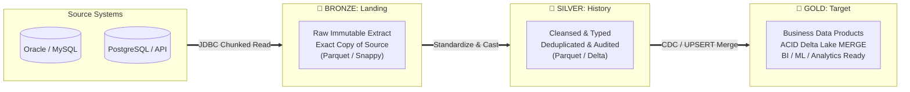

# 🏅 The Medallion Architecture Explained: Business Perspective & Technical Implementation

This document provides an in-depth explanation of the **Three-Layer Data Architecture (Bronze, Silver, Gold)** implemented in our metadata-driven PySpark ETL pipeline. It bridges the gap between **business value** (why we do it this way) and **technical execution** (how our code achieves it).

---

## 1. Executive Summary: Why Three Layers?

In traditional data pipelines, data is often copied directly from a source database into a final reporting table. While this seems simple, it introduces catastrophic risks:
- ❌ **If the source database deletes or corrupts records**, your reporting dashboards instantly break or show wrong numbers with no way to recover.
- ❌ **If business logic changes**, re-calculating historical numbers requires querying the production source database again—slowing down operational systems or failing because the historical data is no longer there.
- ❌ **Data trust is low**, because raw data from transactional databases contains duplicates, formatting errors, and missing fields.

The **Medallion Architecture** solves this by establishing a **progressive data refinement pipeline**:



### 🎯 The Core Business Philosophy
> **"Never lose data, trust every number, and build once for multiple consumers."**

1. **🥉 Bronze (Raw Landing)**: *The Immutable Safety Net & Digital Tape Archive.*
2. **🥈 Silver (History)**: *The Single Source of Truth for Enterprise Data Quality.*
3. **🥇 GOLD (Target)**: *The Certified Business Data Products for Decision Making.*

---

## 2. In-Depth Layer Breakdown

### 🥉 BRONZE LAYER: Raw Landing (`LayerName.BRONZE`)

#### 💼 Business Perspective: The Safety Net
The primary business goal of the Bronze layer is **risk mitigation and historical preservation**. 
- **Zero Data Loss Guarantee**: When we extract data from source operational databases (like ERP, CRM, or transactional billing systems), we capture an exact, immutable snapshot of what the source system looked like on that day.
- **Audit & Compliance**: If financial auditors or regulatory bodies ask, *"What did our customer database look like exactly on March 15th three years ago?"*, the Bronze layer answers instantly without needing backup tapes.
- **Source Shielding**: We extract from production databases **once and only once**. If a data scientist or business analyst wants to test a new calculation, they experiment on the Bronze data without ever putting extra CPU load on live transactional databases.

#### 🛠️ Technical Implementation & Rules
- **Extraction Mechanism**: Our `Extractor` class (`src/extract/extractor.py`) reads from JDBC sources using parallel Spark partition bounds (`upperBound`, `lowerBound`, `numPartitions`).
- **1:1 Exact Mirror**: Zero business transformations, zero filtering, zero data type alterations. What exists in the source is written as-is.
- **Storage Format**: Written as **Snappy-compressed Parquet** files at `/data/landing/{source_tag}/{table}/dt={date}/`.
- **Write Mode**: `overwrite` per date partition. If a pipeline fails midway and reruns, it cleanly overwrites only today's landing partition, ensuring idempotency.

---

### 🥈 SILVER LAYER: History / Cleansed Stage (`LayerName.SILVER`)

#### 💼 Business Perspective: Single Source of Truth
Raw data is notoriously messy. Different source systems format dates differently, text fields contain leading/trailing spaces, and network retries can create duplicate records. The Silver layer is the **enterprise quality filter**.
- **Data Trust**: Business stakeholders cannot make decisions if customer counts or revenue numbers fluctuate due to duplicate rows. Silver eliminates duplicates and enforces enterprise-wide data standards.
- **Data Lineage & Accountability**: Every record in the Silver layer is stamped with audit metadata: *When was this record loaded? Which pipeline run created it? Which raw source file did it come from?* This gives stakeholders 100% traceability when debugging anomalies.
- **Cross-Departmental Reusability**: Unlike final BI reports (which are customized for specific teams), Silver data is standardized across the whole organization. Both the Finance team and the Marketing team can draw from the exact same cleansed customer tables.

#### 🛠️ Technical Implementation & Rules
- **Input Source**: Reads directly from the Bronze landing parquet files.
- **Transformation Pipeline**: Executed via our `Transformer` class (`src/transform/transformer.py`):
  1. **Natural Key Deduplication**: Uses `window` functions (`row_number() over (partition by business_key order by dml_timestamp desc)`) to drop duplicate records and keep the most recent version.
  2. **Schema & Type Casting**: Reads rules from PostgreSQL `metadata.db_columns_etl`. Converts raw database strings into explicit PySpark types (`IntegerType`, `DecimalType(18,2)`, `TimestampType`).
  3. **Audit Injection**: Appends mandatory audit columns (`dml_timestamp`, `pipeline_run_id`, `landing_ingestion_timestamp`).
- **Storage Format**: Stored as clean Parquet or Delta Lake tables at `/data/history/{source_tag}/{table}/`.

---

### 🥇 GOLD LAYER: Target / Business Consumption (`LayerName.GOLD`)

#### 💼 Business Perspective: Certified Data Products
The Gold layer is where data is transformed into high-value **business intelligence and analytics data products**. This is the layer that powers executive dashboards, financial reporting, machine learning models, and customer-facing APIs.
- **High-Performance Querying**: Executive dashboards need to load in milliseconds, not minutes. Gold tables are pre-joined, aggregated, and indexed using Delta Lake so that PowerBI, Tableau, or Spark SQL queries run at lightning speed.
- **Incremental Accuracy (CDC)**: In large enterprise systems, you cannot re-load 100 million rows every night. The Gold layer uses **Change Data Capture (CDC)** to intelligently identify and update *only the records that changed today*.
- **Financial & Operational Certification**: Before data is exposed in the Gold layer, it must pass automated **Reconciliation Checks**. Our pipeline compares source row counts against target row counts. If a discrepancy exceeds the business threshold (e.g., `0.00%` tolerance for billing data), the pipeline halts and alerts the team before executives see incorrect numbers.

#### 🛠️ Technical Implementation & Rules
- **Input Source**: Reads cleansed data from the Silver layer.
- **CDC & Delta Lake UPSERT**: Managed by our `CDCHandler` (`src/cdc/cdc_handler.py`) and written using Delta Lake `MERGE` commands:
  ```sql
  MERGE INTO gold_target t
  USING silver_source s
  ON t.business_key = s.business_key
  WHEN MATCHED AND s.dml_timestamp > t.dml_timestamp THEN UPDATE SET *
  WHEN NOT MATCHED THEN INSERT *
  ```
- **Reconciliation Gatekeeper**: Executed by `Reconciler.reconcile()` (`src/validation/reconciler.py`). Verifies that `abs(source_count - target_count) / source_count <= reconcile_threshold`.
- **Storage Format**: Stored exclusively as **ACID-compliant Delta Lake** tables at `/data/target/{domain}/{table}/`.

---

## 3. Comprehensive Feature Comparison Matrix

| Dimension | 🥉 Bronze Layer (Raw Landing) | 🥈 Silver Layer (History) | 🥇 Gold Layer (Target / Business) |
|---|---|---|---|
| **Primary Business Goal** | Historical preservation, audit trail, source database shielding | Data cleansing, deduplication, enterprise standardization | High-performance BI, executive reporting, ML data products |
| **Data Quality & Trust** | **Raw / Untrusted**<br>(May contain nulls, duplicates, and source errors) | **Cleansed & Trusted**<br>(Deduplicated, schema-enforced, audit-stamped) | **Certified & Reconciled**<br>(Financially reconciled, business-logic validated) |
| **Storage Format** | Snappy-compressed Parquet | Parquet or Delta Lake | ACID Delta Lake (Mandatory) |
| **Update Mechanism** | Immutable date-partitioned write (`mode("overwrite")` per day) | Append / Overwrite cleansed history | Incremental UPSERT (`MERGE ON business_key`) |
| **Transformations** | None (Exact 1:1 mirror of source JDBC table) | Type casting, deduplication, audit column addition | Business logic joins, aggregations, CDC filtering |
| **Target Audience** | Data Engineers, Disaster Recovery Teams, Compliance Auditors | Data Scientists, Data Engineers, Deep-dive Analysts | Executive Leadership, BI Analysts, PowerBI / Tableau, ML Models |
| **Query Performance** | Slow (Scans raw unindexed historical daily folders) | Medium (Scans typed, clean tabular data) | **Ultra-Fast** (Delta indexing, file compaction, z-ordering) |
| **Failure Cost** | **Zero Risk**: Reloading from source takes minutes without breaking downstream | **Low Risk**: Reprocessing from Bronze requires zero source DB load | **High Visibility**: Protected by Reconciler gates to prevent bad data release |

---

## 4. How Our PySpark Codebase Achieves This

Our codebase is engineered so that **you do not write custom code for each layer**. Instead, our orchestrator (`src/orchestrator/etl.py`) dynamically reads instructions from the **PostgreSQL Metadata Control Database** (`metadata.db_tables_etl`).

### ⚙️ Step-by-Step Execution Flow

1. **Metadata Configuration (`db_tables_etl`)**:
   When you register a table in the database, you specify its layer behavior:
   ```sql
   INSERT INTO metadata.db_tables_etl (
       source_tag, source_table, landing_table, history_table, target_table,
       table_type, is_cdc, reconcile_threshold, reconcile_action
   ) VALUES (
       'postgres_source', 'users', 'lnd_users', 'his_users', 'tgt_users',
       'cdc', 'y', 0.00, 'FAIL'
   );
   ```

2. **Phase 1: Bronze Extraction (`load_with_db_link`)**:
   - The orchestrator spawns a Python `ThreadPoolExecutor` worker pool (`max_workers=5`).
   - `Extractor.extract_table()` connects via JDBC using credentials from `databases.ini` (managed by `ConnectionManager`).
   - Data is streamed into Spark and written immediately to `/data/landing/postgres_source/users/dt=YYYY-MM-DD/` as raw Parquet.

3. **Phase 2: Silver Cleansing (`load_historyData`)**:
   - `Transformer.add_source_identification_key()` attaches unique lineage IDs.
   - `Transformer.deduplicate()` strips out any identical rows using `columns_unique_key`.
   - `ColumnMapper.get_mappings()` queries `db_columns_etl` and casts columns to their target types.
   - The clean DataFrame is written to `/data/history/postgres_source/users/`.

4. **Phase 3: Gold CDC & Reconciliation (`refresh_tables_cdc_12AM`)**:
   - `CDCHandler` checks `last_success_timestamp` in the metadata database and extracts only records modified since the last run.
   - The data is merged into the Gold Delta Lake table using `Loader.write_delta_merge()`.
   - `Reconciler.reconcile()` counts rows in the source and rows in the Delta table. If they match within `reconcile_threshold`, the run is logged as `SUCCESS` in `metadata.batch_log`.

---

## 5. Business ROI & Summary

By implementing this Three-Layer Medallion Architecture in PySpark, our engineering team delivers three tangible business returns:

1. **🛡️ 100% Disaster Recovery**: If our data warehouse is ever completely destroyed, we can reconstruct the entire Silver and Gold analytical layers from scratch using our immutable Bronze Parquet archives—without ever touching or burdening production operational databases.
2. **📈 Exponential Dashboard Speed**: By unloading heavy joins and aggregations into the Gold Delta Lake layer, business dashboards load instantly, increasing executive adoption and data-driven decision velocity.
3. **🔍 Total Audit Transparency**: With built-in reconciliation gates and automated lineage timestamps (`landing_ingestion_timestamp`, `pipeline_run_id`), every single metric presented to the board of directors can be traced back to its exact transactional origin with mathematical certainty.
