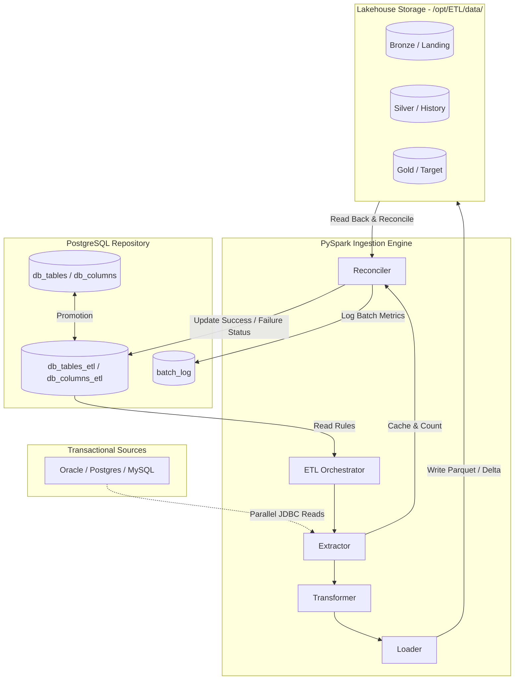

# HiveFlow Platform: Operations & User Manual

This manual provides comprehensive instructions and architectural references for operating, maintaining, and monitoring the Generic Metadata-Driven PySpark ETL Pipeline. This system leverages PostgreSQL metadata to orchestrate distributed data extraction, transformation, loading, Change Data Capture (CDC), and data reconciliation.

---

## 1. Introduction

### 1.1 Purpose of the Pipeline
The Generic Metadata-Driven PySpark ETL Pipeline extracts data from various source databases (PostgreSQL, MySQL, Oracle, SQL Server), applies transformations, and lands it in a highly structured, query-ready format. It supports high-throughput batch extraction and low-latency incremental landing, scaling horizontally to meet enterprise-grade data volumes.

### 1.2 Core Philosophy (Metadata-Driven)
The pipeline is designed with a **zero-code operational model**. All behaviors—such as which tables to extract, column mappings, datatypes, priorities, scheduling rules, Change Data Capture (CDC) watermarks, and reconciliation thresholds—are defined as configuration facts in a central PostgreSQL metadata repository. 

To onboard a new source table or update type-casting rules, you perform a database `INSERT` or `UPDATE` query in the metadata catalog. The code itself remains static, eliminating compilation, deployment, and testing cycles for new schemas.

### 1.3 Key Features
- **Zero-Code Onboarding**: Register new tables and column transformation rules using SQL only.
- **Master-Subscriber Architecture**: Separates automated source system catalog discovery from manual subscriber execution controls.
- **Automatic Reconciliation**: Performs source-to-target row count validation and applies configurable thresholds to raise alarms or block downstream flows.
- **Idempotency & Rerun Isolation**: Skips successful runs to prevent duplicate daily ingestion, while locking failed tables to block automated retries until an engineer reviews.
- **ConcurrentUser Execution**: Implements table-level parallel execution within priority tiers using thread pools.
- **Selective Overrides**: Supports ad-hoc forced runs for single tables using command-line arguments or Python functions, bypassing idempotency checks.
- **Medallion Standard Ingestion**: Ingests data through distinct Bronze, Silver, and Gold quality layers.

### 1.4 System Requirements
- **Apache Spark**: Spark 3.4+ configured in Connect Mode or local execution mode.
- **Python**: Python 3.9+ with packages `pyspark`, `psycopg2-binary`, and `pyyaml`.
- **PostgreSQL**: PostgreSQL 12+ hosting the configuration catalog.
- **Shared Ingestion Volume**: A distributed or local shared directory path (e.g., `/opt/ETL/data/`) visible to all Spark executors.
- **JDBC Drivers**: Appropriate JDBC drivers for each source database type (PostgreSQL, Oracle, MySQL, SQL Server) must be available in the Spark classpath (typically in `$SPARK_HOME/jars/` or provided via `--jars` in `spark-submit`).

---

## 2. Architecture Overview

### 2.1 High-Level Architecture Diagram

The diagram below represents the movement of data and metadata coordination.



### 2.2 The Three-Layer Data Architecture

> [!WARNING]
> **Current Deployment Status (Phase 1)**:
> 
> The pipeline architecture fully supports all three layers (Bronze, Silver, Gold). However, the current **Phase 1** deployment executes only the **Bronze (Landing)** layer. Silver and Gold are fully coded, tested, and ready, but are disabled via entry-point scripts (`run_source.py`, `run_generic.py`). They can be enabled by uncommenting the corresponding method calls. This phased approach validates the extraction layer before adding transformation complexity.

Data progresses through three physical layers:

| Layer | Alias | Path | Format | Characteristics | Write Mode |
|---|---|---|---|---|---|
| Bronze | Landing | `/data/landing/{source_tag}/{table}/dt={date}/` | Parquet (Snappy) | Raw extract. No transformations. Exact copy of source. Safety net. | Overwrite (idempotent per date partition) |
| Silver | History | `/data/history/{source_tag}/{table}/` | Delta Lake (Parquet fallback) | Deduplicated, type-cast, audit-enriched records. | Append (partition by source_tag) |
| Gold | Target | `/data/target/{domain}/{table}/` | Delta Lake (Parquet fallback) | Consumer-ready, business-aggregate tables. CDC MERGE upserts. | UPSERT (Delta MERGE) |

> [!IMPORTANT]
> Bronze uses **OVERWRITE** mode, not append. Each date partition (`dt=YYYY-MM-DD/`) is deleted and re-created on every run for that day. This guarantees idempotency — re-running the pipeline on the same day produces the exact same data without duplicates. Historical partitions are never modified.

### 2.3 The Master-Subscriber Metadata Pattern
The database is structured as a two-tier metadata registry:
- **Master Catalog (`db_tables`, `db_columns`)**: Represents source system reality. An automated schema crawler runs nightly to discover new databases, schemas, tables, and column attributes, logging them in the read-only Master Catalog.
- **Subscriber Control (`db_tables_etl`, `db_columns_etl`)**: Holds the active configurations of the ETL engine. Data engineering promotes a table from the Master Catalog to Subscriber Control to activate landing, specify type castings, set target schemas, and define reconciliation thresholds.

---

## 3. Metadata Database Guide

### 3.1 `metadata.db_tables` (Master Catalog - Source Reality)
Contains one row for every table discovered in the source systems. Managed automatically.

| Column | Type | Description |
|---|---|---|
| `table_master_key` | `SERIAL (PK)` | Auto-incrementing identifier. |
| `database_tag` | `VARCHAR(100)` | Section name matching `databases.ini` configuration. |
| `database_type` | `VARCHAR(50)` | Source database family (`postgres`, `oracle`, `mssql`, `mysql`). |
| `schema_name` | `VARCHAR(200)` | Physical schema name in the source system. |
| `table_name` | `VARCHAR(200)` | Physical table name in the source system. |
| `table_type` | `VARCHAR(50)` | Type identifier (`BASE TABLE` or `VIEW`). |
| `cdc_columns` | `VARCHAR(500)` | Auto-detected modification indicator columns (e.g., `updated_at`). |
| `business_key` | `VARCHAR(200)` | Auto-detected unique natural keys. |
| `table_row_count` | `BIGINT` | Total row count detected at crawler scan. Used for query tuning. |
| `insert_date` | `TIMESTAMP` | Record creation timestamp. |

### 3.2 `metadata.db_columns` (Master Catalog - Column Catalog)
Contains one row for every column discovered by the schema crawler.

| Column | Type | Description |
|---|---|---|
| `column_master_key` | `SERIAL (PK)` | Auto-incrementing identifier. |
| `table_master_key` | `INTEGER (FK)` | Reference to `metadata.db_tables`. |
| `database_tag` | `VARCHAR(100)` | Section name in `databases.ini`. |
| `schema_name` | `VARCHAR(200)` | Source schema name. |
| `table_name` | `VARCHAR(200)` | Source table name. |
| `column_name` | `VARCHAR(200)` | Physical column name. |
| `data_type` | `VARCHAR(100)` | Raw datatype from the source database (e.g., `VARCHAR2`, `NUMBER`). |
| `data_length` | `INTEGER` | Column character maximum length. |
| `data_precision` | `INTEGER` | Numeric precision index. |
| `data_scale` | `INTEGER` | Numeric scale index. |
| `column_seq` | `INTEGER` | Ordinal position of the column in the source table. |
| `is_nullable` | `VARCHAR(1)` | Nullability indicator (`Y` or `N`). |

### 3.3 `metadata.db_tables_etl` (Subscriber Control - Ingestion Rules)
Defines target destinations, frequencies, and reconciliation parameters. Managed by operators.

| Column | Type | Description |
|---|---|---|
| `table_id` | `SERIAL (PK)` | Primary execution key. |
| `source_tag` | `VARCHAR(100)` | Configured database section in `databases.ini`. |
| `source_schema` | `VARCHAR(200)` | Source schema to extract from. |
| `source_table` | `VARCHAR(200)` | Table to extract. |
| `cdc_columns` | `VARCHAR(500)` | Inherited CDC columns. Controls watermark extraction. |
| `columns_unique_key` | `VARCHAR(200)` | Unique constraint column used for parallel JDBC reads. |
| `target_schema` | `VARCHAR(200)` | Target folder namespace schema. |
| `target_table` | `VARCHAR(200)` | Target output folder name. |
| `landing_table` | `VARCHAR(200)` | Bronze storage subdirectory name. |
| `history_table` | `VARCHAR(200)` | Silver storage subdirectory name. |
| `table_type` | `VARCHAR(50)` | Core load strategy (`full`, `incremental`, or `cdc`). |
| `priority` | `INTEGER` | Processing order tier (`1`=High, `2`=Medium, `3`=Low). |
| `is_active` | `CHAR(1)` | State flag (`y` = runs, `n` = ignored). |
| `is_cdc` | `CHAR(1)` | Incremental loading indicator (`y` or `n`). |
| `cdc_p_days` | `INTEGER` | CDC lookup lookback buffer (default: `7` days). |
| `delta_days` | `INTEGER` | Run frequency schedule constraint (default: `1` day). |
| `last_success_timestamp` | `TIMESTAMP` | The highest CDC watermark successfully recorded. |
| `is_reconcile` | `CHAR(1)` | Enable row count validation (`y` or `n`). |
| `check_reconcile_column` | `VARCHAR(200)` | Optional column to validate for specific metrics. |
| `reconcile_measure` | `VARCHAR(100)` | Target metric type (default: `count`). |
| `reconcile_threshold` | `NUMERIC(5,2)` | Allowed percentage discrepancy (e.g. `0.05` for 0.05% mismatch). |
| `reconcile_action` | `VARCHAR(20)` | Action on threshold breach (`FAIL` or `WARN`). |
| `rerun_flag` | `CHAR(1)` | Manual run bypass flag (`y` forces run, `n` runs daily). |
| `last_success_date` | `DATE` | Calendar date of the last successful landing run. |
| `discovered_at` | `TIMESTAMP` | Timestamp when this table was first discovered by the crawler. |
| `discovered_by` | `VARCHAR(100)` | The crawler or system identifier that registered the table. |
| `last_seen_at` | `TIMESTAMP` | Timestamp when this table was last verified as existing in the source. |
| `notes` | `TEXT` | Operator comments. |

### 3.4 `metadata.db_columns_etl` (Subscriber Control - Column Mapping)
Defines mapping configurations and casting rules for subscriber schemas.

| Column | Type | Description |
|---|---|---|
| `column_id` | `SERIAL (PK)` | Unique column identifier. |
| `table_id` | `INTEGER (FK)` | Reference to `metadata.db_tables_etl`. |
| `source_table` | `VARCHAR(200)` | Target source table name. |
| `source_column` | `VARCHAR(200)` | Column name in the source system. |
| `source_column_datatype` | `VARCHAR(100)` | Raw source database datatype. |
| `target_column` | `VARCHAR(200)` | Cleaned name mapped for target outputs (e.g., lower snake_case). |
| `target_column_datatype` | `VARCHAR(100)` | Target Spark casting type (e.g., `StringType`, `IntegerType`, `DecimalType(18,2)`). |
| `is_active` | `CHAR(1)` | Column activation flag (`y` = keep column, `n` = drop column). |
| `column_sequence` | `INTEGER` | Ordinal sorting index for the target schema. If left NULL, columns are ordered by `column_id` at runtime (the order they were inserted into the table). |
| `discovered_at` | `TIMESTAMP` | Timestamp when this column was first discovered by the crawler. |
| `discovered_by` | `VARCHAR(100)` | The crawler or system identifier that registered the column. |
| `last_seen_at` | `TIMESTAMP` | Timestamp when this column was last verified as existing in the source. |

### 3.5 `metadata.batch_log` (Audit Trail)
Tracks runtime metrics, discrepancies, status tags, and error traces.

| Column | Type | Description |
|---|---|---|
| `id` | `BIGSERIAL (PK)` | Chronological audit identifier. |
| `run_id` | `UUID` | Universally unique run identifier shared by all tables in a single run. |
| `source_tag` | `VARCHAR(100)` | Ingested source config identifier. |
| `source_table` | `VARCHAR(200)` | Table processed. |
| `target_table` | `VARCHAR(200)` | Resulting output table. |
| `load_type` | `VARCHAR(50)` | Processed quality layer (`bronze`, `silver`, or `gold`). |
| `priority` | `INTEGER` | Table processing priority. |
| `source_count` | `BIGINT` | Number of rows extracted from the source database. |
| `target_count` | `BIGINT` | Number of rows validated on target disk. |
| `gap` | `BIGINT` | Discrepancy metric (`source_count - target_count`). Generated dynamically by database. |
| `load_pct` | `NUMERIC(6,2)` | Percent landed (`target_count / source_count * 100`). Clamped to `999.99` maximum. |
| `start_time` | `TIMESTAMP` | Table processing start. |
| `end_time` | `TIMESTAMP` | Table processing completion. |
| `elapsed_seconds` | `NUMERIC(10,2)`| Execution duration. |
| `status` | `VARCHAR(50)` | Output tag (`SUCCESS`, `FAILED`, `SKIPPED`, `RECONCILIATION_FAILED`, `RECONCILIATION_WARNING`). |
| `error_message` | `TEXT` | Raw error trace logged on exceptions. |
| `spark_app_id` | `VARCHAR(200)` | Active Spark applicationId (useful for UI tracking). |
| `notes` | `TEXT` | Run-time contextual notes. |

### 3.6 How to Promote a New Table
To promote a newly discovered source table to active subscriber ingestion control:
1. Locate the source schema metrics in the Master Catalog (`metadata.db_tables` and `metadata.db_columns`).
2. Run an onboarding promote query (or script) that moves the structural definition into `metadata.db_tables_etl`.
3. Populate `metadata.db_columns_etl` with the columns you want to extract, setting their `target_column_datatype` to the desired target types (e.g., `IntegerType`, `TimestampType`).
4. Set execution parameters: assign a `priority` level (1, 2, or 3), enable validation by setting `is_reconcile = 'y'`, define a `reconcile_threshold` (e.g., `0.00` for exact matches), and set `is_active = 'y'`.

### 3.7 Quick Start: Onboarding a New Table

**Step 1**: Verify the table exists in the Master Catalog (`db_tables`).

```sql
SELECT * FROM metadata.db_tables
WHERE database_tag = 'source_mysql' AND table_name = 'inventory';
```

**Step 2**: Promote the table from Master to Control (`db_tables_etl`).

```sql
INSERT INTO metadata.db_tables_etl (
    source_tag, source_schema, source_table,
    cdc_columns, columns_unique_key,
    target_schema, priority, is_active, is_cdc
)
SELECT
    database_tag, schema_name, table_name,
    cdc_columns, business_key,
    'land' AS target_schema,
    2 AS priority,
    'y' AS is_active,
    CASE WHEN cdc_columns IS NOT NULL THEN 'y' ELSE 'n' END AS is_cdc
FROM metadata.db_tables
WHERE database_tag = 'source_mysql' AND table_name = 'inventory';
```

**Step 3**: Insert column mappings into `db_columns_etl`.

```sql
INSERT INTO metadata.db_columns_etl (
    table_id, source_table, source_column,
    target_column, target_column_datatype,
    column_sequence
)
SELECT
    etl.table_id,
    c.table_name,
    c.column_name,
    c.column_name AS target_column,
    CASE
        WHEN c.data_type IN ('VARCHAR', 'VARCHAR2', 'CHAR', 'TEXT') THEN 'StringType'
        WHEN c.data_type IN ('INT', 'INTEGER', 'BIGINT') THEN 'IntegerType'
        WHEN c.data_type IN ('NUMBER', 'DECIMAL') THEN 'DecimalType(18,2)'
        WHEN c.data_type IN ('DATE', 'TIMESTAMP') THEN 'TimestampType'
        ELSE 'StringType'
    END AS target_column_datatype,
    c.column_seq AS column_sequence
FROM metadata.db_columns c
JOIN metadata.db_tables_etl etl
    ON c.table_name = etl.source_table
   AND c.database_tag = etl.source_tag
WHERE c.table_name = 'inventory' AND c.database_tag = 'source_mysql';
```

**Step 4**: Run the pipeline to land the table.

```bash
python jobs/run_source.py source_mysql --config config/config.yaml
```

**Step 5**: Verify the run in `batch_log`.

```sql
SELECT source_table, status, source_count, target_count, load_pct
FROM metadata.batch_log
WHERE source_table = 'inventory'
ORDER BY start_time DESC LIMIT 1;
```

---

### 3.8 Pluggable Recommendation & Governance Engine (`table_recommendations` & `RecommendationService`)

The pipeline decouples observation (discovery) from execution (promotion) via `metadata.table_recommendations` and the centralized `RecommendationService`:
- **Discovery is Observation Only**: When `discover_schema.py` runs, it records candidate strategies (`TIMESTAMP`, `ID_RANGE`, `FULL`) along with confidence ratings (`HIGH`/`MEDIUM`/`LOW`) and reasons (`["TIMESTAMP datatype", "Indexed", "NOT NULL"]`). It does not mutate or deactivate existing active policies (`is_active_version = TRUE`).
- **Data Steward Review**: The GUI Operations Console (`03_Table_Details.py`) enables Data Stewards to review candidate recommendations (`PENDING`), check reasons/risk breakdown, and either **Approve** or **Override** with custom strategies and audit notes (`steward_notes`).
- **Stupid & Deterministic Promotion**: The promotion utility (`promote_table.py`) consumes a clean `RecommendationResult` (`allowed`, `cdc_column`, `cdc_type`, `strategy`, `reason`) from `RecommendationService.get_effective_recommendation(table_id)`. If `res.allowed == True`, it promotes cleanly into `db_tables_etl`. If unapproved (`res.allowed == False`), promotion is blocked with `[GOVERNANCE REJECTED]` unless `--allow-unapproved` is passed.

---

## 4. Module Reference

### 4.1 `ConnectionManager` (`src/connections/connection_manager.py`)
- **Objective**: Manages connection metrics defined in `databases.ini`. It does not persist open sessions; instead, it parses dynamic settings, resolves system variables, and supplies authentication metrics for Spark JDBC drivers.
- **Goal**: Centralize credential management and JDBC URL construction. The pipeline should never hardcode connection strings. If a database password rotates, only one file (`databases.ini`) needs updating — no code changes. This module also normalizes database types (PostgreSQL, Oracle, MySQL, SQL Server) and builds the correct JDBC URL format for each, abstracting away database-specific syntax from the rest of the pipeline.
- **Key Methods**:
  - `ConnectionManager(config_path)`: Constructor loading core YAML and INI database properties.
  - `get(source_tag)`: Returns a connection config containing JDBC URL, credentials, and driver settings.
  - `metadata_db_config`: Property returning connection dictionary parameters for the PostgreSQL repository database.

---

### 4.2 `SparkSessionFactory` (`src/spark_session.py`)
- **Objective**: Create and configure SparkSession instances, supporting both standard cluster mode and Spark Connect (thin client) mode.
- **Goal**: Abstract away Spark session creation logic. The pipeline can run in production (standard cluster) or local development (Spark Connect) without code changes — the factory reads `APP_ENV` and `SPARK_CONNECT_URL` from the environment to determine the correct mode. This eliminates the need for developers to install Spark locally; they simply connect to the remote cluster via gRPC.
- **Public Interface**:
  - `get_session(config) -> SparkSession`: Builds and returns a SparkSession configured with the provided Spark settings.
- **Behavior**:
  - If `APP_ENV=local` and `SPARK_CONNECT_URL` is set → uses Spark Connect (`builder.remote(...)`).
  - If `APP_ENV=local` and no `SPARK_CONNECT_URL` → uses `local[*]` mode (standalone JVM).
  - If `APP_ENV=production` → uses the `master` URL from `config.yaml` with executor/driver memory settings.
  - On Windows (`os.name == 'nt'`), automatically configures `SPARK_LOCAL_IP=127.0.0.1`, `PYSPARK_PYTHON`, `PYSPARK_DRIVER_PYTHON`, and validates `JAVA_HOME` to prevent common local execution failures.

---

### 4.3 `MetadataReader` (`src/metadata/metadata_reader.py`)
- **Objective**: Communicates with the PostgreSQL repository database to select active ingestion tables, track CDC watermarks, apply daily skip logic, and record execution outcomes.
- **Goal**: Enforce idempotency (skip logic) and provide filtered lists of tables based on priority, source tag, and optional table override. This module ensures the pipeline only processes tables that are due for a run today (or manually forced), preventing duplicate daily loads. It also manages the CDC watermark lifecycle — updating timestamps on success and locking tables on failure.
- **Key Methods**:
  - `get_tables(source_tag, priority, table_name, load_type)`: Fetches active subscriber metadata rows. Automatically applies daily skip filters unless overridden by a specific `table_name`.
  - `get_cdc_tables(source_tag, table_name)`: Returns active CDC-enabled metadata configurations.
  - `update_table_success(table_id)`: Sets `last_success_date = CURRENT_DATE` and `rerun_flag = 'n'`.
  - `update_table_failure(table_id)`: Locks a failed table by setting `last_success_date = CURRENT_DATE` and `rerun_flag = 'n'`.
  - `update_watermark(table_id, timestamp)`: Updates `last_success_timestamp` after a successful CDC run.

**Skip Logic in Detail**:

The `MetadataReader` applies an automatic skip filter to all tables returned by `get_tables()` and `get_cdc_tables()`:

- If `rerun_flag = 'y'`, the table is **always selected** (manual override).
- If `last_success_date = CURRENT_DATE` and `rerun_flag = 'n'`, the table is **skipped** (already successful today).
- If `last_success_date < CURRENT_DATE` or `NULL`, the table is **selected** (due for a fresh run).

**Failure Locking**:

When a table fails (reconciliation mismatch or exception), `update_table_failure()` sets `last_success_date = CURRENT_DATE` and `rerun_flag = 'n'`.

This **locks** the table — it will be skipped on all subsequent runs today until an operator manually sets `rerun_flag = 'y'`.

To force a rerun:
```sql
UPDATE metadata.db_tables_etl SET rerun_flag = 'y' WHERE source_table = 'problem_table';
```
The next pipeline run forces the table and resets the flag upon success.

---

### 4.4 `Extractor` (`src/extract/extractor.py`)
- **Objective**: Coordinates parallel extraction from source databases via Spark JDBC.
- **Goal**: Maximize extraction performance through parallel JDBC reads. By using Spark's JDBC partitioning capabilities, this module distributes large table reads across multiple Spark executors, replacing the old single-threaded chunking approach. It also pushes CDC filters down to the source database via SQL subqueries, minimizing network transfer.
- **Tuning Behavior**:
  - Automatically calculates Spark partition bounds by running a boundary check query:
    `SELECT MIN(partition_column), MAX(partition_column) FROM source_table`
  - Tunes JDBC connection fetch size based on the table's row count (derived from `metadata.db_tables.table_row_count`, clamped to a `500,000` row maximum) to optimize execution memory.
- **Key Methods**:
  - `read(metadata_row, cdc_filter)`: Returns a distributed Spark DataFrame representing the source dataset.
  - `count_source(metadata_row)`: Executes a direct count query on the source system database.

---

### 4.5 `Transformer` (`src/transform/transformer.py`)
- **Objective**: Applies standard cleansing, deduping, and column transformations in a strict, sequential order.
- **Goal**: Enforce a strict, repeatable transformation pipeline that guarantees data quality. The five-step order is critical — deduplication and key generation must happen BEFORE column renaming, otherwise column references break. This module ensures every row has lineage (`source_identification_key`), audit timestamps, and correct datatypes without manual intervention.
- **The Critical 5-Step Order**:
  1. **Generate Keys**: Add `source_identification_key` by concatenating the source tag prefix with the natural key value.
  2. **Deduplicate**: Partition by natural keys, ordering by `dml_timestamp DESC` (or source system updates) to retain only the latest record.
  3. **Appends Audit Columns**: Enriches rows with `dml_timestamp`, `dml_status`, `source_tag`, `pipeline_run_id`, and `landing_ingestion_timestamp`.
  4. **Casts Datatypes**: Evaluates mapping rules in `metadata.db_columns_etl` and casts target columns.
  5. **Selects Mapped Columns**: Drops unmapped and inactive columns, retaining only mapped columns and audit attributes.

---

### 4.6 `ColumnMapper` (`src/transform/column_mapper.py`)
- **Objective**: Query `metadata.db_columns_etl` and return a list of column mapping dictionaries for a given source table.
- **Goal**: Decouple column mapping rules from the transformation logic. The `Transformer` reads mapping dictionaries from this module — if a column name changes in the source, only the metadata table needs updating, not the Python code. This enables zero-code column renaming, type casting, and column ordering adjustments.
- **Public Interface**:
  - `get_mappings(source_table) -> List[Dict]`: Returns a list of mappings, each containing:
    - `source_column`: Original column name in the source.
    - `target_column`: Renamed column for the target (or `None` to keep original).
    - `data_type`: Spark target type (e.g., `StringType`, `IntegerType`, `DecimalType(18,2)`).
    - `default_value`: Default value for NULLs (optional).
- **Behavior**:
  - If a table has no column mappings, returns an empty list.
  - Columns are ordered by `column_sequence` (fallback to `column_id`).
  - Only columns with `is_active = 'y'` are returned.

---

### 4.7 `Loader` (`src/load/loader.py`)
- **Objective**: Writes processed datasets to the target file systems.
- **Goal**: Provide idempotent, audited writes with graceful fallback mechanisms. Bronze writes are idempotent (overwrite per date partition). Silver and Gold attempt Delta Lake (ACID, UPSERT) but automatically fall back to Parquet if Delta is unavailable, ensuring the pipeline never fails due to missing libraries.
- **Key Methods**:
  - `write_landing(df, metadata_row, date_partition)`: Overwrites data to the Bronze layer in raw Parquet format, returning the final output path.
  - `write_history(df, metadata_row)`: Appends data to the Silver history layer in Delta format (with automatic Parquet folder partition fallback).
  - `write_target_delta(df, metadata_row, merge_key)`: Merges incremental modifications into Gold target directories using Delta Lake UPSERT (MERGE) execution statements.

---

### 4.8 `CDCHandler` (`src/cdc/cdc_handler.py`)
- **Objective**: Builds extraction query predicates using watermarks and lookback thresholds.
- **Goal**: Enable efficient incremental loading by tracking watermarks. This module ensures that only rows changed since the last successful run are extracted, drastically reducing source database load and pipeline runtime. The 7-day lookback buffer prevents data loss from late-arriving records or clock skew.
- **Key Methods**:
  - `build_cdc_filter(metadata_row)`: Resolves lookup filters using `last_success_timestamp` and lookback window offsets. Returns `None` to trigger a full load if no watermark is found.
  - `is_due(metadata_row)`: Assesses if the time elapsed since the last watermark check exceeds the defined `delta_days` parameter.

---

### 4.9 `Reconciler` (`src/validation/reconciler.py`)
- **Objective**: Caches Spark DataFrames, reads back landed files, and validates row counts against allowed thresholds.
- **Goal**: Prevent silent data loss by enforcing row-count validation. By caching DataFrames (avoiding double source scans) and reading back from disk after writes, this module guarantees that the data physically landed on disk exactly as extracted. Configurable thresholds allow flexibility for CDC drift while maintaining strict quality gates for critical tables.
- **Key Methods**:
  - `count_and_cache(df)`: Caches Spark DataFrames and returns the row count. This ensures the source database is read only once.
  - `count_parquet(spark, path)`: Reads back written Parquet files from disk to count the landed records.
  - `count_delta(spark, path)`: Reads back written Delta tables from disk and counts rows.
  - `reconcile(source_count, target_count, layer, metadata_row)`: Performs validation:
    - Calculates discrepancy: `abs(target_count - source_count) / source_count * 100`
    - Evaluates threshold bounds. Breaches trigger `WARN` alerts (log warnings, save warning status) or `FAIL` exceptions (raise runtime errors, abort current table processing, write failure flags).

---

### 4.10 `BatchLogger` (`src/logging_/batch_logger.py`)
- **Objective**: Writes execution outcomes, durations, and row count metrics to the PostgreSQL audit log (`metadata.batch_log`).
- **Goal**: Provide a complete, queryable audit trail for all pipeline runs. Every table processed, every run, every success, failure, and skip is recorded in `metadata.batch_log`. This enables operators to monitor pipeline health, debug failures, and prove data lineage to auditors without accessing Spark logs.
- **Key Methods**:
  - `log(...)`: Records operational metrics. Handles database insertions defensively, converting numpy or PySpark datatypes to native Python types and clamping `load_pct` to `999.99` to prevent database numeric overflows.

---

### 4.11 `ETL` Orchestrator (`src/orchestrator/etl.py`)
- **Objective**: The central coordinator that executes quality layer flows.
- **Goal**: Coordinate all components into a coherent, scalable execution engine. This module manages table-level concurrency via `ThreadPoolExecutor` (up to 5 tables simultaneously), isolates failures so one table doesn't stop others, and ensures every run is logged. It provides three public methods that mirror the legacy pipeline's method names (`load_with_db_link`, `load_historyData`, `refresh_tables_cdc_12AM`) for seamless transition.
- **Concurrency Model**: The orchestrator uses Python's `ThreadPoolExecutor` with `max_parallel_tables=5` (configurable in `config.yaml`). This allows up to 5 tables to be processed simultaneously within a single Spark session. Each table gets its own thread, and each thread submits Spark jobs to the cluster in parallel. This table-level concurrency is distinct from Spark's row-level parallelism (JDBC partitioning) — the two layers work together to maximize throughput.
- **Layer Methods**:
  - `load_with_db_link(priority, source_tag, table_name)`: Performs raw Bronze landing reads, writes Parquet files, validates landing counts, and logs results.
  - `load_historyData(priority, source_tag, table_name)`: Performs Silver history processing, mapping column casts, deduplicating, writing Delta/Parquet files, and validating historical counts.
  - `refresh_tables_cdc_12AM(source_tag, table_name)`: Performs Gold target incremental uploads, evaluating watermarks, running Delta Lake merge updates, and updating watermark timestamps.

---

## 5. Operational Guide

### 5.1 Running the Pipeline

All pipeline operations are executed through the unified **`jobs/app_etl.py`** CLI runner. It exposes five named actions (tags) that map directly to the underlying ETL orchestrator methods.

**Full pipeline — Bronze + Silver + Gold (recommended):**
```bash
# Run all three Medallion layers for priority 1 tables
python jobs/app_etl.py --source_tag source_mysql --action load_prioritywise --priority 1 --config config/config.yaml

# Run all priority tiers in sequence
python jobs/app_etl.py --source_tag source_mysql --action load_prioritywise --priority 1 --config config/config.yaml
python jobs/app_etl.py --source_tag source_mysql --action load_prioritywise --priority 2 --config config/config.yaml
python jobs/app_etl.py --source_tag source_mysql --action load_prioritywise --priority 3 --config config/config.yaml
```

**Bronze (Landing) only:**
```bash
python jobs/app_etl.py --source_tag source_mysql --action load_historyData --priority 1 --config config/config.yaml
```

**Silver (History) only:**
```bash
python jobs/app_etl.py --source_tag source_mysql --action load_historyData --priority 1 --config config/config.yaml
```

**Gold (CDC incremental) only:**
```bash
python jobs/app_etl.py --source_tag source_mysql --action refresh_tables_cdc_12AM --config config/config.yaml
```

> [!NOTE]
> **Legacy Entry Points**: `jobs/run_source.py` and `jobs/run_generic.py` still work but execute **Bronze only**. They are preserved for backwards compatibility. For all new workflows, use `app_etl.py` which supports all three Medallion layers and the full action set.

### 5.2 Selective Execution: Running a Single Table

To extract a single table (bypasses daily idempotency checks automatically), pass `--table`:

```bash
# Targeted single-table run (all 3 layers)
python jobs/app_etl.py --source_tag source_mysql --action load_prioritywise --priority 1 --table customers --config config/config.yaml

# Bronze only for a single table
python jobs/app_etl.py --source_tag source_mysql --action load_historyData --priority 1 --table customers --config config/config.yaml
```

To limit to a specific priority level:
```bash
python jobs/app_etl.py --source_tag source_mysql --action load_prioritywise --priority 1 --config config/config.yaml
```

### 5.3 Python API: Using `load_landing()` in Notebooks
You can import the landing pipeline entry point directly in Databricks notebooks, Jupyter environments, or Python scripts:

```python
from jobs.run_landing import load_landing

# Ingest all active tables for source_mysql
load_landing(source_tag="source_mysql", config_path="config/config.yaml")

# Ingest only the customers table, bypassing idempotency checks
load_landing(
    source_tag="source_mysql",
    table_name="customers",
    config_path="config/config.local.yaml"
)
```

> [!NOTE]
> `jobs/run_landing.py` is designed to be imported as a module. It can also be executed directly, but it will print a usage message rather than running the pipeline (use `run_source.py` for CLI execution).

### 5.4 Idempotency & Rerun Control
To prevent duplicate data extraction and redundant source queries, the pipeline checks execution states daily:
- **Skip Rules**: On startup, `MetadataReader` filters out tables that have already run successfully today (`last_success_date = CURRENT_DATE` and `rerun_flag = 'n'`).
- **Failure Lockout**: If a table run fails (due to connection timeouts, database exceptions, or row-count reconciliation breaches), the orchestrator sets `last_success_date = CURRENT_DATE` and `rerun_flag = 'n'`. This locks the table for the rest of the day, preventing automated schedulers from repeatedly hitting the source database until an engineer resolves the underlying issue.

### 5.5 Forcing a Table to Rerun

Use the `fix` action — no Spark required, instant response:

```bash
# Force a table to re-run at next execution
python jobs/app_etl.py --source_tag source_mysql --action fix --table customers --operation rerun
```

Or via SQL directly:
```sql
UPDATE metadata.db_tables_etl
   SET rerun_flag = 'y'
 WHERE source_tag = 'source_mysql'
   AND source_table = 'customers';
```

### 5.6 Reconciliation and Thresholds
Reconciliation parameters are configured in the metadata registry for each table:

- **Configure Strict Matching (Exact Match required)**:
  ```sql
  UPDATE metadata.db_tables_etl
     SET is_reconcile = 'y',
         reconcile_threshold = 0.00,
         reconcile_action = 'FAIL'
   WHERE source_table = 'financial_ledgers';
  ```
  If the target row count does not match the source count exactly, the pipeline aborts the run, registers a `RECONCILIATION_FAILED` status, and locks execution.

- **Configure Lenient Matching (Allow up to 1.5% discrepancy)**:
  ```sql
  UPDATE metadata.db_tables_etl
     SET is_reconcile = 'y',
         reconcile_threshold = 1.50,
         reconcile_action = 'WARN'
   WHERE source_table = 'user_activity_logs';
  ```
  If a row count mismatch occurs but is within the 1.5% limit, the run succeeds. If it exceeds 1.5%, a warning is printed, the status is logged as `RECONCILIATION_WARNING`, and the pipeline proceeds.

---

## 6. Monitoring & Troubleshooting

### 6.1 Querying `batch_log` for Run Status
Monitor run status, execution duration, and data volume anomalies using SQL:

- **Show recent runs, discrepancies, and load metrics**:
  ```sql
  SELECT source_table, 
         load_type, 
         source_count, 
         target_count, 
         gap, 
         load_pct, 
         status, 
         elapsed_seconds,
         error_message
    FROM metadata.batch_log
   ORDER BY id DESC
   LIMIT 20;
  ```

- **Query failed runs**:
  ```sql
  SELECT source_table, load_type, end_time, error_message
    FROM metadata.batch_log
   WHERE status IN ('FAILED', 'RECONCILIATION_FAILED')
   ORDER BY id DESC;
  ```

### 6.2 Checking Which Tables Will Run Next
Verify which tables are scheduled to ingest during the next pipeline execution:

```sql
SELECT source_table, priority, table_type, last_success_date, rerun_flag
  FROM metadata.db_tables_etl
 WHERE is_active = 'y'
   AND LOWER(source_tag) = 'source_mysql'
   AND (
       rerun_flag = 'y'
       OR last_success_date IS NULL
       OR last_success_date < CURRENT_DATE
   )
 ORDER BY priority ASC;
```

### 6.3 Handling Reconciliation Failures
When a table's status is logged as `RECONCILIATION_FAILED`:
1. Check the error log in `batch_log` to review the mismatch metrics:
   `SELECT source_count, target_count, gap FROM metadata.batch_log WHERE source_table = '...' ORDER BY id DESC LIMIT 1;`
2. If `target_count` is 0: Check folder permissions, disk capacity, or the writing directory paths.
3. If `target_count` is less than `source_count`: Verify if network latency caused JDBC timeouts or if Spark executor memory pressure led to packet loss.
4. Once resolved, unlock the table by resetting its `rerun_flag`:
   ```sql
   UPDATE metadata.db_tables_etl SET rerun_flag = 'y' WHERE source_table = '...';
   ```

### 6.4 Handling CDC Watermark Issues
If incremental CDC loads extract incorrect windows:

- **Inspect current watermark** (using `app_etl.py` — no Spark required):
  ```bash
  python jobs/app_etl.py --source_tag source_mysql --action fix --table customers --operation check_watermark
  ```
  Or via SQL:
  ```sql
  SELECT source_table, last_success_timestamp 
    FROM metadata.db_tables_etl 
   WHERE source_table = 'customers';
  ```
- **Reset watermark to force a historical reload**:
  ```bash
  python jobs/app_etl.py --source_tag source_mysql --action fix --table customers --operation reset_watermark
  ```
  Or via SQL:
  ```sql
  UPDATE metadata.db_tables_etl 
     SET last_success_timestamp = NULL,
         last_success_date = NULL,
         rerun_flag = 'y'
   WHERE source_table = 'customers';
  ```

### 6.5 Common Errors and Resolutions

| Symptom / Error | Root Cause | Resolution |
|---|---|---|
| `Reconciliation failed for {table} (bronze)` | Landed file count does not match the source row count. | Check write capacity, target space limits, or network connectivity. Adjust `reconcile_threshold` if minor discrepancies are expected on active transactional sources. |
| `Numeric value out of range` in batch log | High count discrepancies (e.g. 0 target vs 100,000 source) caused `load_pct` calculation to overflow database decimal precision. | Batch logger now clamps percentages to `999.99`. Ensure database schemas match the updated schema definitions. |
| `grpc_status:1 Channel closed` warnings | Local client lost connection to the remote Spark Connect session during long idle periods. | The client automatically retries execution. For heavy loads, increase memory settings or tune JDBC fetch sizes in the database to prevent spark-connect timeouts. |
| Table does not ingest, but no error is logged | Table was skipped because it already completed successfully today. | Force execution by setting `rerun_flag = 'y'` or pass the `--table` argument to override the skip logic. |

---

## 7. Configuration Reference

### 7.1 `config/config.yaml`
Configures Spark, base storage paths, and pipeline audit variables.

```yaml
spark:
  app_name: "GenericETLPipeline"
  master: "local[*]"
  executor_memory: "4g"
  driver_memory: "2g"
  executor_cores: 2
  dynamic_allocation: false
  log_level: "WARN"
  extra_configs:
    spark.sql.adaptive.enabled: "true"
    spark.sql.adaptive.coalescePartitions.enabled: "true"
    spark.sql.shuffle.partitions: "200"
    spark.sql.parquet.compression.codec: "snappy"

paths:
  landing_base: "/opt/ETL/data/landing"
  history_base: "/opt/ETL/data/history"
  target_base: "/opt/ETL/data/target"
  checkpoint_base: "/opt/ETL/data/checkpoints"

database_ini_path: "config/databases.ini"
metadata_db_section: "RepositoryDB"

pipeline:
  default_chunk_size: 100000
  default_num_partitions: 10
  max_parallel_tables: 5
  audit_columns:
    - dml_timestamp
    - dml_status
    - source_tag
    - source_identification_key
    - source_identification_table
    - pipeline_run_id
    - landing_ingestion_timestamp
  default_dml_status: 1
```

### 7.2 `config/databases.ini`
Declares JDBC metrics, connection hosts, and credentials. Target tags match metadata query attributes.

```ini
[RepositoryDB]
db_type = PostgresSQL
db_driver = None
server = localhost
database = hiveflow_metadata
schema = metadata
user = postgres
password = secure_password
port = 5432

[postgres_source]
db_type = PostgresSQL
db_driver = None
server = localhost
database = postgres_source
schema = land
user = postgres
password = secure_password
port = 5432

[source_mysql]
db_type = MySQL
db_driver = None
server = localhost
database = app_db
schema = None
user = root
password = secure_password
port = 3306
```

### 7.3 Environment Variables

The pipeline reads the following environment variables at runtime:

| Variable | Purpose | Valid Values |
|---|---|---|
| `APP_ENV` | Determines Spark execution mode. | `production` (default) or `local` |
| `SPARK_CONNECT_URL` | Remote Spark Connect endpoint. Used only when `APP_ENV=local`. | `sc://host:port` (e.g., `sc://spark-master:15002`) |
| `PYSPARK_PYTHON` | Python executable for Spark executors. Auto-set on Windows local mode. | Path or name (e.g., `python`) |
| `PYSPARK_DRIVER_PYTHON` | Python executable for the Spark driver. Auto-set on Windows local mode. | Path or name (e.g., `python`) |
| `SPARK_LOCAL_IP` | IP address Spark binds to. Auto-set to `127.0.0.1` on Windows local mode. | IP address (e.g., `127.0.0.1`) |
| `JAVA_HOME` | Path to JDK installation. Validated and auto-corrected on Windows local mode. | Directory path (e.g., `C:\Program Files\Java\jdk-17`) |
| `${ENV_VAR}` in `config.yaml` | Placeholder substitution. Any `${VAR}` in `config.yaml` or `databases.ini` is replaced with the corresponding environment variable. | e.g., `${DB_PASSWORD}` → actual password |

**Example `.env` file for local development**:
```ini
APP_ENV=local
SPARK_CONNECT_URL=sc://spark-master:15002
DB_PASSWORD=my_secure_password
```

### 7.4 Zero-Hardcoding Policy & Connection Enforcement

To guarantee zero credential leakage and seamless portability across development, staging, and production environments, the pipeline enforces a **Zero-Hardcoding Policy**:

1. **Exclusively Externalized Credentials**:
   - All server hostnames, IP addresses, database names, schema names, usernames, passwords, and ports must be defined in `config/databases.ini` (or injected via environment variable placeholders like `${DB_PASSWORD}`).
   - Hardcoding IP literals (`10.99.*`, `58.65.*`), ports (`5432`, `3306`), or credentials anywhere in Python application code under `src/` or `jobs/` is strictly prohibited.

2. **Mandatory ConnectionManager Context Managers**:
   - Direct database driver instantiations (`psycopg2.connect`, `pymysql.connect`, `cx_Oracle.connect`) are forbidden outside of `src/connections/connection_manager.py`.
   - All application scripts and utility modules must acquire connections via context managers:
     - `with conn_mgr.get_metadata_db_connection() as conn:` for repository operations.
     - `with conn_mgr.get_db_connection(source_tag) as conn:` for source/target database operations.

3. **Automated CI/CD Policy Testing**:
   - Policy compliance is automatically validated by `tests/test_zero_hardcoding.py`. This test suite scans every `.py` file in `src/` and `jobs/` and fails if any forbidden direct driver calls, IP literals, or Spark Connect URLs (`sc://`) are detected.

---

## 8. Appendices

### 8.1 Glossary of Terms
- **Metadata Promotion**: The manual or automated process of copying structural metrics from the Master Catalog into Subscriber Control to active landing operations.
- **Watermark**: The highest value of a timestamp column (e.g., `updated_at`) successfully processed. Used as the starting point for the next incremental CDC extract.
- **Discrepancy Gap**: The row difference between the source extract size and the landed file count on disk.
- **Daily skip check**: The logic that checks `last_success_date` and `rerun_flag` on startup to exclude already-processed tables from the execution plan.
- **Table Lockout**: The process of setting `last_success_date = CURRENT_DATE` and `rerun_flag = 'n'` on failure to prevent automated schedulers from executing a broken pipeline repeatedly.

### 8.2 Sample SQL for Common Operations

- **Onboard (Promote) a Table from Master Catalog to Ingestion Control**:
  ```sql
  INSERT INTO metadata.db_tables_etl (
      source_tag, source_schema, source_table, 
      cdc_columns, columns_unique_key, target_schema, 
      target_table, table_type, priority, 
      is_active, is_reconcile, reconcile_threshold, reconcile_action
  )
  SELECT 
      database_tag, schema_name, table_name, 
      cdc_columns, business_key, 'land', 
      table_name, 'full', 1, 
      'y', 'y', 0.00, 'FAIL'
    FROM metadata.db_tables
   WHERE database_tag = 'source_mysql'
     AND table_name = 'customers'
  ON CONFLICT (source_tag, source_table) DO NOTHING;
  ```

- **Enable CDC Incremental loading**:
  ```sql
  UPDATE metadata.db_tables_etl
     SET is_cdc = 'y',
         table_type = 'cdc',
         cdc_columns = 'updated_at',
         cdc_p_days = 7,
         delta_days = 1
   WHERE source_table = 'customers';
  ```

- **Reset All Tables to Rerun (Manual Daily Override)**:
  ```sql
  UPDATE metadata.db_tables_etl
     SET rerun_flag = 'y'
   WHERE is_active = 'y';
  ```

- **Inspect Daily Execution Outcomes**:
  ```sql
  SELECT status, count(*), avg(elapsed_seconds) as avg_duration
    FROM metadata.batch_log
   WHERE start_time >= CURRENT_DATE
   GROUP BY status;
  ```

---

## 9. Automated Discovery & Promotion

### 9.1 Overview
The pipeline includes a **weekly automated discovery and promotion crawler** that runs every Sunday at 2 AM. It discovers all tables and columns from configured sources and updates the Subscriber Control tables.

| What it does | Rule |
|---|---|
| **New tables** | Insert into `db_tables_etl` with `is_active='n'` (disabled by default) |
| **New columns** | Insert into `db_columns_etl` with `is_active='y'` (active by default) |
| **Tables removed from source** | Optionally set `is_active='n'` |
| **Columns removed from source** | Optionally set `is_active='n'` |

### 9.2 Running the Crawler

**Manual Run (All Sources):**
```bash
python jobs/discover_and_promote.py --config config/config.yaml
```

**Manual Run (Specific Source):**
```bash
python jobs/discover_and_promote.py --source_tag source_mysql --config config/config.yaml
```

**Dry Run (Preview Changes):**
```bash
python jobs/discover_and_promote.py --dry-run --config config/config.yaml
```

**Deactivate Missing Tables/Columns:**
```bash
python jobs/discover_and_promote.py --deactivate-missing --config config/config.yaml
```

### 9.3 Reviewing Discovered Items
Review newly discovered tables and columns:
```bash
python jobs/review_discovered.py --source_tag source_mysql
```

**SQL Queries:**
```sql
-- Tables discovered in the last 7 days
SELECT source_tag, source_schema, source_table, is_active, discovered_at
FROM metadata.db_tables_etl
WHERE discovered_at >= CURRENT_DATE - 7
ORDER BY discovered_at DESC;

-- Columns discovered in the last 7 days
SELECT 
    etl.source_tag,
    etl.source_table,
    col.source_column,
    col.target_column_datatype,
    col.is_active,
    col.discovered_at
FROM metadata.db_columns_etl col
JOIN metadata.db_tables_etl etl ON col.table_id = etl.table_id
WHERE col.discovered_at >= CURRENT_DATE - 7
ORDER BY col.discovered_at DESC;
```

### 9.4 Activating a Table
To start landing a table discovered by the crawler, set `is_active='y'`:
```sql
UPDATE metadata.db_tables_etl SET is_active='y' WHERE source_table='inventory';
```

### 9.5 Deactivating a Column
If a column is not needed, deactivate it:
```sql
UPDATE metadata.db_columns_etl SET is_active='n' WHERE source_column='unwanted_col';
```

### 9.6 Scheduling
The crawler is scheduled via Airflow or cron:
```bash
# Weekly on Sunday at 2 AM
0 2 * * 0 cd /opt/hiveflow/platform && python jobs/discover_and_promote.py --config config/config.yaml >> /var/log/discovery.log 2>&1
```

---

## 10. End-to-End Reference Walkthrough: MySQL (`source_mysql`) → PostgreSQL (`target_warehouse`)

This section documents an end-to-end, production-grade reference configuration for extracting from a **MySQL** database (`source_mysql`) and publishing into a **PostgreSQL** warehouse schema (`target_warehouse`). This setup follows the standard Master-Subscriber Metadata Inheritance pattern described in Section 2.3.

> [!IMPORTANT]
> This reference deployment demonstrates end-to-end configuration. The pipeline code is 100% generic; all behavior is dynamically controlled by entries in `databases.ini` and the `metadata.*` tables.

---

### 10.1 Connection Architecture

```
[MySQL Source]                      [PostgreSQL — Dual Role]
source_mysql                          ┌──────────────────────────────────┐
mysql.company.internal                        │  Repository DB (schema: metadata)  │
source_app_db  ──────► │  postgres / hiveflow_db               │
                                    │  ETL control + audit tables        │
                                    └──────────────────────────────────┘
                                               │
                                               ▼ Spark JDBC writes
                                    ┌──────────────────────────────────┐
                                    │  Target DB (schema: target_warehouse)       │
                                    │  postgres / hiveflow_db               │
                                    │  Bronze Parquet landing files      │
                                    └──────────────────────────────────┘
```

| Role | Tag | DB Type | Host | Database | Schema |
|---|---|---|---|---|---|
| **Metadata Repository** | `RepositoryDB` | PostgreSQL | `postgres` | `hiveflow_db` | `metadata` |
| **Source** | `source_mysql` | MySQL | `mysql.company.internal` | `source_app_db` | `source_app_db` |
| **Target** | `target_warehouse` | PostgreSQL | `postgres` | `hiveflow_db` | `target_warehouse` |

---

### 10.2 `databases.ini` Configuration

The `config/databases.ini` file holds all three connections. The `[RepositoryDB]` section is the metadata control database (identified by `metadata_db_section` in `config.yaml`). The `[source_mysql]` section is the MySQL source. The `[target_warehouse]` section defines the target PostgreSQL schema.

```ini
[target_warehouse]
db_type          = PostgresSQL
db_driver        = None
server           = postgres
database         = hiveflow_db
schema           = warehouse
user             = etl_service_user
password         = ${POSTGRES_TARGET_PASSWORD}
port             = 5432
service          = None
source_id        = PG_WH_01
constant_class   = Constants_postgresql
constant_metastore = postgress_metasoruce
meta_db          = None
meta_schema      = ddd

[source_mysql]
db_type          = MySQL
db_driver        = None
server           = mysql.company.internal
database         = source_app_db
schema           = source_app_db
user             = mysql_reader_user
password         = ${MYSQL_SOURCE_PASSWORD}
port             = 3306
service          = None
source_id        = MYSQL_SRC_01
constant_class   = Constants_mysql
constant_metastore = mysql_metasource
meta_db          = None
meta_schema      = ddd
```

> [!NOTE]
> The `[RepositoryDB]` section (not shown above) must also be present with `server=postgres`, `database=hiveflow_db`, `schema=metadata`. Its section name must match the value of `metadata_db_section` in `config.yaml`.

---

### 10.3 Metadata Entries for Reference Tables

The following `metadata.db_tables_etl` entries define five reference e-commerce tables targeting the `warehouse` schema in PostgreSQL.

| `source_table` | `source_schema` | `priority` | `table_type` | `is_cdc` | `is_active` | `target_schema` | `landing_table` |
|---|---|---|---|---|---|---|---|
| `users` | `source_app_db` | `1` | `full` | `n` | `y` | `target_warehouse` | `lnd_users` |
| `orders` | `source_app_db` | `1` | `full` | `n` | `y` | `target_warehouse` | `lnd_orders` |
| `order_items` | `source_app_db` | `2` | `full` | `n` | `y` | `target_warehouse` | `lnd_order_items` |
| `products` | `source_app_db` | `2` | `full` | `n` | `y` | `target_warehouse` | `lnd_products` |
| `categories` | `source_app_db` | `3` | `full` | `n` | `y` | `target_warehouse` | `lnd_categories` |

> [!NOTE]
> The `source_tag` for every row is `source_mysql`. This value must exactly match the `[source_mysql]` section name in `databases.ini`.

---

### 10.4 Setting Up the Metadata Tables (First Time)

#### Step 1 — Verify `databases.ini` Sections

Confirm `databases.ini` contains `[RepositoryDB]`, `[source_mysql]`, and `[target_warehouse]` with correct host/port/credentials (see Section 10.2).

#### Step 2 — Apply the Schema Migration DDL

If the metadata schema does not yet exist, apply the migrations once to create all control tables:

```bash
psql -h postgres -U etl_admin -d hiveflow_metadata -f migrations/001_master_subscriber_schema.sql
psql -h postgres -U etl_admin -d hiveflow_metadata -f migrations/002_reconciliation_idempotency.sql
```

#### Step 3 — Verify the Schema

```sql
SELECT table_name
  FROM information_schema.tables
 WHERE table_schema = 'metadata'
 ORDER BY table_name;
-- Expected: batch_log, db_columns, db_columns_etl, db_tables, db_tables_etl
```

#### Step 4A — Crawl the Source (Recommended)

Run the automated discovery crawler to discover all tables and columns in `source_mysql`:

```bash
# Preview changes first (no DB writes)
python jobs/discover_and_promote.py \
    --source_tag source_mysql \
    --dry-run \
    --config config/config.yaml

# Execute — inserts tables as is_active='n', columns as is_active='y'
python jobs/discover_and_promote.py \
    --source_tag source_mysql \
    --config config/config.yaml
```

Then activate the tables you want to land:

```sql
-- Activate Priority 1 tables
UPDATE metadata.db_tables_etl
   SET is_active = 'y', priority = 1
 WHERE source_tag   = 'source_mysql'
   AND source_table IN ('users', 'orders');

-- Activate Priority 2 tables
UPDATE metadata.db_tables_etl
   SET is_active = 'y', priority = 2
 WHERE source_tag   = 'source_mysql'
   AND source_table IN ('order_items', 'products');

-- Activate Priority 3 tables
UPDATE metadata.db_tables_etl
   SET is_active = 'y', priority = 3
 WHERE source_tag   = 'source_mysql'
   AND source_table IN ('categories');
```

#### Step 4B — Direct SQL Promotion (Manual Alternative)

If you prefer to register specific tables without running the crawler:

```sql
-- Promote a table manually (example: users)
INSERT INTO metadata.db_tables_etl (
    source_tag, source_schema, source_table,
    target_database, target_schema, target_table,
    landing_table, history_table,
    table_type, priority, is_active, is_cdc,
    cdc_p_days, delta_days, is_reconcile,
    created_at, updated_at
) VALUES (
    'source_mysql', 'source_app_db', 'users',
    'hiveflow_db', 'target_warehouse', 'users', 'lnd_users', 'hist_users',
    'full', 1, 'y', 'n',
    7, 1, 'n',
    CURRENT_TIMESTAMP, CURRENT_TIMESTAMP
) ON CONFLICT (source_tag, source_table) DO NOTHING;
```

Repeat for `orders` (priority 1), `order_items` / `products` (priority 2), and `categories` (priority 3), adjusting table names accordingly.

#### Step 5 — Insert Column Mappings

After tables are promoted, insert their column mappings. The `discover_and_promote.py` crawler does this automatically. For manual promotion, run:

```sql
-- Example: promote columns for 'users' from master catalog
INSERT INTO metadata.db_columns_etl (
    table_id, source_table, source_column,
    source_column_datatype, target_column, target_column_datatype,
    is_active, column_sequence, created_at
)
SELECT
    etl.table_id, c.table_name, c.column_name, c.data_type, c.column_name,
    CASE
        WHEN UPPER(c.data_type) IN ('VARCHAR','CHAR','TEXT','TINYTEXT','MEDIUMTEXT','LONGTEXT') THEN 'StringType'
        WHEN UPPER(c.data_type) IN ('INT','INTEGER','TINYINT','SMALLINT','MEDIUMINT')           THEN 'IntegerType'
        WHEN UPPER(c.data_type) = 'BIGINT'                                                       THEN 'LongType'
        WHEN UPPER(c.data_type) IN ('DECIMAL','NUMERIC','FLOAT','DOUBLE','REAL')                 THEN 'DoubleType'
        WHEN UPPER(c.data_type) IN ('DATE','DATETIME','TIMESTAMP')                               THEN 'TimestampType'
        WHEN UPPER(c.data_type) IN ('BOOLEAN','BOOL','BIT')                                      THEN 'BooleanType'
        ELSE 'StringType'
    END,
    'y', c.column_seq, CURRENT_TIMESTAMP
  FROM metadata.db_columns c
  JOIN metadata.db_tables_etl etl
    ON c.table_name   = etl.source_table
   AND c.database_tag = etl.source_tag
 WHERE c.database_tag = 'source_mysql'
   AND c.table_name   = 'users'
ON CONFLICT (table_id, source_column) DO NOTHING;
```

---

### 10.5 Verification Queries

Run these before executing the pipeline to confirm all metadata is correctly configured.

```sql
-- 1. Check promoted tables
SELECT table_id, source_tag, source_table, target_schema, priority,
       is_active, is_cdc, landing_table, discovered_at
  FROM metadata.db_tables_etl
 WHERE source_tag = 'source_mysql'
 ORDER BY priority, source_table;

-- 2. Check column mapping counts per table
SELECT etl.source_table,
       COUNT(*) AS total_columns,
       SUM(CASE WHEN col.is_active = 'y' THEN 1 ELSE 0 END) AS active_columns
  FROM metadata.db_columns_etl col
  JOIN metadata.db_tables_etl  etl ON col.table_id = etl.table_id
 WHERE etl.source_tag = 'source_mysql'
 GROUP BY etl.source_table ORDER BY etl.source_table;

-- 3. Check which tables will run at next execution
SELECT source_table, priority, last_success_date, rerun_flag
  FROM metadata.db_tables_etl
 WHERE source_tag = 'source_mysql'
   AND is_active  = 'y'
   AND (rerun_flag = 'y' OR last_success_date IS NULL OR last_success_date < CURRENT_DATE)
 ORDER BY priority;
```

---

### 10.6 Running the Pipeline

Once metadata is configured and verified, use `app_etl.py` as the primary CLI:

```bash
# ── Full pipeline (Bronze + Silver + Gold) ────────────────────────────────
# Priority 1 (users, orders)
python jobs/app_etl.py --source_tag source_mysql --action load_prioritywise --priority 1 --config config/config.yaml

# Priority 2 (order_items, products)
python jobs/app_etl.py --source_tag source_mysql --action load_prioritywise --priority 2 --config config/config.yaml

# Priority 3 (categories)
python jobs/app_etl.py --source_tag source_mysql --action load_prioritywise --priority 3 --config config/config.yaml

# ── Single-table targeted run (bypasses daily skip check) ─────────────────
python jobs/app_etl.py --source_tag source_mysql --action load_prioritywise --priority 1 --table users --config config/config.yaml

# ── CDC Gold incremental only ─────────────────────────────────────────────
python jobs/app_etl.py --source_tag source_mysql --action refresh_tables_cdc_12AM --config config/config.yaml

# ── Discovery sync (dry-run first, then execute) ──────────────────────────
python jobs/app_etl.py --source_tag source_mysql --action sync --dry-run --config config/config.yaml
python jobs/app_etl.py --source_tag source_mysql --action sync --config config/config.yaml

# ── Fix: inspect table state ──────────────────────────────────────────────
python jobs/app_etl.py --source_tag source_mysql --action fix --table users --operation check_watermark --config config/config.yaml

# ── Fix: force a failed table to rerun ────────────────────────────────────
python jobs/app_etl.py --source_tag source_mysql --action fix --table users --operation rerun --config config/config.yaml
```

**Monitor execution outcome:**
```sql
SELECT source_table, status, source_count, target_count,
       gap, load_pct, elapsed_seconds, error_message
  FROM metadata.batch_log
 WHERE source_tag = 'source_mysql'
 ORDER BY id DESC LIMIT 10;
```

---

### 10.7 Post-Run File Layout

After a successful Bronze run, files are written under the landing base path from `config.yaml`:

```
/opt/ETL/data/landing/
└── source_mysql/
    ├── lnd_users/
    │   └── dt=2026-06-29/
    │       └── part-00000-*.snappy.parquet
    ├── lnd_orders/
    │   └── dt=2026-06-29/
    │       └── part-00000-*.snappy.parquet
    ├── lnd_order_items/
    │   └── dt=2026-06-29/
    │       └── part-00000-*.snappy.parquet
    ├── lnd_products/
    │   └── dt=2026-06-29/
    │       └── part-00000-*.snappy.parquet
    └── lnd_categories/
        └── dt=2026-06-29/
            └── part-00000-*.snappy.parquet
```

> [!TIP]
> Each `dt=YYYY-MM-DD/` partition is **overwritten** on re-runs for the same day. Historical partitions (prior dates) are never touched, providing a safe, idempotent daily snapshot.

---

### 10.8 Troubleshooting Reference Pipeline Issues

| Symptom | Likely Cause | Resolution |
|---|---|---|
| `Connection refused` to MySQL at `mysql.company.internal:3306` | Firewall rule or wrong credentials | Verify the `[source_mysql]` section `server`, `port`, `user`, `password`. Test with `mysql -h mysql.company.internal -u mysql_reader_user -p source_app_db`. |
| `FATAL: role "etl_service_user" does not exist` on PostgreSQL | Wrong user in `[target_warehouse]` or `[RepositoryDB]` section | Confirm PostgreSQL user `etl_service_user` exists: `SELECT usename FROM pg_user;` |
| `No tables found for source_tag='source_mysql'` | Metadata not promoted yet | Run `discover_and_promote.py` or insert rows manually per Section 10.4. |
| Pipeline skips all tables with no error | Tables already landed today (`last_success_date = CURRENT_DATE`) | Force rerun: `UPDATE metadata.db_tables_etl SET rerun_flag='y' WHERE source_tag='source_mysql';` |
| `ON CONFLICT` violation during manual promotion | Duplicate `(source_tag, source_table)` — already exists | Use `ON CONFLICT DO NOTHING` in your INSERT, or use `--force` with `promote_table.py` to re-sync. |
| MySQL JDBC driver not found | Driver JAR missing from Spark classpath | Ensure `mysql-connector-java-*.jar` is in `$SPARK_HOME/jars/` or passed via `--jars`. |
| Tables found but 0 rows extracted | Source MySQL firewall restricts `SELECT` on that schema | Verify the `mysql_reader_user` user has `SELECT` privileges on `source_app_db.*`. |

---

## 11. Pipeline Resilience & EL-Only Mode (v4)

The v4 release introduces dynamic target database routing, atomic staging-table UPSERT workflows, multi-DBMS lock retry resilience, and Extract-Load (EL) raw landing mode.

### 11.1 EL-Only Mode (`--run_silver false`)

When ingesting raw data from source systems without executing downstream transformation (Silver) or target database synchronization (Gold), pass `--run_silver false` to `app_etl.py`:

```bash
# Run Bronze raw landing only for Priority 1 tables
python jobs/app_etl.py --source_tag source_mysql --action load_prioritywise --priority 1 --run_silver false --config config/config.yaml
```

When `--run_silver false` is passed:
1. Only `load_with_db_link()` (Bronze landing) executes.
2. The pipeline skips calling `load_historyData()` (Silver) and `refresh_tables_cdc_12AM()` (Gold).
3. The summary rollup is logged to `metadata.batch_summary`, and the job exits cleanly.

---

### 11.2 Monitoring via Batch Summary (`metadata.batch_summary`)

Instead of querying table-level rows in `metadata.batch_log`, operators can query `metadata.batch_summary` to get a single aggregated rollup row per layer execution:

```sql
SELECT run_id, source_tag, layer, status,
       total_tables, succeeded, failed, skipped,
       total_rows, elapsed_seconds, error_summary
  FROM metadata.batch_summary
 ORDER BY summary_id DESC LIMIT 10;
```

**Status definitions:**
- **`COMPLETED`**: All active tables in the layer were processed successfully (or generated non-fatal reconciliation warnings).
- **`PARTIAL`**: Some tables succeeded while others failed or were skipped. Check `error_summary` for details.
- **`FAILED`**: All tables failed or a database connection error aborted the layer.
- **`SKIPPED`**: No active tables were found or all tables were skipped due to daily idempotency filters.

---

### 11.3 Dynamic Target Routing (`target_tag`)

To route a table's processed output to a specific relational database (PostgreSQL, Oracle, SQL Server, MySQL), set `target_tag` in `metadata.db_tables_etl` to match a section in `databases.ini`:

```sql
-- Route the currencies table to the target_warehouse database section in databases.ini
UPDATE metadata.db_tables_etl
   SET target_tag = 'target_warehouse'
 WHERE source_table = 'currencies' AND source_tag = 'source_mysql';
```

When `write_target()` executes:
1. It looks up `[target_warehouse]` in `databases.ini` and establishes a JDBC connection.
2. It writes data to a temporary staging table (`{target_table}_stg_{uuid_8}`).
3. It executes a dialect-specific atomic MERGE (`ON CONFLICT` for Postgres, `MERGE INTO` for Oracle/SQL Server, `ON DUPLICATE KEY UPDATE` for MySQL).
4. It drops the temporary staging table automatically.

If `target_tag` is NULL, the loader defaults to file-based Delta MERGE on the filesystem.

---

### 11.4 Manual Partition Count Override (`num_partitions_override`)

Spark automatically calculates JDBC extraction partition counts based on table size heuristics. If a specific table experiences data skew or requires fixed parallelism, operators can set a manual override:

```sql
-- Force Spark to extract the users table using exactly 16 parallel JDBC partitions
UPDATE metadata.db_tables_etl
   SET num_partitions_override = 16
 WHERE source_table = 'users' AND source_tag = 'source_mysql';
```

To revert back to self-tuning automatic partition calculations, set the override back to `NULL`:
```sql
UPDATE metadata.db_tables_etl
   SET num_partitions_override = NULL
 WHERE source_table = 'users' AND source_tag = 'source_mysql';
```


